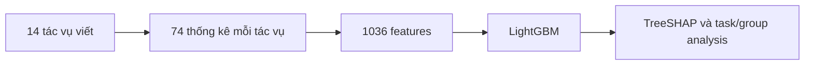
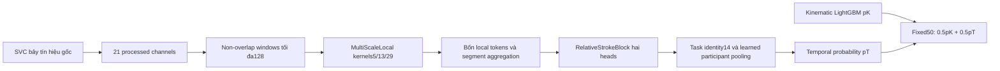
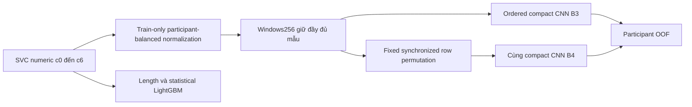

# Ba tuyến kiến trúc cần phân biệt

## Mốc trước: Kinematic và XAI

Code: `src/diagramo/features.py`, `branches/kinematic.py`, `kinematic_xai.py`. XAI diễn giải mô hình, không nhận diện nguyên nhân bệnh.

## Raw Temporal đã triển khai

Nguồn: `src/diagramo/temporal/preprocessing.py`, `dataset.py`, `segmentation.py`, `src/diagramo/temporal_v2/multiscale.py`, config `configs/raw_temporal_v2/phase4_lite.json`. Khoảng25.252 tham số. Relative attention hoạt động giữa segment/stroke representations trong task groups; task identity embedding và pooling **không phải task-level Transformer attention**. Giữ thứ tự vật lý và mask theo code; không diễn giải attention như causal attribution.

## Slovak opaque benchmark độc lập

Nguồn: `scripts/native_channel_research/compact_multiscale_cnn.py`, `participant_dataset.py`, `sequence_permutation.py`. 13.761 tham số, không relative attention, task identities hoặc14task head. Đây không phải cùng Stroke Temporal25.252 tham số. Không chuyển tên numeric columns thành pressure/timestamp đã VERIFIED; B4 có thể giữ implicit positional cues qua giá trị cột.
