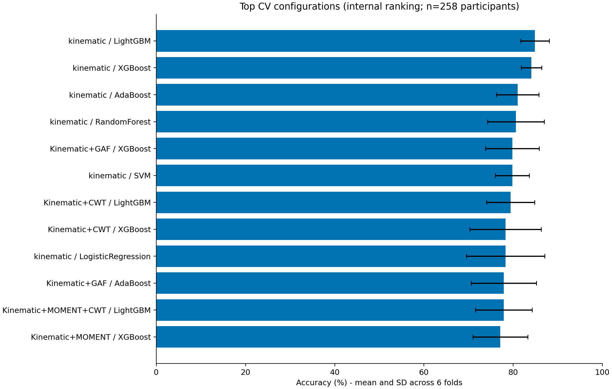
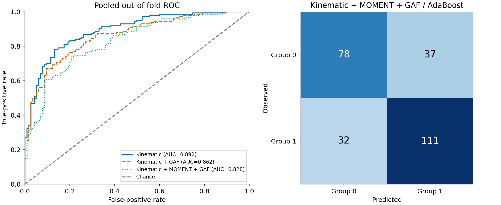
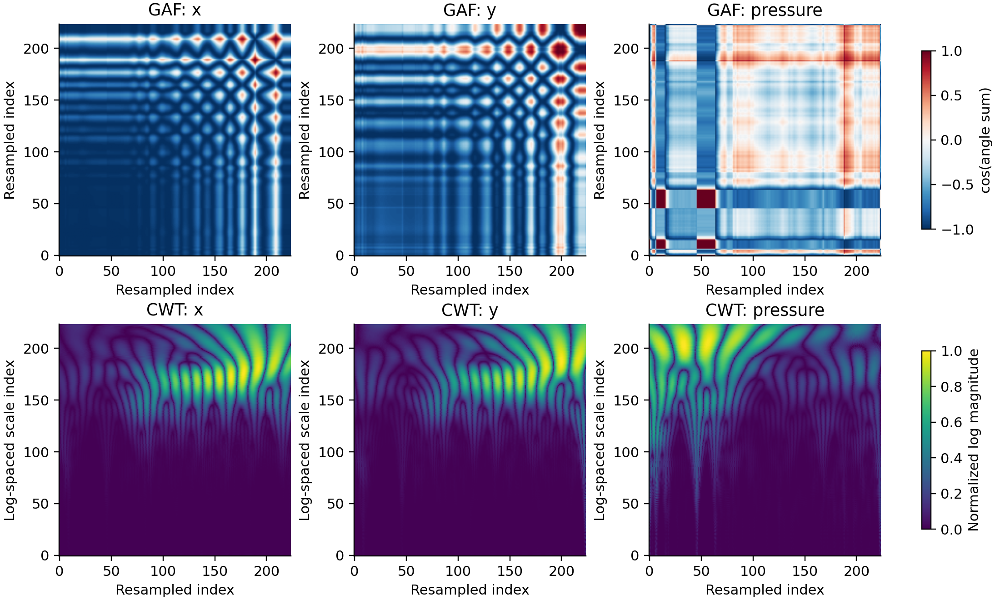

# Báo cáo thực nghiệm DiaGraMo

Bản cập nhật: 2026-10-31T03:14:50+07:00 (Asia/Bangkok). Bảng CSV tiếp tục được cập nhật trong lúc ma trận còn chạy.

Trạng thái: **Đã chạy đủ 21 cấu hình × 8 bộ phân loại (168 kết quả CV, gồm Dummy).**

Các cấu hình được công bố trong bảng I–III: **15/15 đã có kết quả thực chạy**. Ma trận đầy đủ: **168/168**.

## Dữ liệu và đánh giá

Đã đọc 294 tệp nguồn, 4000 bản ghi. Cohort chính: 258 người (115 group=0, 143 group=1), mỗi người 14 tác vụ, 7 kênh. Kiểm tra 168 tệp dự đoán OOF: đúng 258 ID duy nhất/tệp, cùng thứ tự người, xác suất hữu hạn trong [0,1]. Sáu fold tách người, seed=42. Tất cả phép fit chuẩn hóa đều chỉ dùng tập train.

Đây là **tái lập độc lập với giả định được công bố**, không phải xác nhận tái hiện chính xác số liệu tác giả. Xem [quy trình và các điểm chưa xác định](../EXPERIMENT_PROTOCOL.md).

## Kết quả thực chạy

Các giá trị trong bảng sau là **OOF gộp**, đơn vị %. F1 là macro; không đồng nhất chắc chắn với F1 chưa được định nghĩa trong bài báo. Bảng xếp hạng sử dụng chính CV nên không phải hiệu năng trên tập ngoài.

| representation | classifier | accuracy | f1_macro | auc |
| --- | --- | --- | --- | --- |
| kinematic | LightGBM | 84.88 | 84.72 | 90.69 |
| kinematic | XGBoost | 84.11 | 83.81 | 91.18 |
| kinematic | AdaBoost | 81.01 | 80.76 | 89.18 |
| kinematic | RandomForest | 80.62 | 79.73 | 86.80 |
| Kinematic+GAF | XGBoost | 79.84 | 79.40 | 87.47 |
| kinematic | SVM | 79.84 | 78.99 | 86.13 |
| Kinematic+CWT | LightGBM | 79.46 | 79.07 | 86.40 |
| Kinematic+CWT | XGBoost | 78.29 | 77.76 | 86.74 |
| kinematic | LogisticRegression | 78.29 | 78.11 | 86.73 |
| Kinematic+GAF | AdaBoost | 77.91 | 77.58 | 86.15 |
| Kinematic+MOMENT+CWT | LightGBM | 77.91 | 77.44 | 86.01 |
| Kinematic+MOMENT | XGBoost | 77.13 | 76.48 | 85.19 |
| Kinematic+MOMENT+GAF | XGBoost | 77.13 | 76.70 | 84.97 |
| Kinematic+CWT | AdaBoost | 76.74 | 76.11 | 84.77 |
| Kinematic+GAF+CWT | AdaBoost | 76.74 | 76.17 | 84.04 |

Cấu hình đứng đầu bảng CV: **kinematic / LightGBM**, accuracy 84.88%, F1 macro 84.72%, AUC gộp 90.69%. Không diễn giải thứ hạng này thành bằng chứng vượt bài báo khi thiết lập tái lập chưa trùng hoàn toàn.

## Đối chiếu cấu hình bài báo

Bảng đối chiếu dùng mean 6 fold, AUC gộp được giữ ở cột riêng trong CSV. Delta accuracy tính theo điểm phần trăm. Không thay công thức hay chọn siêu tham số để ép khớp 85,3%.

| representation | classifier | paper_acc | local_acc | delta_acc_pp | paper_auc | local_mean_auc |
| --- | --- | --- | --- | --- | --- | --- |
| moment | LogisticRegression | 65.10 | 63.18 | -1.92 | 70.10 | 69.96 |
| moment | RandomForest | 65.10 | 67.83 | 2.73 | 71.40 | 72.64 |
| moment | SVM | 70.20 | 67.83 | -2.37 | 74.90 | 75.07 |
| kinematic | XGBoost | 82.20 | 84.11 | 1.91 | 89.90 | 91.13 |
| kinematic | LightGBM | 82.90 | 84.88 | 1.98 | 90.50 | 90.40 |
| kinematic | AdaBoost | 83.70 | 81.01 | -2.69 | 90.10 | 88.94 |
| gaf_efficientnet_b4 | XGBoost | 65.90 | 66.28 | 0.38 | 71.80 | 74.34 |
| gaf_vgg16 | RandomForest | 68.60 | 68.22 | -0.38 | 72.20 | 71.41 |
| gaf_vit_b_16 | LightGBM | 73.30 | 63.18 | -10.12 | 78.50 | 66.30 |
| cwt_vgg16 | SVM | 66.30 | 57.75 | -8.55 | 70.80 | 58.40 |
| cwt_vit_b_16 | SVM | 67.10 | 68.60 | 1.50 | 72.10 | 72.56 |
| cwt_efficientnet_b4 | LightGBM | 71.70 | 63.57 | -8.13 | 75.30 | 69.82 |
| Kinematic+GAF | AdaBoost | 84.90 | 77.91 | -6.99 | 91.10 | 86.38 |
| Kinematic+MOMENT+GAF | AdaBoost | 85.30 | 73.26 | -12.04 | 90.80 | 82.62 |
| Kinematic+MOMENT+GAF+CWT | AdaBoost | 83.70 | 75.19 | -8.51 | 90.10 | 82.77 |

Cấu hình trọng tâm Kinematic + MOMENT + GAF / AdaBoost đạt 73.26% accuracy trong bản dựng này, so với 85.3% được công bố (chênh -12.04 điểm phần trăm). **Chưa tái hiện được kết quả fusion trọng tâm của tác giả.** Các khác biệt về cohort/nhãn, bộ 74 đặc trưng, biến thể AdaBoost, checkpoint và phép biến đổi ảnh cần được đối chiếu với mã nguồn hoặc cấu hình gốc.

## Phân tích nhạy cảm thăm dò

Giữ cùng danh sách người trong từng fold, rồi đổi nhãn hoặc bỏ các trường hợp có cờ omit trong cả train/test tương ứng. Đây là phân tích thăm dò trên nhánh động học, không thay nhãn hay chọn cohort sau khi xem kết quả fusion. Các giá trị là OOF gộp (%).

| scenario | classifier | n | accuracy | f1_macro | auc |
| --- | --- | --- | --- | --- | --- |
| group_all | AdaBoost | 258 | 81.01 | 80.76 | 89.18 |
| group_all | LightGBM | 258 | 84.88 | 84.72 | 90.69 |
| diagnosis_same_cohort | AdaBoost | 258 | 81.01 | 80.92 | 88.05 |
| diagnosis_same_cohort | LightGBM | 258 | 81.01 | 80.76 | 89.24 |
| group_without_omit_flags | AdaBoost | 255 | 81.96 | 81.72 | 89.64 |
| group_without_omit_flags | LightGBM | 255 | 80.78 | 80.69 | 89.29 |

## Các điểm cần giữ khi viết báo cáo khoa học

- Số 258 khớp bài báo sau khi yêu cầu đủ tác vụ **và có nhãn**, nhưng không có danh sách ID chính thức để xác nhận cùng cohort.
- Nhãn group khác cờ chẩn đoán dysgraphia ở 5 người. Có 3 người có cờ omit trong cohort. Phân tích nhạy cảm được lưu riêng nếu đã chạy, không thay kết quả chính.
- Định nghĩa 74 đặc trưng, scale CWT, chuẩn hóa và kernel 7 kênh, phiên bản encoder, tham số classifier và loại F1 là các lựa chọn tái lập được ghi rõ trong protocol.
- Các timestamp không tăng được loại chỉ khi tính đạo hàm; không sửa tệp nguồn. Không lấy tần số 167 Hz thay cho timestamp thực tế trong công thức động học.
- Encoder được đóng băng trước CV. Không dùng nhãn/điểm nhận thức làm đầu vào.
- Chưa có kiểm định trên tập dữ liệu độc lập. Không có kết luận chẩn đoán lâm sàng từ thực nghiệm này.

## Tệp bàn giao

- `cv/summary.csv`: toàn bộ kết quả, cả OOF và mean±SD.
- `cv/*.oof.csv`: dự đoán từng người ngoài tập train.
- `cv/fold_assignments.csv`: danh sách fold cố định.
- `table_unimodal.csv`, `table_fusion.csv`, `comparison_paper.csv`.
- `audit/`: danh sách giữ/loại, kiểm tra bản ghi, checksum nguồn.
- `figures/`: biểu đồ PNG/SVG và provenance.
- `../notebooks/`: notebook xem dữ liệu, đặc trưng và kết quả; lệnh huấn luyện chạy bằng script để không phụ thuộc trạng thái kernel.

