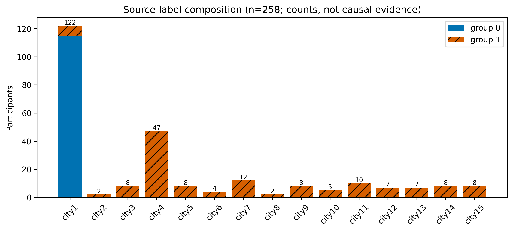
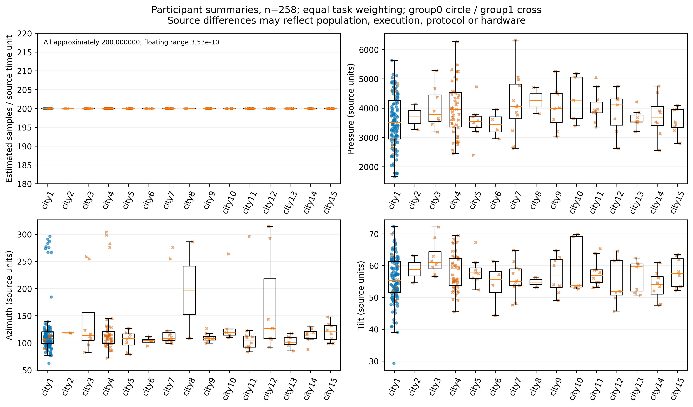
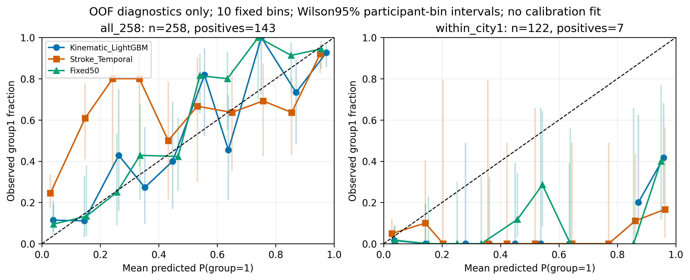
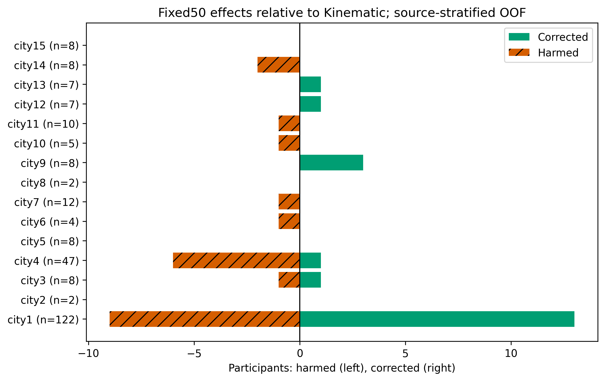

# DiaGraMo — Comprehensive Data Validity & Source Confounding Audit V3

## 1. Executive Summary

**CONDITIONAL GO** cho nghiên cứu phương pháp thăm dò; **NO-GO** cho tuyên bố clinical biomarkers, source-invariance hay cross-domain generalization từ cohort hiện tại. Chưa có cơ sở ưu tiên tăng độ phức tạp mô hình. Không chứng minh mô hình đã học sai; chỉ xác định các giới hạn của dữ liệu và phép đánh giá.

### Các verified facts và associations quan trọng

1. Tái tạo đúng 258 IDs/labels/folds; 294 merged files và 288 SVC directory IDs không phải cùng một inventory. Có 12 source-link anomalies ngoài cohort, không tự sửa danh tính.
2. Group và specific dysgraphia flag khác ở 5 người; 3 người mang omit flag vẫn được giữ theo baseline. Raw CSV thiếu total omission flag; clinical label definitions/flag-generation provenance chưa xác nhận. Duplicate cognitive ID có các trường HLS xung đột.
3. City1: 115 group0/7 group1; city khác: 0/136. City–group V=0.946827. Mapping city chỉ học Train đạt OOF accuracy=0.972868, prior=0.554264. Đây là diagnostic source→dataset label, không clinical classifier.
4. Source overlap làm participant-independent CV không trở thành source-independent. City-held-out không có split vừa Train vừa Test đủ hai lớp. Within-city1 chỉ ít positives nên không có precision đáng tin để khái quát rộng.
5. Raw SVC/cached21channels/statistics được kiểm tra toàn cohort; preprocessing/source differences được lượng hóa ở PhaseD, không suy hardware causation. Units thiết bị và clinical codebook chưa xác minh.
6. Full OOF giữ kết quả cũ: Kinematic tốt hơn fixed average về point Macro-F1; fusion corrected=20, harmed=22, ΔF1=-0.006483, CI95%[-0.053470,+0.041286]. Source/subgroup/sensitivity đều hậu nghiệm; không chọn winner.

| model | accuracy | f1_macro | auc | brier |
| --- | --- | --- | --- | --- |
| Kinematic_LightGBM | 0.848837 | 0.847163 | 0.906902 | 0.122450 |
| Stroke_Temporal | 0.713178 | 0.713178 | 0.807540 | 0.224193 |
| Fixed50 | 0.841085 | 0.840681 | 0.906111 | 0.129793 |

### Việc cần làm trước mô hình tiếp theo

Xin tác giả/chủ dữ liệu codebook clinical, cohort list/omit rules, lý do disagreement, pipeline CSV/RDS→merged và duplicate-ID resolution; device/clock/export/operator/SOP/recruitment records. Thiết kế dữ liệu có cả hai lớp tại nhiều nguồn và test độc lập. C1 structured-temporal mechanism cần equal-capacity/equal-budget controls và OOD-aware perturbations riêng; C2 complementary motor evidence cần calibrated Kinematic control Train-only và validation độc lập. Chưa chạy thêm thí nghiệm.

Direct leakage, source confounding và researcher-level selection bias là ba vấn đề khác nhau. Audit code/fit-ID provenance không phát hiện đường trực tiếp đưa source ID/cognitive label vào features, nhưng không thể chứng minh vắng mọi leakage hay phân rã motor/source causally. Các giả thuyết population, protocol và thiết bị còn unidentifiable.

Code mới `scripts/data_audit_v3/`, tests riêng `tests/data_audit_v3/`, mọi outputs `results/data_audit_v3/`. Không thay đổi input/cohort/model/folds/checkpoints/OOF cũ; xem `VALIDATION_CHECKS.json` và manifest để biết phạm vi xác minh cuối cùng. Không push hoặc merge.

## 2. Dataset Inventory & Provenance

**Verified fact:** audit đọc lại toàn bộ merged files và SVC theo đường dẫn thật trong code. Các con số là ID/files theo từng nguồn, không tự coi các ID khác nhau là những người vật lý khác nhau.

| entity | count |
| --- | --- |
| merged_participants | 294 |
| selected_participants | 258 |
| excluded_merged_participants | 36 |
| merged_recordings | 4000 |
| original_svc_files | 4000 |
| participants_with_svc | 288 |
| raw_metadata_rows | 289 |
| raw_metadata_unique_ids | 288 |
| raw_metadata_duplicate_id_rows | 1 |
| selected_tasks | 14 |
| selected_recordings | 3612 |

| stage | entering | retained | excluded_at_step |
| --- | --- | --- | --- |
| all_merged | 294 | 294 | 0 |
| complete_14_tasks | 294 | 266 | 28 |
| no_duplicate_tasks | 266 | 266 | 0 |
| valid_signal_arrays | 266 | 266 | 0 |
| binary_group | 266 | 258 | 8 |

Điều kiện `prepare.py`: đủ14 canonical tasks, không trùng task, arrays cùng chiều và ít nhất4 samples, không nonfinite, `group`∈{0,1}. `flag_to_omit_total` không tham gia eligibility. Tái tạo IDs/labels khớp `kinematic.npz` và six-fold assignments. Không tạo feature matrix mới, không đổi cohort.

Phát hiện source-link: 12 merged IDs có liên kết nguồn không đầy đủ; 6 trong số đó thiếu cognitive metadata. Không trường hợp nào thuộc cohort258. Có IDs trong CSV nhưng không có SVC và IDs có SVC nhưng không match CSV chính xác; không tự sửa mã hay gán nhãn. `identity_link_anomalies.csv` lưu phép kiểm tra chuỗi và `participant_source_links.csv` lưu liên kết thật. Không có bằng chứng đủ để gộp các ID này thành cùng người.

CSV cognitive có 1 ID lặp. Các khác biệt nằm ở các trường đánh giá HLS trong `duplicate_metadata_ids.csv`; không phải hai dòng hoàn toàn giống nhau. Group, cờ dysgraphia, city/site trên cohort được đối chiếu với mọi giá trị của các dòng lặp, không chọn dòng theo kết quả mô hình.

Kinematic đọc per-sample merged JSON qua `diagramo.branches.kinematic.extract` (alias `features.kinematic`), 74 features/task. Temporal hiện tại đọc **SVC gốc**, 21 channels, NPZfloat32 và packed float16; đây không phải cùng đường dữ liệu với Kinematic. Source migration và sự khác biệt export được giữ nguyên, kiểm toán lại ở Phase D. Normalization chỉ lấy statistics của Train fold.

`metadata_dictionary.csv` thống kê tất cả trường từ CSV và merged: nguồn, dtype, missingness, cardinality, domain. Các trường city, school/site, site_type, kỳ thu thập, age, sex/class/language thật sự tồn tại. Không có bằng chứng local về model thiết bị/serial, clock calibration, firmware hoặc recruitment SOP. Không suy phần cứng từ city/site.

Hash provenance của nguồn đọc nằm trong `source_provenance.json`; `PROTECTED_BEFORE.csv` bao phủ input/cache/checkpoint/code và artifacts được bảo vệ. Không copy raw signals hoặc cognitive item rows vào audit output.

## 3. Cohort Selection Validity

| stage | entering | retained | excluded_at_step |
| --- | --- | --- | --- |
| all_merged | 294 | 294 | 0 |
| complete_14_tasks | 294 | 266 | 28 |
| no_duplicate_tasks | 266 | 266 | 0 |
| valid_signal_arrays | 266 | 266 | 0 |
| binary_group | 266 | 258 | 8 |

Original eligibility được tái thực thi trên toàn bộ merged files; không áp dụng omission rules mới. `participants_inventory.csv` và `selection_by_source.csv` giữ cả người bị loại, lý do thiếu tasks/labels và source missingness. ID duy nhất là độc lập theo ID trong code, chưa phải xác nhận hồ sơ rằng mọi ID đều là người vật lý khác nhau; anomalies ngoài cohort đã được ghi riêng.

## 4. Label Definition & Consistency

`group` là target thực tế. `diagnosis` trong audit là **alias của `special_care_type_dysgraphia`**, không phải một nhãn lâm sàng độc lập mới phát hiện. Dữ liệu nhị phân và quan hệ giữa chúng được xác minh; định nghĩa chẩn đoán/cách tuyển nhóm chưa có codebook độc lập để xác nhận.

| field | origin | implementation | clinical_definition |
| --- | --- | --- | --- |
| group | CSV and merged cognitive metadata | Actual target for protected models | UNVERIFIED: grouping/case ascertainment and screening rules absent locally |
| diagnosis | Audit alias of special_care_type_dysgraphia | Not an independently verified diagnosis variable | No separate exact diagnosis field assumed; alias explicitly distinguished |
| special_care_type_dysgraphia | CSV and merged metadata | Specific binary flag, distinct from group | UNVERIFIED: clinician, diagnostic tool, threshold and assessment timing unknown |
| flag_to_omit_total | Merged metadata; absent from original cognitive CSV | Recorded but not used by prepare.py eligibility | Flag components observable in merged; transformation/author intent/official exclusion rule UNVERIFIED |

| group | diagnosis0 | diagnosis1 |
| --- | --- | --- |
| 0.000000 | 114 | 1 |
| 1.000000 | 4 | 139 |

Có 5 participant hai trường không khớp và 3 participant mang omission flag. Không thể tự suy trường nào đúng lâm sàng. `label_disagreements.csv` chứa riêng các disagreement; `omission_flag_details.csv` chứa flagged participants cùng các component flags quan sát; `label_consistency.csv` là bảng đầy đủ. Kiểm tra OR của component flags với total chỉ là tính nhất quán quan sát, không thay cho codebook/quy tắc chính thức; không loại người hoặc sửa nguồn.

**Phát hiện provenance mới:** raw cognitive CSV không có `flag_to_omit_total` và các omission flags như merged. Vì vậy không được ghi “đã đối chiếu flag với CSV gốc”. `metadata_join_checks.csv` đánh dấu trường vắng mặt là UNVERIFIABLE, không cho pass giả. Processed RDS tồn tại nhưng local không có pyreadr/Rscript để giải mã; không cài/tải qua mạng. Cần xác nhận pipeline tạo flags và ý nghĩa exclusion từ chủ dữ liệu. Các component flags hiện có là quan sát, không tự coi tổng OR là quy tắc chính thức nếu thiếu code tạo cờ.

Sensitivity dưới đây chỉ dùng cùng xác suất OOF đã huấn luyện cho `group`. Các cohort253/255 và nhãn diagnosis là phân tích hậu nghiệm, không phải retraining hoặc independent validation, không dùng chọn winner.

| model | cohort | target | n | group0 | group1 | accuracy | f1_macro | auc | brier |
| --- | --- | --- | --- | --- | --- | --- | --- | --- | --- |
| Kinematic_LightGBM | original_258 | label | 258 | 115 | 143 | 0.848837 | 0.847163 | 0.906902 | 0.122450 |
| Kinematic_LightGBM | consistent_labels | label | 253 | 114 | 139 | 0.849802 | 0.848321 | 0.908620 | 0.121335 |
| Kinematic_LightGBM | no_omission_flag | label | 255 | 113 | 142 | 0.850980 | 0.849291 | 0.908949 | 0.120458 |
| Kinematic_LightGBM | diagnosis_relabelled_same_OOF | diagnosis | 258 | 118 | 140 | 0.837209 | 0.835788 | 0.892797 | 0.132608 |
| Stroke_Temporal | original_258 | label | 258 | 115 | 143 | 0.713178 | 0.713178 | 0.807540 | 0.224193 |
| Stroke_Temporal | consistent_labels | label | 253 | 114 | 139 | 0.719368 | 0.719368 | 0.811814 | 0.218013 |
| Stroke_Temporal | no_omission_flag | label | 255 | 113 | 142 | 0.713725 | 0.713708 | 0.807491 | 0.223400 |
| Stroke_Temporal | diagnosis_relabelled_same_OOF | diagnosis | 258 | 118 | 140 | 0.717054 | 0.717016 | 0.806416 | 0.220331 |
| Fixed50 | original_258 | label | 258 | 115 | 143 | 0.841085 | 0.840681 | 0.906111 | 0.129793 |
| Fixed50 | consistent_labels | label | 253 | 114 | 139 | 0.845850 | 0.845502 | 0.908747 | 0.126895 |
| Fixed50 | no_omission_flag | label | 255 | 113 | 142 | 0.839216 | 0.838730 | 0.905896 | 0.129532 |
| Fixed50 | diagnosis_relabelled_same_OOF | diagnosis | 258 | 118 | 140 | 0.837209 | 0.836964 | 0.897579 | 0.132940 |

Câu hỏi cần chủ dữ liệu: group định nghĩa bằng chẩn đoán hay recruitment/screening nào; dysgraphia flag do ai đánh giá, công cụ/ngưỡng và thời điểm nào; giải thích từng disagreement; nguồn tạo các omission flags và cohort paper chính thức; xử lý duplicate cognitive ID và HLS rows nào được merge.

## 5. Source–Label Confounding

| field | source | group0 | group1 | n |
| --- | --- | --- | --- | --- |
| id_city | city1 | 115 | 7 | 122 |
| id_city | city10 | 0 | 5 | 5 |
| id_city | city11 | 0 | 10 | 10 |
| id_city | city12 | 0 | 7 | 7 |
| id_city | city13 | 0 | 7 | 7 |
| id_city | city14 | 0 | 8 | 8 |
| id_city | city15 | 0 | 8 | 8 |
| id_city | city2 | 0 | 2 | 2 |
| id_city | city3 | 0 | 8 | 8 |
| id_city | city4 | 0 | 47 | 47 |
| id_city | city5 | 0 | 8 | 8 |
| id_city | city6 | 0 | 4 | 4 |
| id_city | city7 | 0 | 12 | 12 |
| id_city | city8 | 0 | 2 | 2 |
| id_city | city9 | 0 | 8 | 8 |

City1 có 115 group0/7 group1. Các city khác có tổng 136 người, 0 group0 và 136 group1. Đây là **statistical association**, không phải city gây Dysgraphia.

| field | n | categories | mixed_sources | single_class_sources | label_purity | cramers_v | chi_square | chi_square_asymptotic_p | expected_cells_lt5 | permutation_p |
| --- | --- | --- | --- | --- | --- | --- | --- | --- | --- | --- |
| id_city | 258 | 15 | 1 | 14 | 0.972868 | 0.946827 | 231.291987 | 0.000000 | 23 | 0.001000 |
| id_school_ppp | 258 | 35 | 4 | 31 | 0.972868 | 0.957250 | 236.412405 | 0.000000 | 56 | 0.001000 |
| site_type_ppp | 258 | 2 | 1 | 1 | 0.655039 | 0.461384 | 54.921843 | 0.000000 | 0 | 0.001000 |
| date_of_administration | 258 | 7 | 6 | 1 | 0.825581 | 0.671403 | 116.301730 | 0.000000 | 4 | 0.001000 |

Purity = tổng số người thuộc lớp đa số trong từng source / tổng cohort, chỉ là mô tả toàn cohort. Cramér V không bias-corrected. Chi-square dùng correction=False; nhiều expected cells<5 nên p asymptotic chỉ tham khảo. Kiểm chứng bằng999 participant-label permutations, seed42 (p tối thiểu1/1000), không phải phép kiểm định nhân quả và chưa giải quyết clustering/tuyển mẫu.

| field | fold | train_sources | test_sources | unseen_test_sources | test_participants | fraction_test_source_seen |
| --- | --- | --- | --- | --- | --- | --- |
| id_city | 0 | 15 | 11 | 0 | 43 | 1.000000 |
| id_city | 1 | 15 | 11 | 0 | 43 | 1.000000 |
| id_city | 2 | 15 | 9 | 0 | 43 | 1.000000 |
| id_city | 3 | 15 | 11 | 0 | 43 | 1.000000 |
| id_city | 4 | 15 | 10 | 0 | 43 | 1.000000 |
| id_city | 5 | 15 | 12 | 0 | 43 | 1.000000 |
| id_school_ppp | 0 | 35 | 20 | 0 | 43 | 1.000000 |
| id_school_ppp | 1 | 35 | 20 | 0 | 43 | 1.000000 |
| id_school_ppp | 2 | 33 | 21 | 2 | 43 | 0.953488 |
| id_school_ppp | 3 | 34 | 23 | 1 | 43 | 0.976744 |
| id_school_ppp | 4 | 34 | 22 | 1 | 43 | 0.976744 |
| id_school_ppp | 5 | 34 | 25 | 1 | 43 | 0.976744 |
| site_type_ppp | 0 | 2 | 2 | 0 | 43 | 1.000000 |
| site_type_ppp | 1 | 2 | 2 | 0 | 43 | 1.000000 |
| site_type_ppp | 2 | 2 | 2 | 0 | 43 | 1.000000 |
| site_type_ppp | 3 | 2 | 2 | 0 | 43 | 1.000000 |
| site_type_ppp | 4 | 2 | 2 | 0 | 43 | 1.000000 |
| site_type_ppp | 5 | 2 | 2 | 0 | 43 | 1.000000 |
| date_of_administration | 0 | 7 | 6 | 0 | 43 | 1.000000 |
| date_of_administration | 1 | 7 | 7 | 0 | 43 | 1.000000 |
| date_of_administration | 2 | 7 | 7 | 0 | 43 | 1.000000 |
| date_of_administration | 3 | 7 | 6 | 0 | 43 | 1.000000 |
| date_of_administration | 4 | 7 | 5 | 0 | 43 | 1.000000 |
| date_of_administration | 5 | 7 | 6 | 0 | 43 | 1.000000 |

`fold_source_class_distributions.csv` liệt kê source và class counts trong Train/Test của từng fold. Participant độc lập nhưng nguồn có thể đã thấy trong Train. Không gọi đây là source-independent validation.

### Negative control hợp lệ

Mapping nguồn chỉ dùng nhãn Train của năm folds khác. Train prior=(n1+1)/(n+2); source probability=(source_n1+2×Train prior)/(source_n+2). Source chưa thấy fallback Train prior; missing source là category riêng. Strength2 cố định, không tune. Không đưa participant ID/prefix vào diagnostic và không đưa source metadata vào clinical models.

| control | n | accuracy | f1_macro | auc | balanced_accuracy | brier |
| --- | --- | --- | --- | --- | --- | --- |
| id_city | 258 | 0.972868 | 0.972687 | 0.966981 | 0.975524 | 0.032264 |
| id_school_ppp | 258 | 0.957364 | 0.956960 | 0.988568 | 0.958133 | 0.045242 |
| site_type_ppp | 258 | 0.655039 | 0.634613 | 0.668440 | 0.688811 | 0.194830 |
| date_of_administration | 258 | 0.825581 | 0.821503 | 0.820219 | 0.818820 | 0.143447 |
| Train_class_prior | 258 | 0.554264 | 0.356608 | 0.493463 | 0.500000 | 0.247088 |

Diagnostic city đạt accuracy 0.972868 so với prior 0.554264. Đây là khả năng dự đoán **nhãn dataset từ nguồn** dưới CV có source overlap, không phải clinical classifier. Không dùng purity tính toàn cohort để giả làm OOF.

### Identifiability

Không tách được hiệu ứng source và group cho các city chỉ có một lớp. Trong city1 có overlap hai lớp nên có thể mô tả/discriminate trong cùng nguồn, nhưng chỉ 7 positives nên không đủ để khẳng định generalization rộng hay sensitivity chính xác. Nếu giữ city1 làm Test, Train không còn lớp0; nếu giữ city khác làm Test, Test chỉ một lớp. Leave-One-City-Out không giải quyết vấn đề. Site-level có thể có split chứa hai lớp theo đại số nhưng cần xem support và city/protocol vẫn chồng lấp. Bảng đầy đủ `source_validation_feasibility.csv` không đánh đồng khả thi đại số với đủ lực thống kê.

## 6. Sensor & Acquisition Heterogeneity

Đọc SVC gốc: 4000 recordings, 288 directory IDs; cohort bảo vệ có 3612 recordings/258 participant. Tổng samples cohort=54808751. Header count,7 columns, finite values và pen states được kiểm tra. Bảng recording và participant được giữ riêng; không coi hàng triệu samples là hàng triệu replicates độc lập.

Sampling-rate estimate =1/median(positive Δt), đơn vị **samples/source-time-unit**, không xác nhận Hz vì không có chứng chỉ clock units. Duration và pen up/down valid duration dùng source-time; valid intervals trong[1e-4,1] theo code hiện tại. Khoảng không hợp lệ vẫn được đếm, không sort/drop/impute. Min observed step là khoảng cách nhỏ nhất giữa giá trị quan sát, không phải ADC resolution đã chứng minh.

**Negative evidence quan trọng:** participant cadence nằm trong [199.999999999675, 200.000000000029], gần200 ở mọi city. Range chỉ 3.534e-10. Rank tests trên số float chưa làm tròn có thể cho p nhỏ dù chênh lệch chỉ ở sai số biểu diễn. `acquisition_precision_sensitivity.csv` giữ nguyên test gốc và thêm diagnostic rounding (Δt9 chữ số, rate6 chữ số); không đổi preprocessing/model. Không dùng p nhỏ này để tuyên bố sampling hardware khác nhau.

| feature | n_participants | observed_range | diagnostic_rounding_decimals | rounded_range | rounded_city_kruskal_p |
| --- | --- | --- | --- | --- | --- |
| median_dt_positive | 258 | 0.000000 | 9 | 0.000000 | 1.000000 |
| estimated_rate_per_source_time | 258 | 0.000000 | 6 | 0.000000 | 1.000000 |

| stratum | feature | n_participants | mean | median | p25 | p75 |
| --- | --- | --- | --- | --- | --- | --- |
| city1 | estimated_rate_per_source_time | 122 | 200.000000 | 200.000000 | 200.000000 | 200.000000 |
| city1 | pressure_mean | 122 | 3549.333509 | 3516.247752 | 2946.752263 | 4265.315559 |
| city1 | azimuth_mean | 122 | 119.657557 | 106.929161 | 98.457468 | 120.264487 |
| city1 | tilt_mean | 122 | 55.636933 | 55.296716 | 51.445015 | 61.300363 |
| city10 | estimated_rate_per_source_time | 5 | 200.000000 | 200.000000 | 200.000000 | 200.000000 |
| city10 | pressure_mean | 5 | 4312.814242 | 4274.722227 | 3649.928753 | 5062.917406 |
| city10 | azimuth_mean | 5 | 146.481413 | 119.238110 | 114.292922 | 125.453584 |
| city10 | tilt_mean | 5 | 59.718262 | 53.764510 | 53.225816 | 69.140718 |
| city11 | estimated_rate_per_source_time | 10 | 200.000000 | 200.000000 | 200.000000 | 200.000000 |
| city11 | pressure_mean | 10 | 4039.308620 | 3904.677431 | 3835.869667 | 4208.489135 |
| city11 | azimuth_mean | 10 | 121.350821 | 105.035301 | 92.239911 | 112.472838 |
| city11 | tilt_mean | 10 | 57.626420 | 56.914294 | 54.743493 | 58.620112 |
| city12 | estimated_rate_per_source_time | 7 | 200.000000 | 200.000000 | 200.000000 | 200.000000 |
| city12 | pressure_mean | 7 | 3849.775196 | 4107.311486 | 3422.696773 | 4310.260278 |
| city12 | azimuth_mean | 7 | 169.306836 | 126.870827 | 107.881387 | 217.940168 |
| city12 | tilt_mean | 7 | 55.275188 | 51.943451 | 50.725652 | 61.621404 |
| city13 | estimated_rate_per_source_time | 7 | 200.000000 | 200.000000 | 200.000000 | 200.000000 |
| city13 | pressure_mean | 7 | 3650.193049 | 3559.570296 | 3525.221250 | 3766.348414 |
| city13 | azimuth_mean | 7 | 102.744567 | 101.248893 | 97.374320 | 110.308560 |
| city13 | tilt_mean | 7 | 56.815149 | 59.623673 | 51.981922 | 60.513926 |
| city14 | estimated_rate_per_source_time | 8 | 200.000000 | 200.000000 | 200.000000 | 200.000000 |
| city14 | pressure_mean | 8 | 3720.994229 | 3691.256641 | 3406.371274 | 4065.100659 |
| city14 | azimuth_mean | 8 | 113.808313 | 116.280645 | 108.333027 | 120.813571 |
| city14 | tilt_mean | 8 | 53.761267 | 53.966105 | 51.026312 | 56.497185 |
| city15 | estimated_rate_per_source_time | 8 | 200.000000 | 200.000000 | 200.000000 | 200.000000 |
| city15 | pressure_mean | 8 | 3548.731261 | 3489.517271 | 3336.123883 | 3948.227765 |
| city15 | azimuth_mean | 8 | 119.998474 | 120.196229 | 105.746648 | 132.237566 |
| city15 | tilt_mean | 8 | 57.788774 | 57.531003 | 53.377938 | 62.149272 |
| city2 | estimated_rate_per_source_time | 2 | 200.000000 | 200.000000 | 200.000000 | 200.000000 |
| city2 | pressure_mean | 2 | 3699.254403 | 3699.254403 | 3480.990173 | 3917.518632 |
| city2 | azimuth_mean | 2 | 118.373539 | 118.373539 | 118.304342 | 118.442736 |
| city2 | tilt_mean | 2 | 58.830432 | 58.830432 | 56.706604 | 60.954261 |
| city3 | estimated_rate_per_source_time | 8 | 200.000000 | 200.000000 | 200.000000 | 200.000000 |
| city3 | pressure_mean | 8 | 4012.109303 | 3776.362654 | 3549.728036 | 4449.870968 |
| city3 | azimuth_mean | 8 | 143.947470 | 113.978365 | 104.831414 | 156.259466 |
| city3 | tilt_mean | 8 | 62.353019 | 60.914239 | 58.967222 | 64.350130 |
| city4 | estimated_rate_per_source_time | 47 | 200.000000 | 200.000000 | 200.000000 | 200.000000 |
| city4 | pressure_mean | 47 | 3975.134813 | 3957.623196 | 3352.428744 | 4534.842409 |
| city4 | azimuth_mean | 47 | 124.459730 | 110.977097 | 99.148957 | 121.500712 |
| city4 | tilt_mean | 47 | 57.818296 | 56.076395 | 53.672084 | 62.284117 |
| city5 | estimated_rate_per_source_time | 8 | 200.000000 | 200.000000 | 200.000000 | 200.000000 |
| city5 | pressure_mean | 8 | 3530.571419 | 3535.581334 | 3326.124394 | 3723.948720 |
| city5 | azimuth_mean | 8 | 104.931505 | 108.396883 | 95.915765 | 116.436486 |
| city5 | tilt_mean | 8 | 58.320567 | 57.665779 | 56.033601 | 59.251821 |
| city6 | estimated_rate_per_source_time | 4 | 200.000000 | 200.000000 | 200.000000 | 200.000000 |
| city6 | pressure_mean | 4 | 3448.975567 | 3439.904596 | 3186.466266 | 3702.413897 |
| city6 | azimuth_mean | 4 | 103.347535 | 104.033885 | 101.430113 | 105.951307 |
| city6 | tilt_mean | 4 | 54.180673 | 55.526323 | 51.495258 | 58.211738 |
| city7 | estimated_rate_per_source_time | 12 | 200.000000 | 200.000000 | 200.000000 | 200.000000 |
| city7 | pressure_mean | 12 | 4138.982350 | 4061.773144 | 3633.894261 | 4819.297861 |
| city7 | azimuth_mean | 12 | 134.523336 | 108.340478 | 104.349359 | 118.757232 |
| city7 | tilt_mean | 12 | 55.725932 | 55.012347 | 53.664015 | 58.973084 |
| city8 | estimated_rate_per_source_time | 2 | 200.000000 | 200.000000 | 200.000000 | 200.000000 |
| city8 | pressure_mean | 2 | 4260.977204 | 4260.977204 | 4036.281867 | 4485.672542 |
| city8 | azimuth_mean | 2 | 197.065379 | 197.065379 | 152.639851 | 241.490907 |
| city8 | tilt_mean | 2 | 54.792565 | 54.792565 | 53.992176 | 55.592954 |
| city9 | estimated_rate_per_source_time | 8 | 200.000000 | 200.000000 | 200.000000 | 200.000000 |
| city9 | pressure_mean | 8 | 4014.535258 | 3993.317666 | 3514.043555 | 4500.566965 |
| city9 | azimuth_mean | 8 | 109.740291 | 108.147365 | 105.129138 | 111.523884 |
| city9 | tilt_mean | 8 | 57.163938 | 57.028007 | 53.119418 | 61.891171 |

| feature | contrast | test | n | effect | p | fdr_bh_global |
| --- | --- | --- | --- | --- | --- | --- |
| median_dt_positive | Across cities; source and group confounded | Kruskal-Wallis | 258 | N/A | 0.000003 | 0.000029 |
| median_dt_positive | group0_vs_group1 | Mann-Whitney U | 258 | 0.5312861051991487 | 0.000000 | 0.000000 |
| median_dt_positive | within_city1_group0_vs_group1 | Mann-Whitney U | 122 | 0.7565217391304349 | 0.000817 | 0.003267 |
| estimated_rate_per_source_time | Across cities; source and group confounded | Kruskal-Wallis | 258 | N/A | 0.000003 | 0.000029 |
| estimated_rate_per_source_time | group0_vs_group1 | Mann-Whitney U | 258 | -0.530982061416844 | 0.000000 | 0.000000 |
| estimated_rate_per_source_time | within_city1_group0_vs_group1 | Mann-Whitney U | 122 | -0.7565217391304347 | 0.000817 | 0.003267 |
| duplicate_dt_fraction | Across cities; source and group confounded | Kruskal-Wallis | 258 | N/A | 0.000043 | 0.000260 |
| duplicate_dt_fraction | group0_vs_group1 | Mann-Whitney U | 258 | -0.38643964730921254 | 0.000000 | 0.000002 |
| duplicate_dt_fraction | within_city1_group0_vs_group1 | Mann-Whitney U | 122 | -0.05341614906832293 | 0.817171 | 0.834558 |
| large_gap_fraction | Across cities; source and group confounded | Kruskal-Wallis | 258 | N/A | 0.615066 | 0.720078 |
| large_gap_fraction | group0_vs_group1 | Mann-Whitney U | 258 | -0.13298875038005475 | 0.066563 | 0.114109 |
| large_gap_fraction | within_city1_group0_vs_group1 | Mann-Whitney U | 122 | -0.08074534161490687 | 0.724627 | 0.808886 |
| samples | Across cities; source and group confounded | Kruskal-Wallis | 258 | N/A | 0.048231 | 0.085744 |
| samples | group0_vs_group1 | Mann-Whitney U | 258 | -0.24767406506536938 | 0.000632 | 0.003034 |
| samples | within_city1_group0_vs_group1 | Mann-Whitney U | 122 | -0.4608695652173913 | 0.041687 | 0.085488 |
| duration_source_time | Across cities; source and group confounded | Kruskal-Wallis | 258 | N/A | 0.014521 | 0.040342 |
| duration_source_time | group0_vs_group1 | Mann-Whitney U | 258 | -0.3334144116752812 | 0.000004 | 0.000034 |
| duration_source_time | within_city1_group0_vs_group1 | Mann-Whitney U | 122 | -0.45093167701863357 | 0.046306 | 0.085488 |
| pressure_mean | Across cities; source and group confounded | Kruskal-Wallis | 258 | N/A | 0.199890 | 0.299834 |
| pressure_mean | group0_vs_group1 | Mann-Whitney U | 258 | -0.20778352082699914 | 0.004145 | 0.013265 |
| pressure_mean | within_city1_group0_vs_group1 | Mann-Whitney U | 122 | 0.05590062111801242 | 0.808630 | 0.834558 |
| pressure_std | Across cities; source and group confounded | Kruskal-Wallis | 258 | N/A | 0.018870 | 0.045287 |
| pressure_std | group0_vs_group1 | Mann-Whitney U | 258 | -0.30045606567345695 | 0.000034 | 0.000232 |
| pressure_std | within_city1_group0_vs_group1 | Mann-Whitney U | 122 | -0.07080745341614902 | 0.757895 | 0.826794 |
| pressure_min_observed_step | Across cities; source and group confounded | Kruskal-Wallis | 258 | N/A | 0.524394 | 0.662393 |
| pressure_min_observed_step | group0_vs_group1 | Mann-Whitney U | 258 | 0.122286409242931 | 0.090010 | 0.148982 |
| pressure_min_observed_step | within_city1_group0_vs_group1 | Mann-Whitney U | 122 | 0.10062111801242235 | 0.658473 | 0.752540 |
| azimuth_mean | Across cities; source and group confounded | Kruskal-Wallis | 258 | N/A | 0.264706 | 0.385027 |
| azimuth_mean | group0_vs_group1 | Mann-Whitney U | 258 | -0.11498935846761937 | 0.112696 | 0.180313 |
| azimuth_mean | within_city1_group0_vs_group1 | Mann-Whitney U | 122 | -0.05341614906832293 | 0.817171 | 0.834558 |
| azimuth_std | Across cities; source and group confounded | Kruskal-Wallis | 258 | N/A | 0.045741 | 0.085488 |
| azimuth_std | group0_vs_group1 | Mann-Whitney U | 258 | -0.24037701429005776 | 0.000911 | 0.003363 |
| azimuth_std | within_city1_group0_vs_group1 | Mann-Whitney U | 122 | -0.3291925465838509 | 0.146179 | 0.226341 |
| tilt_mean | Across cities; source and group confounded | Kruskal-Wallis | 258 | N/A | 0.384428 | 0.512570 |
| tilt_mean | group0_vs_group1 | Mann-Whitney U | 258 | -0.1466099118273031 | 0.043114 | 0.085488 |
| tilt_mean | within_city1_group0_vs_group1 | Mann-Whitney U | 122 | -0.1279503105590062 | 0.574491 | 0.698421 |
| tilt_std | Across cities; source and group confounded | Kruskal-Wallis | 258 | N/A | 0.004121 | 0.013265 |
| tilt_std | group0_vs_group1 | Mann-Whitney U | 258 | -0.2772271207053816 | 0.000131 | 0.000697 |
| tilt_std | within_city1_group0_vs_group1 | Mann-Whitney U | 122 | -0.1577639751552795 | 0.487962 | 0.633031 |
| x_range | Across cities; source and group confounded | Kruskal-Wallis | 258 | N/A | 0.276591 | 0.390481 |
| x_range | group0_vs_group1 | Mann-Whitney U | 258 | 0.011006384919428402 | 0.879924 | 0.879924 |
| x_range | within_city1_group0_vs_group1 | Mann-Whitney U | 122 | -0.1254658385093168 | 0.582017 | 0.698421 |
| y_range | Across cities; source and group confounded | Kruskal-Wallis | 258 | N/A | 0.016529 | 0.041758 |
| y_range | group0_vs_group1 | Mann-Whitney U | 258 | -0.16716327151109756 | 0.021095 | 0.048218 |
| y_range | within_city1_group0_vs_group1 | Mann-Whitney U | 122 | -0.23726708074534164 | 0.295637 | 0.405444 |
| pen_down_fraction | Across cities; source and group confounded | Kruskal-Wallis | 258 | N/A | 0.015128 | 0.040342 |
| pen_down_fraction | group0_vs_group1 | Mann-Whitney U | 258 | 0.20328367284889026 | 0.005035 | 0.015105 |
| pen_down_fraction | within_city1_group0_vs_group1 | Mann-Whitney U | 122 | 0.5080745341614907 | 0.024717 | 0.053928 |

Các test dùng **participant summaries** với equal-task weighting;16 acquisition indicators được khai báo trước trong code. Kruskal-Wallis across cities; Mann–Whitney giữa group hoặc trong city1; BH điều chỉnh trên toàn bộ các test hợp lệ. Missing-test p không được thay bằng0. Rank-biserial dương nghĩa group0 lớn hơn, không phải hướng tác động bệnh. City sizes không cân bằng, city1 chỉ ít positives, school/population clustering chưa mô hình hóa; p/q không phải bằng chứng thiết bị gây khác biệt.

Azimuth/tilt summaries ở đây là arithmetic mean/std trong conventions gốc; nếu có circular wrap, chúng không tương đương circular orientation statistics. Chưa xác minh angular units nên không tự đổi degrees/radians hoặc gán ý nghĩa sinh cơ học. Figure cadence dùng trục±10% median để không phóng đại sai số float10⁻¹⁰ thành khác biệt acquisition lớn; raw statistics và numerical-sensitivity table vẫn được giữ đầy đủ.

### Fidelity toàn cohort

Raw SVC→21-channel signed-log float32 được dựng lại cho mọi recording cohort; independent dt/pen masks; window boundaries không vượt segment; coverage không mất samples. NPZ x/index channels, inventory, lengths và packed float16 được đối chiếu toàn bộ. Statistics gốc được tính lại trên float32 per participant; mean/SD của normalization lấy đúng215 Train, participant-balanced, SD floor0,1; flags không scale; clipping±10. Không refit clinical model và không load pickle/checkpoint weights.

Số recording source/merged có sample count khác nhau trong cohort: 3. `svc_merged_comparison.csv` còn kiểm tra exact channel hashes và pressure round4; không coi hai nhánh dùng input hoàn toàn đồng nhất khi conversion có khác biệt. Kinematic xử lý timestamp/đạo hàm khác Temporal: bỏ mẫu có local Δt≤0 trước gradient và gradient qua cả in-air; Temporal giữ mẫu, mask/reset đạo hàm theo pen/time boundaries. Đây là khác biệt triển khai đã tồn tại, không phải direct label leakage tự động.

Packed quantization/clipping theo recording/source được ghi ở `preprocessing_fidelity.csv` và `preprocessing_by_source.csv`; distortion phải xét số liệu này, không suy rằng “float16 hẳn vô hại” hoặc “preprocessing làm mất tín hiệu bệnh”. Không có phép ánh xạ causal từ clipping vào lỗi mô hình trong audit này.

**Hypotheses còn mở:** khác biệt sampling/pressure/angle có thể đến từ thiết bị, firmware, clock conventions, người thực hiện, tác vụ, population hoặc protocol. Chỉ thấy association không xác định được nguyên nhân. Cần device IDs, export/software versions, units/calibration, operator/SOP và recordings crossover hoặc hai lớp trong cùng điều kiện để phân biệt.

## 7. Preprocessing Fidelity

| check | float32_cache_exact | index_cache_exact | packed_float16_exact | independent_masks_exact | sample_coverage_exact |
| --- | --- | --- | --- | --- | --- |
| count | 3612 | 3612 | 3612 | 3612 | 3612 |
| sum | 3612 | 3612 | 3612 | 3612 | 3612 |

Cache comparison là exhaustive cho recording cohort; summary statistical tests dùng participant units. Normalization replay dựa trên statistics float32 gốc, trong khi input inference được half-packed rồi lên float32. Clip/quantization max không tự đo clinical information loss. Không chứng minh toàn bộ Kinematic feature matrix từng bit bằng cách trích xuất lại1036features cho cả cohort; baseline X/hash/source code được bảo vệ và các đường input được đối chiếu, đây là phạm vi audit được công bố.

## 8. Existing Model Performance Under Source Confounding

OOF được đọc trực tiếp từ baseline và sáu Temporal fold files, kiểm tra unique/missing IDs, labels/fold IDs, sigmoid(logit), threshold p>0,5 và pF=0,5pK+0,5pT. Checkpoint chỉ hash; audit không train lại, không thực hiện mới network inference. Replay ở đây là kiểm toán số học OOF/metrics; prior checkpoint replay evidence được giữ phân biệt. Fit-ID/normalizer-ID lists phải khớp215 Train, không giao43 Test. Tất cả8 metrics khớp reports trước trong tolerance1e-12.

| model | n | accuracy | f1_macro | auc | balanced_accuracy | sensitivity | specificity | brier | log_loss |
| --- | --- | --- | --- | --- | --- | --- | --- | --- | --- |
| Kinematic_LightGBM | 258 | 0.848837 | 0.847163 | 0.906902 | 0.847461 | 0.860140 | 0.834783 | 0.122450 | 0.406506 |
| Stroke_Temporal | 258 | 0.713178 | 0.713178 | 0.807540 | 0.721678 | 0.643357 | 0.800000 | 0.224193 | 0.752517 |
| Fixed50 | 258 | 0.841085 | 0.840681 | 0.906111 | 0.845576 | 0.804196 | 0.886957 | 0.129793 | 0.416361 |

### Within city1 (không phải external validation)

| model | n | group0 | group1 | tn | fp | fn | tp | sensitivity | specificity | auc | sensitivity_wilson_low | sensitivity_wilson_high |
| --- | --- | --- | --- | --- | --- | --- | --- | --- | --- | --- | --- | --- |
| Kinematic_LightGBM | 122 | 115 | 7 | 96 | 19 | 1 | 6 | 0.8571428571428571 | 0.8347826086956521 | 0.8944099378881987 | 0.4868721707256811 | 0.9743203756552565 |
| Stroke_Temporal | 122 | 115 | 7 | 92 | 23 | 5 | 2 | 0.2857142857142857 | 0.8 | 0.6149068322981366 | 0.08221892400405678 | 0.6410655481673808 |
| Fixed50 | 122 | 115 | 7 | 102 | 13 | 3 | 4 | 0.5714285714285714 | 0.8869565217391304 | 0.8422360248447205 | 0.2504583645276572 | 0.8417801447485302 |

Ở nguồn một lớp, AUC và balanced accuracy là N/A; sensitivity hoặc specificity thiếu mẫu số cũng N/A. Macro-F1 báo với fixed labels[0,1] chỉ để minh bạch phép tính, không dùng so sánh source-invariance giữa nguồn thiếu một lớp. Các Wilson intervals là mô tả binomial theo participant, chưa bao gồm clustering/model selection; city1 rất ít positive nên bất định lớn.

| scope | stratum | n | group0 | group1 | both_correct | kinematic_only_correct | temporal_only_correct | both_wrong | fusion_corrected | fusion_harmed | probability_correlation |
| --- | --- | --- | --- | --- | --- | --- | --- | --- | --- | --- | --- |
| all | all_258 | 258 | 115 | 143 | 159 | 60 | 25 | 14 | 20 | 22 | 0.5030272745591159 |
| city | city1 | 122 | 115 | 7 | 80 | 22 | 14 | 6 | 13 | 9 | 0.2551634823478409 |
| city | city10 | 5 | 0 | 5 | 4 | 1 | 0 | 0 | 0 | 1 | 0.5260354590256671 |
| city | city11 | 10 | 0 | 10 | 8 | 2 | 0 | 0 | 0 | 1 | 0.4444959294424273 |
| city | city12 | 7 | 0 | 7 | 3 | 2 | 2 | 0 | 1 | 0 | -0.03077246539546723 |
| city | city13 | 7 | 0 | 7 | 4 | 1 | 1 | 1 | 1 | 0 | 0.5455814924464885 |
| city | city14 | 8 | 0 | 8 | 6 | 2 | 0 | 0 | 0 | 2 | 0.10498372936105457 |
| city | city15 | 8 | 0 | 8 | 7 | 0 | 0 | 1 | 0 | 0 | 0.954015994889591 |
| city | city2 | 2 | 0 | 2 | 2 | 0 | 0 | 0 | 0 | 0 | -1.0 |
| city | city3 | 8 | 0 | 8 | 5 | 1 | 1 | 1 | 1 | 1 | 0.5515976862197319 |
| city | city4 | 47 | 0 | 47 | 20 | 20 | 3 | 4 | 1 | 6 | 0.2226897548732341 |
| city | city5 | 8 | 0 | 8 | 6 | 2 | 0 | 0 | 0 | 0 | -0.28914369547946983 |
| city | city6 | 4 | 0 | 4 | 2 | 2 | 0 | 0 | 0 | 1 | 0.6192867857281575 |
| city | city7 | 12 | 0 | 12 | 7 | 4 | 0 | 1 | 0 | 1 | 0.5089030466980353 |
| city | city8 | 2 | 0 | 2 | 1 | 0 | 1 | 0 | 0 | 0 | -1.0 |
| city | city9 | 8 | 0 | 8 | 4 | 1 | 3 | 0 | 3 | 0 | -0.3505934698317242 |

Fusion sửa đúng 20 và làm sai 22 dự đoán Kinematic. Both-correct/only-correct/both-wrong và probability correlation có theo fold/city/site. Các case không tự chứng minh incremental motor information. Mỗi OOF participant dùng cả14 tasks; không có task-level prediction trong file OOF nên **không xác định được task nào gây correction**. `fusion_case_task_quality.csv` chỉ mô tả quality theo task/case group, không gán attribution.

| metric | delta | lower95 | upper95 | replicates | method |
| --- | --- | --- | --- | --- | --- |
| f1_macro | -0.006483 | -0.053470 | 0.041286 | 2000 | Paired participant bootstrap within label; fixed models, not selection- or cluster-adjusted |
| auc | -0.000791 | -0.026575 | 0.027124 | 2000 | Paired participant bootstrap within label; fixed models, not selection- or cluster-adjusted |
| brier | 0.007343 | -0.012722 | 0.026393 | 2000 | Paired participant bootstrap within label; fixed models, not selection- or cluster-adjusted |

Paired bootstrap2.000 lần seed42, resample participant trong từng label và giữ mô hình cố định; không giải quyết source clustering hay researcher selection bias. ΔF1 Fixed50−Kinematic=-0.006483, CI95%[-0.053470,+0.041286]. Không chọn threshold/model/calibration từ CI.

| model | scope | n | group1 | brier | log_loss | ece10 |
| --- | --- | --- | --- | --- | --- | --- |
| Kinematic_LightGBM | all_258 | 258 | 143 | 0.122450 | 0.406506 | 0.086405 |
| Kinematic_LightGBM | within_city1 | 122 | 7 | 0.133538 | 0.448566 | 0.205504 |
| Stroke_Temporal | all_258 | 258 | 143 | 0.224193 | 0.752517 | 0.181813 |
| Stroke_Temporal | within_city1 | 122 | 7 | 0.170278 | 0.548977 | 0.185489 |
| Fixed50 | all_258 | 258 | 143 | 0.129793 | 0.416361 | 0.079382 |
| Fixed50 | within_city1 | 122 | 7 | 0.113359 | 0.371282 | 0.181263 |

Reliability dùng10 equal-width bins cố định, empty bins không điền số giả. ECE nhạy binning; phải đọc cùng Brier/log-loss và class mix. Averaging có thể thay calibration/threshold effects mà chưa chứng minh temporal signal độc lập; audit không fit temperature/Platt/isotonic. Cần train-only calibrated Kinematic control trong nghiên cứu riêng mới kiểm tra công bằng giả thuyết đó.

## 9. Shortcut Learning & Leakage Assessment

**Verified code facts:** feature extraction nhận signals, không cognitive scores hoặc participant ID làm vector đầu vào. IDs dùng tra cứu file, join và partition; task identity embeddings là task identity, không participant identity. Baseline pipelines fit imputer/variance/scaler trên Train. Temporal fit/normalizer IDs khớp Train theo saved provenance; checkpoint hashes và protected artifacts được kiểm tra. Source-only diagnostic được fit trên Train labels đúng phạm vi.

**Statistical association:** city/site/date và acquisition summaries liên quan nhãn; metadata source-only dự đoán group mạnh. **Hypotheses:** mô hình có thể khai thác sensor/population/protocol shortcuts hoặc motor signal, hoặc cả hai. **Unidentifiable:** tỷ phần performance do mỗi nguồn, hardware causation, diagnosis truth của disagreement. Không có randomized/crossover/source-balanced design để phân rã.

**Researcher-level selection bias:** cohort đã được dùng trong nhiều feature/embedding/architecture decisions và partial OOF đã được xem trước khi khóa trọng tâm nghiên cứu. Train/Test participant isolation không làm quá trình chọn hướng độc lập với cohort. Bootstrap conditional không sửa selection bias này.

## 10. Statistical Identifiability & Validation Feasibility

| source_field | sources | sources_with_two_classes | sources_allowing_both_train_test_classes | largest_within_source_minority |
| --- | --- | --- | --- | --- |
| date_of_administration | 7 | 6 | 6 | 18 |
| id_city | 15 | 1 | 0 | 7 |
| id_school_ppp | 35 | 4 | 4 | 2 |
| site_type_ppp | 2 | 1 | 0 | 89 |

- **A — Original six-fold:** đánh giá khả năng dự đoán group cho người mới trong hỗn hợp nguồn hiện tại, với source overlap. Không chứng minh generalization nguồn mới, chẩn đoán lâm sàng hay model selection độc lập.
- **B — Within-source:** city1 có hai lớp nhưng minority nhỏ; với6fold chỉ1–2 positives/Test nên sensitivity nhảy50–100 điểm% theo một người. Không trình bày như nghiên cứu đủ lực thống kê. Một số school/site có hai lớp nhưng cũng rất ít minority; metadata population/protocol chưa cân bằng.
- **C — Leave-One-Source-Out:** city1 Test có hai lớp nhưng Train thiếu lớp0; city khác Test chỉ có một lớp. Site/date held-out có thể khả thi theo đại số ở vài nguồn, chưa đủ support và có thể vẫn overlap city/hardware. Không tự chạy một CV mới hoặc gọi nó là giải pháp confounding.
- **D — External validation:** cần cohort độc lập theo recruitment/site/time và decision process; reference labels có định nghĩa/công cụ/người đánh giá, omission policies,14-task compatibility, channels/timestamp units, device/firmware/export version, calibration/SOP/operator, missingness và harmonization plan Train-only được khóa trước Test. Cần cả hai lớp ở Test và fit population phù hợp.
- **E — Multi-source balanced collection:** thu cả hai lớp ở nhiều nguồn, có clinical ascertainment tương đương và điều kiện acquisition được ghi nhận; tránh source gần như đồng nhất label. Dự tính sample size từ độ chính xác mong muốn của sensitivity/specificity và paired improvement, tính clustering theo site, không chọn một con số tùy tiện. Có thể bổ sung crossover thiết bị hoặc standardized reference traces để phân biệt acquisition và population.

| direction | decision | prerequisite |
| --- | --- | --- |
| Temporal encoder expansion on current cohort | NO-GO for confirmatory claims; CONDITIONAL GO for explicitly exploratory methodological controls | Resolve labels/source provenance and independent balanced validation; no architecture race now |
| Train-only calibrated fusion | CONDITIONAL GO as separately preregistered exploratory control, not clinical validation | Train-only calibration/cross-fitting and independent/source-aware evaluation; current OOF cannot select parameters |
| SSL | NO-GO as current priority | SSL may preserve/amplify source information; first establish source/clinical identifiability |
| Static Visual branch | NO-GO as current priority | Images can also encode source/protocol; require data validity and a separately justified hypothesis |
| Source invariance / cross-domain / clinical biomarkers | NO-GO claims | Independent multi-source balanced data, verified reference labels and acquisition metadata |

**Quyết định tổng thể: CONDITIONAL GO cho nghiên cứu phương pháp thăm dò có giới hạn; NO-GO cho confirmatory/clinical/source-invariant claims trên thiết kế hiện tại.** Ưu tiên data/codebook/provenance và independent balanced validation; không tự tăng Transformer, thêm nhánh ảnh, SSL hoặc tìm fusion để chạy theo F1. Không kết luận LightGBM/Transformer đã học sai; hiện không định lượng được bao nhiêu phần performance đến từ source shortcut thay vì motor evidence.

## 11. Required Additional Data/Metadata

Codebook và assessment provenance (clinical criteria, assessor, instrument/threshold/date, co-occurring conditions), recruitment/source definitions, omission derivation and official retained IDs, duplicate clinical rows, raw/processed ID mapping, device model/serial/firmware/driver/software, timestamp units and resolution, pressure/angle units and calibration, SOP/operator/task instructions, acquisition order/dates, repeat-subject linkage and privacy-safe source identifiers. Cần cases và controls tại cùng nhiều nguồn, không chỉ thêm nhiều người từ các nguồn đơn lớp hiện có.

## 12. Implications for Stroke Temporal Transformer

Không rebuild network. Bounded segment attention không phải clinical-stroke annotation hoặc full-time-series attention; learned task pooling không phải task Transformer/duration pooling. Các derivative/time/acquisition channels cũng có thể chứa source signatures. Relative attention weights không phải causal explanation. C1 hiện là hypothesis có development controls chưa đủ capacity/budget-matched evidence; C2 chưa được xác nhận như motor complementarity vì fixed fusion không tăng toàn bộ F1 và nguồn/clinical ascertainment còn confounded. C3 cần dữ liệu độc lập.

## 13. Research GO / NO-GO Decisions

| direction | decision | prerequisite |
| --- | --- | --- |
| Temporal encoder expansion on current cohort | NO-GO for confirmatory claims; CONDITIONAL GO for explicitly exploratory methodological controls | Resolve labels/source provenance and independent balanced validation; no architecture race now |
| Train-only calibrated fusion | CONDITIONAL GO as separately preregistered exploratory control, not clinical validation | Train-only calibration/cross-fitting and independent/source-aware evaluation; current OOF cannot select parameters |
| SSL | NO-GO as current priority | SSL may preserve/amplify source information; first establish source/clinical identifiability |
| Static Visual branch | NO-GO as current priority | Images can also encode source/protocol; require data validity and a separately justified hypothesis |
| Source invariance / cross-domain / clinical biomarkers | NO-GO claims | Independent multi-source balanced data, verified reference labels and acquisition metadata |

Không có experiment mới để tối ưu F1 được khởi chạy. Metadata negative control chỉ là diagnostic đã yêu cầu, không thay clinical model.

## 14. Limitations

Không có clinical codebook/SOP hoặc chứng chỉ units; RDS metadata chưa giải mã vì thiếu local reader, có thể chứa attributes/labels không xuất sangCSV. Không truy cập thêm dữ liệu mạng. Statistical tests không model school/source sampling dependence; city1 ít positives; class/source imbalance; sparse contingency cells; no external test. Không xác minh physical-person identity từ ID alone. OOF replay không phải fresh neural inference. Không task-level attribution từ participant OOF; quality-by-task chỉ là mô tả. Không xác định trường nhãn nào đúng lâm sàng. Các blocker/unverified items được giữ trong `BLOCKERS.md`, không điền số liệu giả.

## 15. Reproducibility & Artifact Manifest

Reference commit `35ad4208ae5a8180942a00d8e89a06df3d7ac813`, actual start `35ad4208ae5a8180942a00d8e89a06df3d7ac813`. Working tree has pre-existing untracked files; conditional clean-tree requirement respected; no stash or checkout. CLI/seed/phạm vi trong `REPRODUCE.md`; snapshot SHA trước audit trong `PROTECTED_BEFORE.csv`; bảo toàn cuối và unit tests trong `VALIDATION_CHECKS.json`; hashes mọi artifact mới trong `ARTIFACT_MANIFEST.json`. Kiểm toán hoàn thành về mặt tính toán không có nghĩa clinical validity được xác nhận. Không push/merge.

Một số checkpoint ignored của XAI ngoài phạm vi directory scan ban đầu còn có expected hashes trong historical protected manifests. `LEGACY_PROTECTED_ADDITIONAL.csv` đối chiếu trực tiếp với các hashes lịch sử đó; không sửa hoặc bổ sung hồi tố snapshot ban đầu. Validation kết hợp cả snapshot trước audit và các historical expectations, phân biệt nguồn bằng chứng rõ ràng.

Sự cố vận hành được ghi minh bạch trong `INCIDENT_AND_RESTORATION.json`: một lần gọi CLI report đã resolve nhầm module `scripts/report.py`, ghi lại9 tệp báo cáo/notebook/lock cũ. Không fit model hoặc ghi dữ liệu nguồn. Chín tệp được khôi phục byte-for-byte theo SHA snapshot trước audit (kể cả line endings), CLI đã dùng explicit local-module path guard và regression test. Kiểm tra bảo toàn cuối phải khớp toàn bộ snapshot, không chỉ9 tệp đã khôi phục. Không che giấu sự cố bằng cách cập nhật snapshot chuẩn.
