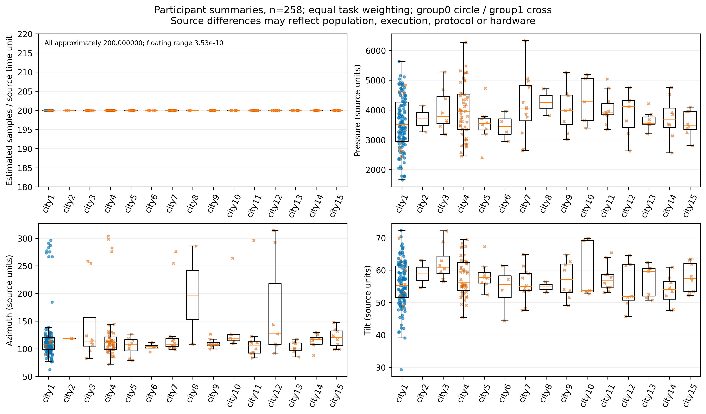

# Phase D — Sensor, acquisition và preprocessing

Đọc SVC gốc: 4000 recordings, 288 directory IDs; cohort bảo vệ có 3612 recordings/258 participant. Tổng samples cohort=54808751. Header count,7 columns, finite values và pen states được kiểm tra. Bảng recording và participant được giữ riêng; không coi hàng triệu samples là hàng triệu replicates độc lập.

Sampling-rate estimate =1/median(positive Δt), đơn vị **samples/source-time-unit**, không xác nhận Hz vì không có chứng chỉ clock units. Duration và pen up/down valid duration dùng source-time; valid intervals trong[1e-4,1] theo code hiện tại. Khoảng không hợp lệ vẫn được đếm, không sort/drop/impute. Min observed step là khoảng cách nhỏ nhất giữa giá trị quan sát, không phải ADC resolution đã chứng minh.

**Negative evidence quan trọng:** participant cadence nằm trong [199.999999999675, 200.000000000029], gần200 ở mọi city. Range chỉ 3.534e-10. Rank tests trên số float chưa làm tròn có thể cho p nhỏ dù chênh lệch chỉ ở sai số biểu diễn. `acquisition_precision_sensitivity.csv` giữ nguyên test gốc và thêm diagnostic rounding (Δt9 chữ số, rate6 chữ số); không đổi preprocessing/model. Không dùng p nhỏ này để tuyên bố sampling hardware khác nhau.

| feature | n_participants | observed_range | diagnostic_rounding_decimals | rounded_range | rounded_city_kruskal_p |
| --- | --- | --- | --- | --- | --- |
| median_dt_positive | 258 | 0.000000 | 9 | 0.000000 | 1.000000 |
| estimated_rate_per_source_time | 258 | 0.000000 | 6 | 0.000000 | 1.000000 |

| stratum | feature | n_participants | mean | median | p25 | p75 |
| --- | --- | --- | --- | --- | --- | --- |
| city1 | estimated_rate_per_source_time | 122 | 200.000000 | 200.000000 | 200.000000 | 200.000000 |
| city1 | pressure_mean | 122 | 3549.333509 | 3516.247752 | 2946.752263 | 4265.315559 |
| city1 | azimuth_mean | 122 | 119.657557 | 106.929161 | 98.457468 | 120.264487 |
| city1 | tilt_mean | 122 | 55.636933 | 55.296716 | 51.445015 | 61.300363 |
| city10 | estimated_rate_per_source_time | 5 | 200.000000 | 200.000000 | 200.000000 | 200.000000 |
| city10 | pressure_mean | 5 | 4312.814242 | 4274.722227 | 3649.928753 | 5062.917406 |
| city10 | azimuth_mean | 5 | 146.481413 | 119.238110 | 114.292922 | 125.453584 |
| city10 | tilt_mean | 5 | 59.718262 | 53.764510 | 53.225816 | 69.140718 |
| city11 | estimated_rate_per_source_time | 10 | 200.000000 | 200.000000 | 200.000000 | 200.000000 |
| city11 | pressure_mean | 10 | 4039.308620 | 3904.677431 | 3835.869667 | 4208.489135 |
| city11 | azimuth_mean | 10 | 121.350821 | 105.035301 | 92.239911 | 112.472838 |
| city11 | tilt_mean | 10 | 57.626420 | 56.914294 | 54.743493 | 58.620112 |
| city12 | estimated_rate_per_source_time | 7 | 200.000000 | 200.000000 | 200.000000 | 200.000000 |
| city12 | pressure_mean | 7 | 3849.775196 | 4107.311486 | 3422.696773 | 4310.260278 |
| city12 | azimuth_mean | 7 | 169.306836 | 126.870827 | 107.881387 | 217.940168 |
| city12 | tilt_mean | 7 | 55.275188 | 51.943451 | 50.725652 | 61.621404 |
| city13 | estimated_rate_per_source_time | 7 | 200.000000 | 200.000000 | 200.000000 | 200.000000 |
| city13 | pressure_mean | 7 | 3650.193049 | 3559.570296 | 3525.221250 | 3766.348414 |
| city13 | azimuth_mean | 7 | 102.744567 | 101.248893 | 97.374320 | 110.308560 |
| city13 | tilt_mean | 7 | 56.815149 | 59.623673 | 51.981922 | 60.513926 |
| city14 | estimated_rate_per_source_time | 8 | 200.000000 | 200.000000 | 200.000000 | 200.000000 |
| city14 | pressure_mean | 8 | 3720.994229 | 3691.256641 | 3406.371274 | 4065.100659 |
| city14 | azimuth_mean | 8 | 113.808313 | 116.280645 | 108.333027 | 120.813571 |
| city14 | tilt_mean | 8 | 53.761267 | 53.966105 | 51.026312 | 56.497185 |
| city15 | estimated_rate_per_source_time | 8 | 200.000000 | 200.000000 | 200.000000 | 200.000000 |
| city15 | pressure_mean | 8 | 3548.731261 | 3489.517271 | 3336.123883 | 3948.227765 |
| city15 | azimuth_mean | 8 | 119.998474 | 120.196229 | 105.746648 | 132.237566 |
| city15 | tilt_mean | 8 | 57.788774 | 57.531003 | 53.377938 | 62.149272 |
| city2 | estimated_rate_per_source_time | 2 | 200.000000 | 200.000000 | 200.000000 | 200.000000 |
| city2 | pressure_mean | 2 | 3699.254403 | 3699.254403 | 3480.990173 | 3917.518632 |
| city2 | azimuth_mean | 2 | 118.373539 | 118.373539 | 118.304342 | 118.442736 |
| city2 | tilt_mean | 2 | 58.830432 | 58.830432 | 56.706604 | 60.954261 |
| city3 | estimated_rate_per_source_time | 8 | 200.000000 | 200.000000 | 200.000000 | 200.000000 |
| city3 | pressure_mean | 8 | 4012.109303 | 3776.362654 | 3549.728036 | 4449.870968 |
| city3 | azimuth_mean | 8 | 143.947470 | 113.978365 | 104.831414 | 156.259466 |
| city3 | tilt_mean | 8 | 62.353019 | 60.914239 | 58.967222 | 64.350130 |
| city4 | estimated_rate_per_source_time | 47 | 200.000000 | 200.000000 | 200.000000 | 200.000000 |
| city4 | pressure_mean | 47 | 3975.134813 | 3957.623196 | 3352.428744 | 4534.842409 |
| city4 | azimuth_mean | 47 | 124.459730 | 110.977097 | 99.148957 | 121.500712 |
| city4 | tilt_mean | 47 | 57.818296 | 56.076395 | 53.672084 | 62.284117 |
| city5 | estimated_rate_per_source_time | 8 | 200.000000 | 200.000000 | 200.000000 | 200.000000 |
| city5 | pressure_mean | 8 | 3530.571419 | 3535.581334 | 3326.124394 | 3723.948720 |
| city5 | azimuth_mean | 8 | 104.931505 | 108.396883 | 95.915765 | 116.436486 |
| city5 | tilt_mean | 8 | 58.320567 | 57.665779 | 56.033601 | 59.251821 |
| city6 | estimated_rate_per_source_time | 4 | 200.000000 | 200.000000 | 200.000000 | 200.000000 |
| city6 | pressure_mean | 4 | 3448.975567 | 3439.904596 | 3186.466266 | 3702.413897 |
| city6 | azimuth_mean | 4 | 103.347535 | 104.033885 | 101.430113 | 105.951307 |
| city6 | tilt_mean | 4 | 54.180673 | 55.526323 | 51.495258 | 58.211738 |
| city7 | estimated_rate_per_source_time | 12 | 200.000000 | 200.000000 | 200.000000 | 200.000000 |
| city7 | pressure_mean | 12 | 4138.982350 | 4061.773144 | 3633.894261 | 4819.297861 |
| city7 | azimuth_mean | 12 | 134.523336 | 108.340478 | 104.349359 | 118.757232 |
| city7 | tilt_mean | 12 | 55.725932 | 55.012347 | 53.664015 | 58.973084 |
| city8 | estimated_rate_per_source_time | 2 | 200.000000 | 200.000000 | 200.000000 | 200.000000 |
| city8 | pressure_mean | 2 | 4260.977204 | 4260.977204 | 4036.281867 | 4485.672542 |
| city8 | azimuth_mean | 2 | 197.065379 | 197.065379 | 152.639851 | 241.490907 |
| city8 | tilt_mean | 2 | 54.792565 | 54.792565 | 53.992176 | 55.592954 |
| city9 | estimated_rate_per_source_time | 8 | 200.000000 | 200.000000 | 200.000000 | 200.000000 |
| city9 | pressure_mean | 8 | 4014.535258 | 3993.317666 | 3514.043555 | 4500.566965 |
| city9 | azimuth_mean | 8 | 109.740291 | 108.147365 | 105.129138 | 111.523884 |
| city9 | tilt_mean | 8 | 57.163938 | 57.028007 | 53.119418 | 61.891171 |

| feature | contrast | test | n | effect | p | fdr_bh_global |
| --- | --- | --- | --- | --- | --- | --- |
| median_dt_positive | Across cities; source and group confounded | Kruskal-Wallis | 258 | N/A | 0.000003 | 0.000029 |
| median_dt_positive | group0_vs_group1 | Mann-Whitney U | 258 | 0.5312861051991487 | 0.000000 | 0.000000 |
| median_dt_positive | within_city1_group0_vs_group1 | Mann-Whitney U | 122 | 0.7565217391304349 | 0.000817 | 0.003267 |
| estimated_rate_per_source_time | Across cities; source and group confounded | Kruskal-Wallis | 258 | N/A | 0.000003 | 0.000029 |
| estimated_rate_per_source_time | group0_vs_group1 | Mann-Whitney U | 258 | -0.530982061416844 | 0.000000 | 0.000000 |
| estimated_rate_per_source_time | within_city1_group0_vs_group1 | Mann-Whitney U | 122 | -0.7565217391304347 | 0.000817 | 0.003267 |
| duplicate_dt_fraction | Across cities; source and group confounded | Kruskal-Wallis | 258 | N/A | 0.000043 | 0.000260 |
| duplicate_dt_fraction | group0_vs_group1 | Mann-Whitney U | 258 | -0.38643964730921254 | 0.000000 | 0.000002 |
| duplicate_dt_fraction | within_city1_group0_vs_group1 | Mann-Whitney U | 122 | -0.05341614906832293 | 0.817171 | 0.834558 |
| large_gap_fraction | Across cities; source and group confounded | Kruskal-Wallis | 258 | N/A | 0.615066 | 0.720078 |
| large_gap_fraction | group0_vs_group1 | Mann-Whitney U | 258 | -0.13298875038005475 | 0.066563 | 0.114109 |
| large_gap_fraction | within_city1_group0_vs_group1 | Mann-Whitney U | 122 | -0.08074534161490687 | 0.724627 | 0.808886 |
| samples | Across cities; source and group confounded | Kruskal-Wallis | 258 | N/A | 0.048231 | 0.085744 |
| samples | group0_vs_group1 | Mann-Whitney U | 258 | -0.24767406506536938 | 0.000632 | 0.003034 |
| samples | within_city1_group0_vs_group1 | Mann-Whitney U | 122 | -0.4608695652173913 | 0.041687 | 0.085488 |
| duration_source_time | Across cities; source and group confounded | Kruskal-Wallis | 258 | N/A | 0.014521 | 0.040342 |
| duration_source_time | group0_vs_group1 | Mann-Whitney U | 258 | -0.3334144116752812 | 0.000004 | 0.000034 |
| duration_source_time | within_city1_group0_vs_group1 | Mann-Whitney U | 122 | -0.45093167701863357 | 0.046306 | 0.085488 |
| pressure_mean | Across cities; source and group confounded | Kruskal-Wallis | 258 | N/A | 0.199890 | 0.299834 |
| pressure_mean | group0_vs_group1 | Mann-Whitney U | 258 | -0.20778352082699914 | 0.004145 | 0.013265 |
| pressure_mean | within_city1_group0_vs_group1 | Mann-Whitney U | 122 | 0.05590062111801242 | 0.808630 | 0.834558 |
| pressure_std | Across cities; source and group confounded | Kruskal-Wallis | 258 | N/A | 0.018870 | 0.045287 |
| pressure_std | group0_vs_group1 | Mann-Whitney U | 258 | -0.30045606567345695 | 0.000034 | 0.000232 |
| pressure_std | within_city1_group0_vs_group1 | Mann-Whitney U | 122 | -0.07080745341614902 | 0.757895 | 0.826794 |
| pressure_min_observed_step | Across cities; source and group confounded | Kruskal-Wallis | 258 | N/A | 0.524394 | 0.662393 |
| pressure_min_observed_step | group0_vs_group1 | Mann-Whitney U | 258 | 0.122286409242931 | 0.090010 | 0.148982 |
| pressure_min_observed_step | within_city1_group0_vs_group1 | Mann-Whitney U | 122 | 0.10062111801242235 | 0.658473 | 0.752540 |
| azimuth_mean | Across cities; source and group confounded | Kruskal-Wallis | 258 | N/A | 0.264706 | 0.385027 |
| azimuth_mean | group0_vs_group1 | Mann-Whitney U | 258 | -0.11498935846761937 | 0.112696 | 0.180313 |
| azimuth_mean | within_city1_group0_vs_group1 | Mann-Whitney U | 122 | -0.05341614906832293 | 0.817171 | 0.834558 |
| azimuth_std | Across cities; source and group confounded | Kruskal-Wallis | 258 | N/A | 0.045741 | 0.085488 |
| azimuth_std | group0_vs_group1 | Mann-Whitney U | 258 | -0.24037701429005776 | 0.000911 | 0.003363 |
| azimuth_std | within_city1_group0_vs_group1 | Mann-Whitney U | 122 | -0.3291925465838509 | 0.146179 | 0.226341 |
| tilt_mean | Across cities; source and group confounded | Kruskal-Wallis | 258 | N/A | 0.384428 | 0.512570 |
| tilt_mean | group0_vs_group1 | Mann-Whitney U | 258 | -0.1466099118273031 | 0.043114 | 0.085488 |
| tilt_mean | within_city1_group0_vs_group1 | Mann-Whitney U | 122 | -0.1279503105590062 | 0.574491 | 0.698421 |
| tilt_std | Across cities; source and group confounded | Kruskal-Wallis | 258 | N/A | 0.004121 | 0.013265 |
| tilt_std | group0_vs_group1 | Mann-Whitney U | 258 | -0.2772271207053816 | 0.000131 | 0.000697 |
| tilt_std | within_city1_group0_vs_group1 | Mann-Whitney U | 122 | -0.1577639751552795 | 0.487962 | 0.633031 |
| x_range | Across cities; source and group confounded | Kruskal-Wallis | 258 | N/A | 0.276591 | 0.390481 |
| x_range | group0_vs_group1 | Mann-Whitney U | 258 | 0.011006384919428402 | 0.879924 | 0.879924 |
| x_range | within_city1_group0_vs_group1 | Mann-Whitney U | 122 | -0.1254658385093168 | 0.582017 | 0.698421 |
| y_range | Across cities; source and group confounded | Kruskal-Wallis | 258 | N/A | 0.016529 | 0.041758 |
| y_range | group0_vs_group1 | Mann-Whitney U | 258 | -0.16716327151109756 | 0.021095 | 0.048218 |
| y_range | within_city1_group0_vs_group1 | Mann-Whitney U | 122 | -0.23726708074534164 | 0.295637 | 0.405444 |
| pen_down_fraction | Across cities; source and group confounded | Kruskal-Wallis | 258 | N/A | 0.015128 | 0.040342 |
| pen_down_fraction | group0_vs_group1 | Mann-Whitney U | 258 | 0.20328367284889026 | 0.005035 | 0.015105 |
| pen_down_fraction | within_city1_group0_vs_group1 | Mann-Whitney U | 122 | 0.5080745341614907 | 0.024717 | 0.053928 |

Các test dùng **participant summaries** với equal-task weighting;16 acquisition indicators được khai báo trước trong code. Kruskal-Wallis across cities; Mann–Whitney giữa group hoặc trong city1; BH điều chỉnh trên toàn bộ các test hợp lệ. Missing-test p không được thay bằng0. Rank-biserial dương nghĩa group0 lớn hơn, không phải hướng tác động bệnh. City sizes không cân bằng, city1 chỉ ít positives, school/population clustering chưa mô hình hóa; p/q không phải bằng chứng thiết bị gây khác biệt.

Azimuth/tilt summaries ở đây là arithmetic mean/std trong conventions gốc; nếu có circular wrap, chúng không tương đương circular orientation statistics. Chưa xác minh angular units nên không tự đổi degrees/radians hoặc gán ý nghĩa sinh cơ học. Figure cadence dùng trục±10% median để không phóng đại sai số float10⁻¹⁰ thành khác biệt acquisition lớn; raw statistics và numerical-sensitivity table vẫn được giữ đầy đủ.

## Fidelity toàn cohort

Raw SVC→21-channel signed-log float32 được dựng lại cho mọi recording cohort; independent dt/pen masks; window boundaries không vượt segment; coverage không mất samples. NPZ x/index channels, inventory, lengths và packed float16 được đối chiếu toàn bộ. Statistics gốc được tính lại trên float32 per participant; mean/SD của normalization lấy đúng215 Train, participant-balanced, SD floor0,1; flags không scale; clipping±10. Không refit clinical model và không load pickle/checkpoint weights.

Số recording source/merged có sample count khác nhau trong cohort: 3. `svc_merged_comparison.csv` còn kiểm tra exact channel hashes và pressure round4; không coi hai nhánh dùng input hoàn toàn đồng nhất khi conversion có khác biệt. Kinematic xử lý timestamp/đạo hàm khác Temporal: bỏ mẫu có local Δt≤0 trước gradient và gradient qua cả in-air; Temporal giữ mẫu, mask/reset đạo hàm theo pen/time boundaries. Đây là khác biệt triển khai đã tồn tại, không phải direct label leakage tự động.

Packed quantization/clipping theo recording/source được ghi ở `preprocessing_fidelity.csv` và `preprocessing_by_source.csv`; distortion phải xét số liệu này, không suy rằng “float16 hẳn vô hại” hoặc “preprocessing làm mất tín hiệu bệnh”. Không có phép ánh xạ causal từ clipping vào lỗi mô hình trong audit này.

**Hypotheses còn mở:** khác biệt sampling/pressure/angle có thể đến từ thiết bị, firmware, clock conventions, người thực hiện, tác vụ, population hoặc protocol. Chỉ thấy association không xác định được nguyên nhân. Cần device IDs, export/software versions, units/calibration, operator/SOP và recordings crossover hoặc hai lớp trong cùng điều kiện để phân biệt.
