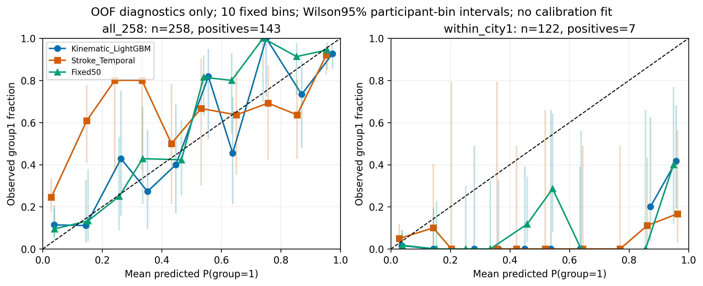

# Phase E — OOF dưới source confounding

OOF được đọc trực tiếp từ baseline và sáu Temporal fold files, kiểm tra unique/missing IDs, labels/fold IDs, sigmoid(logit), threshold p>0,5 và pF=0,5pK+0,5pT. Checkpoint chỉ hash; audit không train lại, không thực hiện mới network inference. Replay ở đây là kiểm toán số học OOF/metrics; prior checkpoint replay evidence được giữ phân biệt. Fit-ID/normalizer-ID lists phải khớp215 Train, không giao43 Test. Tất cả8 metrics khớp reports trước trong tolerance1e-12.

| model | n | accuracy | f1_macro | auc | balanced_accuracy | sensitivity | specificity | brier | log_loss |
| --- | --- | --- | --- | --- | --- | --- | --- | --- | --- |
| Kinematic_LightGBM | 258 | 0.848837 | 0.847163 | 0.906902 | 0.847461 | 0.860140 | 0.834783 | 0.122450 | 0.406506 |
| Stroke_Temporal | 258 | 0.713178 | 0.713178 | 0.807540 | 0.721678 | 0.643357 | 0.800000 | 0.224193 | 0.752517 |
| Fixed50 | 258 | 0.841085 | 0.840681 | 0.906111 | 0.845576 | 0.804196 | 0.886957 | 0.129793 | 0.416361 |

## Within city1 (không phải external validation)

| model | n | group0 | group1 | tn | fp | fn | tp | sensitivity | specificity | auc | sensitivity_wilson_low | sensitivity_wilson_high |
| --- | --- | --- | --- | --- | --- | --- | --- | --- | --- | --- | --- | --- |
| Kinematic_LightGBM | 122 | 115 | 7 | 96 | 19 | 1 | 6 | 0.8571428571428571 | 0.8347826086956521 | 0.8944099378881987 | 0.4868721707256811 | 0.9743203756552565 |
| Stroke_Temporal | 122 | 115 | 7 | 92 | 23 | 5 | 2 | 0.2857142857142857 | 0.8 | 0.6149068322981366 | 0.08221892400405678 | 0.6410655481673808 |
| Fixed50 | 122 | 115 | 7 | 102 | 13 | 3 | 4 | 0.5714285714285714 | 0.8869565217391304 | 0.8422360248447205 | 0.2504583645276572 | 0.8417801447485302 |

Ở nguồn một lớp, AUC và balanced accuracy là N/A; sensitivity hoặc specificity thiếu mẫu số cũng N/A. Macro-F1 báo với fixed labels[0,1] chỉ để minh bạch phép tính, không dùng so sánh source-invariance giữa nguồn thiếu một lớp. Các Wilson intervals là mô tả binomial theo participant, chưa bao gồm clustering/model selection; city1 rất ít positive nên bất định lớn.

| scope | stratum | n | group0 | group1 | both_correct | kinematic_only_correct | temporal_only_correct | both_wrong | fusion_corrected | fusion_harmed | probability_correlation |
| --- | --- | --- | --- | --- | --- | --- | --- | --- | --- | --- | --- |
| all | all_258 | 258 | 115 | 143 | 159 | 60 | 25 | 14 | 20 | 22 | 0.5030272745591159 |
| city | city1 | 122 | 115 | 7 | 80 | 22 | 14 | 6 | 13 | 9 | 0.2551634823478409 |
| city | city10 | 5 | 0 | 5 | 4 | 1 | 0 | 0 | 0 | 1 | 0.5260354590256671 |
| city | city11 | 10 | 0 | 10 | 8 | 2 | 0 | 0 | 0 | 1 | 0.4444959294424273 |
| city | city12 | 7 | 0 | 7 | 3 | 2 | 2 | 0 | 1 | 0 | -0.03077246539546723 |
| city | city13 | 7 | 0 | 7 | 4 | 1 | 1 | 1 | 1 | 0 | 0.5455814924464885 |
| city | city14 | 8 | 0 | 8 | 6 | 2 | 0 | 0 | 0 | 2 | 0.10498372936105457 |
| city | city15 | 8 | 0 | 8 | 7 | 0 | 0 | 1 | 0 | 0 | 0.954015994889591 |
| city | city2 | 2 | 0 | 2 | 2 | 0 | 0 | 0 | 0 | 0 | -1.0 |
| city | city3 | 8 | 0 | 8 | 5 | 1 | 1 | 1 | 1 | 1 | 0.5515976862197319 |
| city | city4 | 47 | 0 | 47 | 20 | 20 | 3 | 4 | 1 | 6 | 0.2226897548732341 |
| city | city5 | 8 | 0 | 8 | 6 | 2 | 0 | 0 | 0 | 0 | -0.28914369547946983 |
| city | city6 | 4 | 0 | 4 | 2 | 2 | 0 | 0 | 0 | 1 | 0.6192867857281575 |
| city | city7 | 12 | 0 | 12 | 7 | 4 | 0 | 1 | 0 | 1 | 0.5089030466980353 |
| city | city8 | 2 | 0 | 2 | 1 | 0 | 1 | 0 | 0 | 0 | -1.0 |
| city | city9 | 8 | 0 | 8 | 4 | 1 | 3 | 0 | 3 | 0 | -0.3505934698317242 |

Fusion sửa đúng 20 và làm sai 22 dự đoán Kinematic. Both-correct/only-correct/both-wrong và probability correlation có theo fold/city/site. Các case không tự chứng minh incremental motor information. Mỗi OOF participant dùng cả14 tasks; không có task-level prediction trong file OOF nên **không xác định được task nào gây correction**. `fusion_case_task_quality.csv` chỉ mô tả quality theo task/case group, không gán attribution.

| metric | delta | lower95 | upper95 | replicates | method |
| --- | --- | --- | --- | --- | --- |
| f1_macro | -0.006483 | -0.053470 | 0.041286 | 2000 | Paired participant bootstrap within label; fixed models, not selection- or cluster-adjusted |
| auc | -0.000791 | -0.026575 | 0.027124 | 2000 | Paired participant bootstrap within label; fixed models, not selection- or cluster-adjusted |
| brier | 0.007343 | -0.012722 | 0.026393 | 2000 | Paired participant bootstrap within label; fixed models, not selection- or cluster-adjusted |

Paired bootstrap2.000 lần seed42, resample participant trong từng label và giữ mô hình cố định; không giải quyết source clustering hay researcher selection bias. ΔF1 Fixed50−Kinematic=-0.006483, CI95%[-0.053470,+0.041286]. Không chọn threshold/model/calibration từ CI.

| model | scope | n | group1 | brier | log_loss | ece10 |
| --- | --- | --- | --- | --- | --- | --- |
| Kinematic_LightGBM | all_258 | 258 | 143 | 0.122450 | 0.406506 | 0.086405 |
| Kinematic_LightGBM | within_city1 | 122 | 7 | 0.133538 | 0.448566 | 0.205504 |
| Stroke_Temporal | all_258 | 258 | 143 | 0.224193 | 0.752517 | 0.181813 |
| Stroke_Temporal | within_city1 | 122 | 7 | 0.170278 | 0.548977 | 0.185489 |
| Fixed50 | all_258 | 258 | 143 | 0.129793 | 0.416361 | 0.079382 |
| Fixed50 | within_city1 | 122 | 7 | 0.113359 | 0.371282 | 0.181263 |

Reliability dùng10 equal-width bins cố định, empty bins không điền số giả. ECE nhạy binning; phải đọc cùng Brier/log-loss và class mix. Averaging có thể thay calibration/threshold effects mà chưa chứng minh temporal signal độc lập; audit không fit temperature/Platt/isotonic. Cần train-only calibrated Kinematic control trong nghiên cứu riêng mới kiểm tra công bằng giả thuyết đó.
