# Kinematic Task-Level XAI — nghiên cứu trên 258 participant

Ngày: 2026-11-16 (Asia/Bangkok). HEAD đầu vào: `a2f257a71020c530bc7dca338e3780069c9da85d`.
Đây là phân tích bản tái lập độc lập DiaGraMo sau refactor. Nhãn là `group`,
không đồng nhất hoàn toàn với cờ dysgraphia cụ thể trong dữ liệu. Không suy ra
biomarker, chẩn đoán lâm sàng hoặc quan hệ nhân quả từ SHAP.

## Protocol, nguồn và tính nguyên vẹn

Giữ 258 ID, 14 tác vụ × 74 đặc trưng, Stratified 6-Fold theo người, seed 42.
Assignments được đọc trực tiếp từ baseline và kiểm tra với StratifiedKFold gốc.
Sáu checkpoint LightGBM outer-fold có sẵn được dùng lại; xác suất/nhãn của chúng
phải khớp OOF cũ trước khi giải thích. Median imputer, variance filter và scaler
được kiểm tra khớp với fit chỉ trên 215 người Train tương ứng. Không dùng mô hình
fit toàn cohort cho held-out attribution. `baseline_manifest.json` bảo vệ các
artifact gốc; chỉ thư mục nghiên cứu mới được ghi output.

Mapping lấy từ `schema.json`, đối chiếu TASKS trong prepare.py và thực thi extractor
gốc trên 42 recording của ba participant đầu/giữa/cuối. Tên và giá trị phải khớp
cache. Nhóm nguồn được suy từ prefix đã kiểm chứng: có **12 nhóm** trong code
hiện tại (gồm Peaks, Lifts và Energy); không ép chúng thành số nhóm mô tả trong
bài báo. Không khôi phục module đã xóa của những nghiên cứu trước. Tái sử dụng
`evaluate.classifiers`, `build_pipeline`, `metrics`, checkpoint và fold hiện có.

Baseline kiểm chứng từ dữ liệu, đơn vị %:

| metric | OOF | fold_mean | fold_SD |
| --- | --- | --- | --- |
| f1_macro | 84.716 | 84.705 | 3.239 |
| accuracy | 84.884 | 84.884 | 3.206 |
| auc | 90.690 | 90.403 | 3.128 |
| balanced_accuracy | 84.746 | 84.728 | 3.234 |

Dependency thực chạy: `{"shap": "0.49.1", "numpy": "1.25.2", "scipy": "1.15.3", "pandas": "2.3.3", "lightgbm": "4.7.0", "scikit-learn": "1.7.2", "matplotlib": "3.10.9", "joblib": "1.6.0"}`.
SHAP 0.49.1 được giữ để tương thích Python 3.10 của baseline; không nâng NumPy/
LightGBM/sklearn. Seed permutation được ghi riêng cho mỗi block/fold/repeat.

## A — Feature-level TreeSHAP

TreeExplainer dùng `model_output='raw'`, `feature_perturbation='tree_path_dependent'`.
Reference là thống kê đường đi/cỡ leaf của cây đã học trên Train, không dùng
background lấy từ Test. Giải thích chỉ 43 người held-out của từng fold; ghép đúng
258 người OOF. Cột hằng bị variance filter loại nhận attribution 0 khi ánh xạ lại
1.036 cột. Scaling một-một không làm mất danh tính đặc trưng gốc.

Kiểm tra từng người: `base_value + sum(phi) = raw_score`, và
`sigmoid(raw_score) = p(group=1)`. Dung sai kiểm tra độc lập là 1e-9; sai số thực
tế ghi trong validation. SHAP ở **log-odds**, không phải xác suất; không áp dụng
sigmoid riêng cho từng phi rồi cộng. Đây là path-dependent TreeSHAP, không phải
conditional causal attribution hay một phân rã xác suất.

Top 20 đầy đủ ở `exploratory/tables/top20_features.csv`; fold-specific cho toàn
bộ 1.036 feature ở `feature_importance_by_fold.csv`. Các feature đầu bảng:

| full_name | mean_absolute_shap_mass | mean_rank | rank_sd |
| --- | --- | --- | --- |
| copy::trajectory_width | 0.967 | 1.167 | 0.408 |
| copy::fft_pressure_dominant_hz | 0.710 | 2.000 | 0.632 |
| copy::statistics_acc_skew | 0.466 | 4.833 | 2.639 |
| copy::trajectory_duration | 0.418 | 5.500 | 3.391 |
| copy::trajectory_bbox_area | 0.386 | 6.833 | 3.488 |
| RCFT-recall::statistics_acc_kurtosis | 0.358 | 8.167 | 5.076 |
| lower-loops-precise::fft_y_bandwidth_hz | 0.256 | 10.167 | 4.916 |
| dictation::orientation_azimuth_std | 0.252 | 12.333 | 5.854 |
| lower-loops-fast::pressure_std | 0.242 | 11.500 | 6.775 |
| dictation::energy_y_rms | 0.237 | 12.667 | 7.737 |

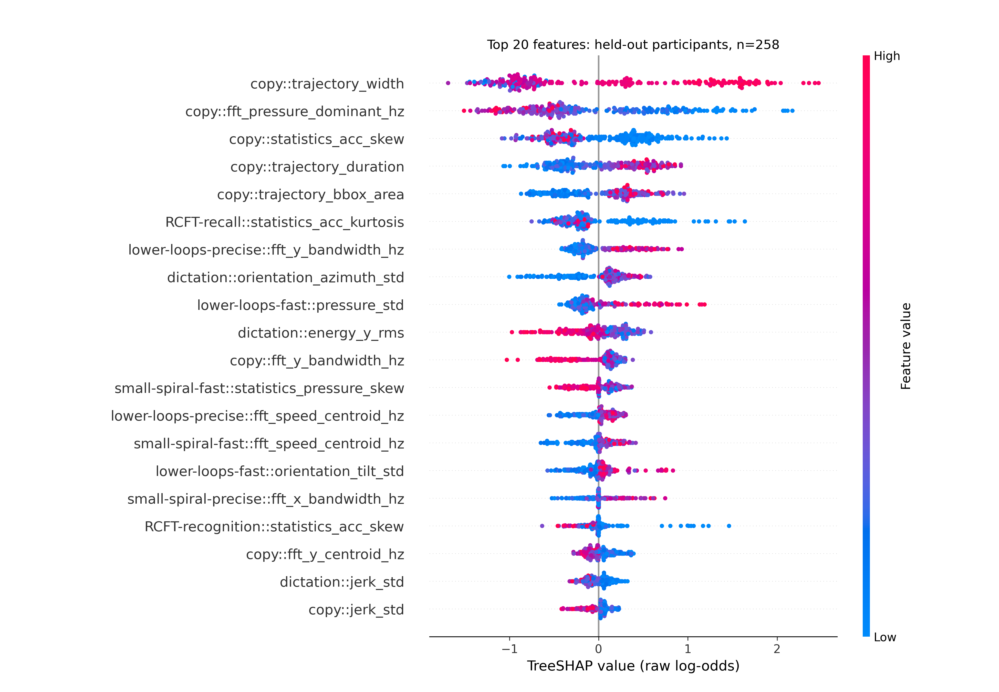
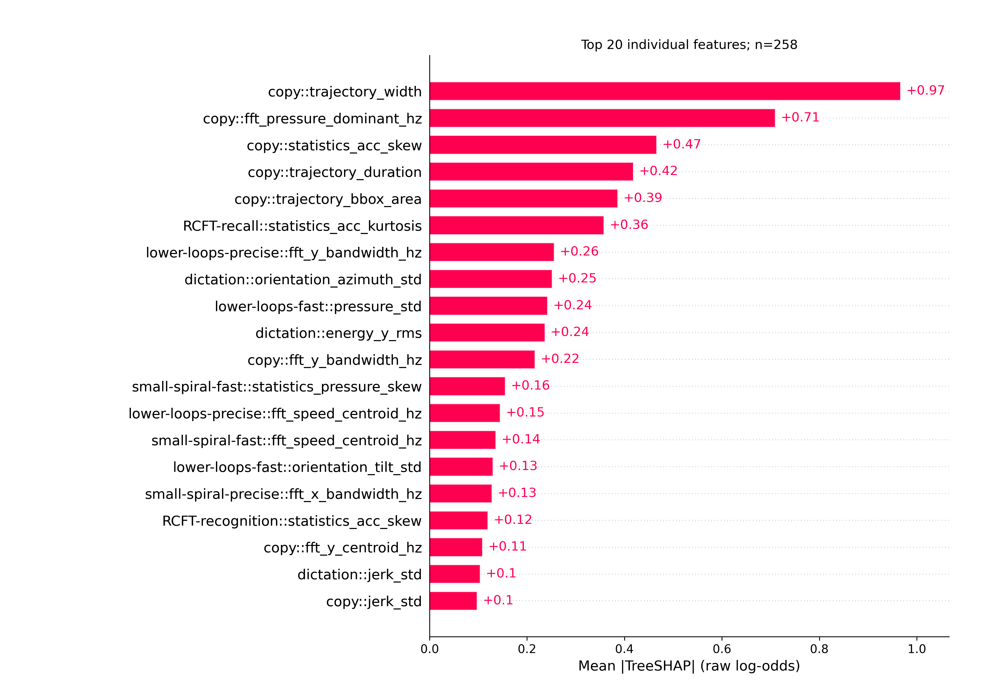

Bốn waterfall minh họa true-positive, true-negative, false-positive và false-negative.
Chọn ID nhỏ nhất theo thứ tự từ điển trong mỗi outcome; quy tắc được lưu ở
`local_cases.csv`, không chọn trường hợp có hình đẹp nhất. Đây là minh họa hậu
kiểm, không dùng để chọn model/threshold.

## B — Task-level attribution

Mass(task) = mean_participant(sum_feature_in_task(abs(phi))). Signed contribution
được cộng riêng trước khi xét dấu. Không thay mass bằng abs(sum(phi)): đóng góp
trái dấu có thể triệt tiêu. Mass là tổng attribution của từng feature, **không phải
grouped Shapley value** khi task được xem như một player trong một game khác.

| task | n_features | mean_absolute_shap_mass | share_percent | mean_rank | rank_sd | top3_count |
| --- | --- | --- | --- | --- | --- | --- |
| copy | 74 | 4.298 | 35.341 | 1.000 | 0.000 | 6 |
| dictation | 74 | 1.363 | 11.209 | 2.333 | 0.516 | 6 |
| lower-loops-fast | 74 | 1.014 | 8.340 | 3.667 | 1.033 | 2 |
| small-spiral-fast | 74 | 0.894 | 7.352 | 4.333 | 0.816 | 1 |
| RCFT-recall | 74 | 0.869 | 7.144 | 4.833 | 1.941 | 2 |
| RCFT-recognition | 74 | 0.698 | 5.739 | 5.833 | 2.041 | 1 |
| lower-loops-precise | 74 | 0.682 | 5.610 | 6.667 | 1.366 | 0 |
| small-spiral-precise | 74 | 0.497 | 4.087 | 8.833 | 1.941 | 0 |
| big-spiral-fast | 74 | 0.379 | 3.113 | 9.833 | 1.472 | 0 |
| rainbow-fast | 74 | 0.308 | 2.531 | 10.667 | 3.077 | 0 |
| upper-loops-fast | 74 | 0.299 | 2.460 | 11.667 | 1.633 | 0 |
| combined-loops-fast | 74 | 0.296 | 2.438 | 11.833 | 1.722 | 0 |
| saw-fast | 74 | 0.291 | 2.392 | 11.667 | 2.160 | 0 |
| combined-loops-precise | 74 | 0.273 | 2.245 | 11.833 | 1.722 | 0 |

`copy` có 35.34% mass;
`dictation` và `lower-loops-fast` đứng sau. Tất cả task có cùng 74 cột nên so sánh
mass giữa task không bị khác số lượng feature. `copy` và `dictation` vào Top-3
ở cả sáu fold; vị trí thứ ba ít ổn định hơn. SD rank và SD mass qua sáu fold cùng
IQR participant được công bố, **không gọi SD là CI**. Các Train fold chồng lấn,
nên sáu fold không phải sáu cohort độc lập. Không thêm CI hoặc kiểm định giả
định độc lập cho các rank này.

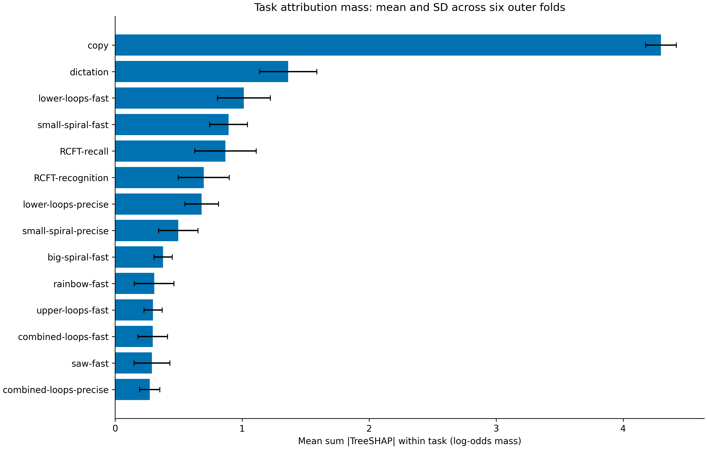

`task_signed_summary.csv` báo mean signed log-odds, mean absolute net và mass;
`participant_task_attributions.csv` lưu cả signed sum và mass cho từng người/task.
Mean signed gần 0 không có nghĩa task không quan trọng.

## C — Feature-group explanation

| group | n_features | share_percent | mass_per_feature | mean_rank | rank_sd |
| --- | --- | --- | --- | --- | --- |
| fft | 224 | 27.962 | 0.015 | 1.167 | 0.408 |
| statistics | 140 | 21.593 | 0.019 | 2.167 | 0.753 |
| trajectory | 112 | 20.275 | 0.022 | 2.667 | 0.516 |
| orientation | 56 | 8.546 | 0.019 | 4.000 | 0.000 |
| pressure | 112 | 4.844 | 0.005 | 5.500 | 0.548 |
| acceleration | 84 | 3.893 | 0.006 | 6.833 | 1.602 |
| energy | 42 | 3.723 | 0.011 | 6.667 | 1.211 |
| jerk | 42 | 3.387 | 0.010 | 7.667 | 1.366 |
| peaks | 42 | 2.283 | 0.007 | 8.833 | 1.169 |
| velocity | 112 | 1.294 | 0.001 | 10.500 | 0.837 |
| curvature | 28 | 1.148 | 0.005 | 10.833 | 1.169 |
| lifts | 42 | 1.053 | 0.003 | 11.167 | 1.329 |

FFT, Statistics và Trajectory có tổng mass lớn nhất. Sau khi chia số feature,
thứ hạng có thể thay đổi; Trajectory có mass/feature cao nhất trong lần chạy này.
Không gán ý nghĩa sinh học chỉ từ tên prefix hoặc mean absolute importance.

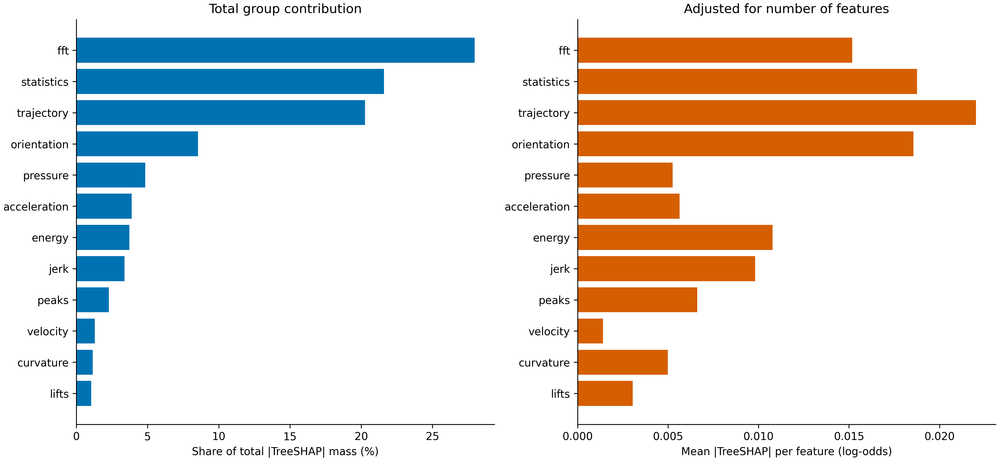
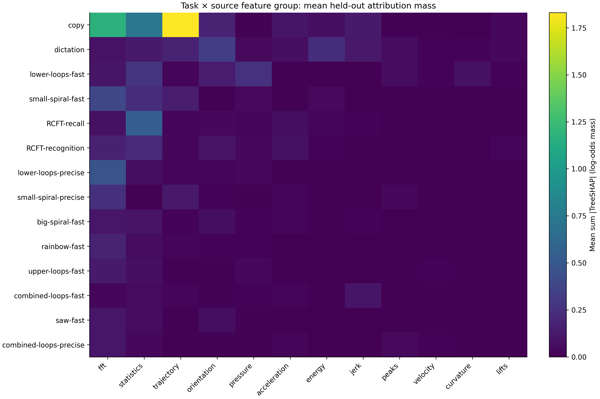

## D — Grouped permutation trên held-out folds

Trong mỗi Test fold, toàn bộ cột của một task hoặc source group được hoán vị
bằng **cùng một thứ tự participant**; các cột khác và nhãn giữ nguyên. Mỗi block
lặp 30 lần, seed và thứ tự hoán vị được lưu cùng dự đoán. Tổng 26 block × 30 × 6
= 4.680 lượt. Không fit lại classifier. Drop = baseline − permuted, dương là giảm
hiệu năng sau perturbation. Bảng dưới là mean ± SD giữa **sáu fold mean**, sau khi
trung bình 30 repeats trong mỗi fold; 180 phép lặp không phải 180 cohort độc lập.

| block | drop_f1_macro_mean | drop_f1_macro_std | drop_accuracy_mean | drop_auc_mean | drop_balanced_accuracy_mean |
| --- | --- | --- | --- | --- | --- |
| copy | 22.387 | 3.315 | 21.576 | 22.570 | 22.316 |
| lower-loops-fast | 4.250 | 2.275 | 4.199 | 2.099 | 4.197 |
| dictation | 3.078 | 3.521 | 2.972 | 1.358 | 3.169 |
| RCFT-recognition | 2.609 | 0.998 | 2.519 | 0.444 | 2.653 |
| RCFT-recall | 2.402 | 2.580 | 2.326 | 0.751 | 2.431 |
| small-spiral-fast | 1.989 | 2.313 | 1.925 | 0.846 | 2.028 |
| lower-loops-precise | 1.870 | 2.792 | 1.860 | 0.481 | 1.805 |
| big-spiral-fast | 1.272 | 0.756 | 1.253 | 0.174 | 1.275 |
| rainbow-fast | 0.976 | 1.412 | 0.969 | 0.126 | 0.928 |
| small-spiral-precise | 0.839 | 2.088 | 0.827 | 0.385 | 0.826 |
| saw-fast | 0.804 | 0.949 | 0.775 | -0.282 | 0.826 |
| combined-loops-fast | 0.444 | 1.056 | 0.465 | -0.083 | 0.370 |
| upper-loops-fast | 0.289 | 0.721 | 0.284 | 0.150 | 0.281 |
| combined-loops-precise | 0.270 | 1.558 | 0.271 | -0.068 | 0.228 |

Permutation giữ cấu trúc nội bộ block nhưng có thể tạo tổ hợp **out-of-distribution**
giữa task/group đã hoán vị và các task/group khác. Drop phản ánh reliance của
mô hình đã fit, không phải causal effect hoặc giá trị khi được huấn luyện lại.

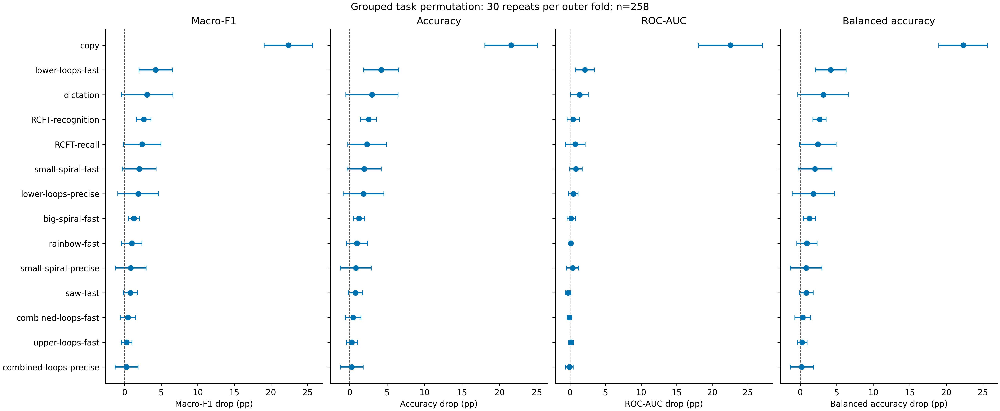
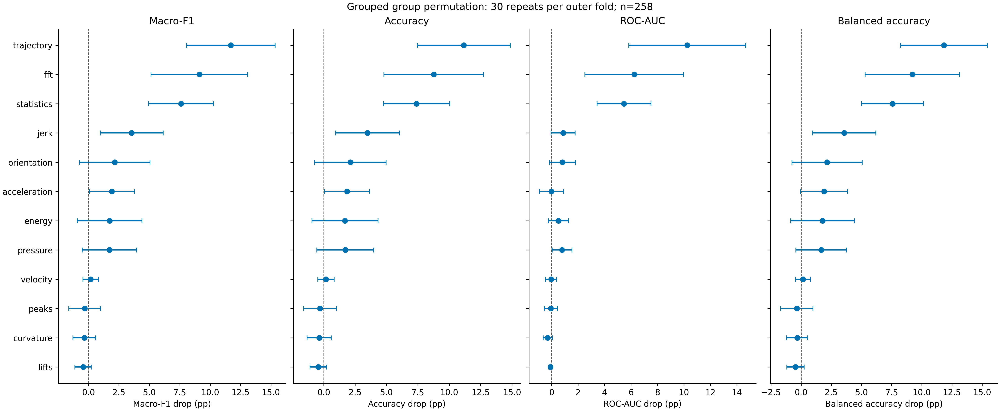

## E — Task ablation: hai câu hỏi khác nhau

1. **Test-time removal diagnostic:** thay 74 cột raw của task bằng median chỉ từ
Train fold (statistics của imputer đã fit), giữ nguyên mô hình và 1.036 cột.
Đây là một quy tắc operational cụ thể cho missing task, có thể OOD; không coi
việc ghi số 0 vào cột raw là trung tính. Bảng kết quả đầy đủ có prefix method
`test_time_train_median`.
2. **Leave-One-Task-Out retraining:** bỏ đúng 74 cột ở cả Train và Test rồi fit
lại đủ preprocessing + LightGBM với cùng tham số, seed và assignments. Có 14 × 6
= **84 fit** trên 962 cột. Không chọn task subset/hyperparameter hoặc ngưỡng từ
outer Test. Checkpoint mới nằm riêng, baseline không bị ghi đè.

Bảng LOTO dưới dùng OOF gộp (%); delta F1 = ablated − baseline, đơn vị điểm %.
`corrected/harmed` là số người chuyển từ sai→đúng/đúng→sai so với baseline.

| task | accuracy | f1_macro | auc | balanced_accuracy | delta_f1_macro | corrected | harmed |
| --- | --- | --- | --- | --- | --- | --- | --- |
| RCFT-recognition | 83.333 | 83.089 | 90.690 | 83.007 | -1.627 | 6.000 | 10.000 |
| RCFT-recall | 82.558 | 82.418 | 90.429 | 82.563 | -2.298 | 7.000 | 13.000 |
| dictation | 82.171 | 81.817 | 88.945 | 81.618 | -2.900 | 6.000 | 13.000 |
| big-spiral-fast | 79.845 | 79.530 | 89.638 | 79.434 | -5.186 | 3.000 | 16.000 |
| small-spiral-fast | 82.558 | 82.231 | 90.106 | 82.052 | -2.485 | 5.000 | 11.000 |
| saw-fast | 81.783 | 81.550 | 90.052 | 81.523 | -3.166 | 6.000 | 14.000 |
| upper-loops-fast | 82.946 | 82.771 | 90.216 | 82.828 | -1.946 | 5.000 | 10.000 |
| lower-loops-fast | 81.008 | 80.730 | 88.744 | 80.654 | -3.987 | 7.000 | 17.000 |
| rainbow-fast | 81.783 | 81.550 | 89.669 | 81.523 | -3.166 | 2.000 | 10.000 |
| combined-loops-fast | 83.721 | 83.554 | 90.581 | 83.612 | -1.162 | 6.000 | 9.000 |
| small-spiral-precise | 84.109 | 83.811 | 90.404 | 83.621 | -0.906 | 7.000 | 9.000 |
| lower-loops-precise | 82.558 | 82.303 | 90.222 | 82.223 | -2.414 | 5.000 | 11.000 |
| combined-loops-precise | 81.783 | 81.581 | 90.526 | 81.608 | -3.135 | 3.000 | 11.000 |
| copy | 73.256 | 72.914 | 81.636 | 72.894 | -11.803 | 12.000 | 42.000 |

CSV đầy đủ còn báo mean±SD mỗi fold, **paired fold deltas**, cả bốn metric,
7.224 dòng thay đổi dự đoán theo participant cho hai phương pháp × 14 task.
Không đánh đồng hai thí nghiệm. Mức tụt OOF đơn lẻ không phải kiểm định ý nghĩa
thống kê hoặc bằng chứng số task tối thiểu.

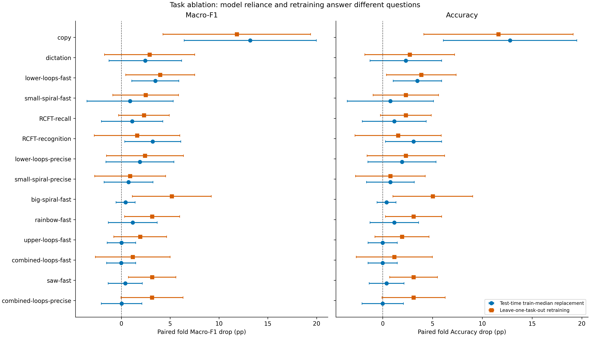

## F — Stability, agreement và disagreement

Rank correlation task giữa 15 cặp fold có mean Spearman
**0.822** (min 0.723,
max 0.925); Top-3 Jaccard mean
**0.567**. Feature-level rank yếu ổn định hơn task/group;
toàn bộ kết quả ở `fold_stability.csv`, không chỉ trình bày cặp fold thuận lợi.

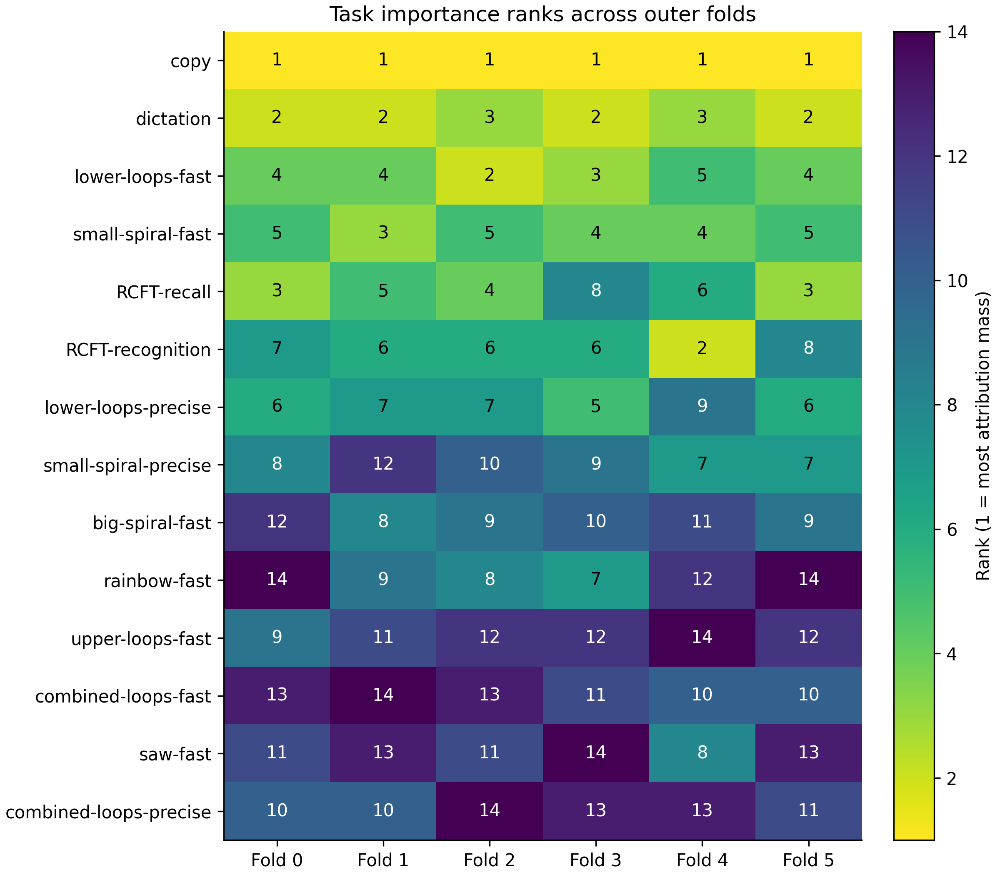
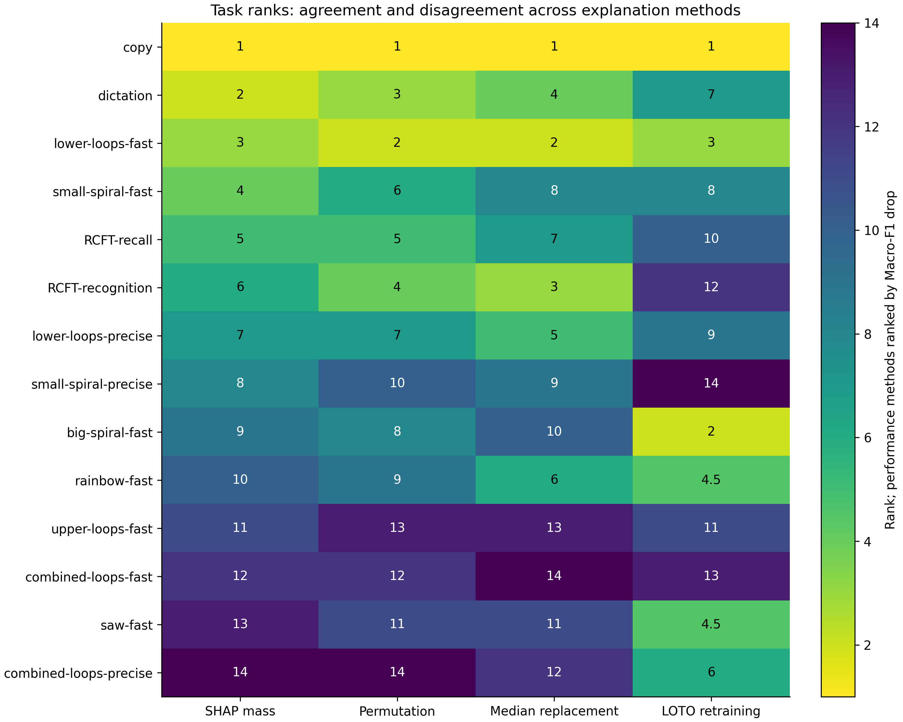

Spearman SHAP task mass ↔ permutation F1 drop là **0.947**, nhưng với
LOTO retraining F1 drop chỉ **0.211**. Top-3 đồng thời ở SHAP, permutation
và LOTO: **copy, lower-loops-fast**. `big-spiral-fast` đứng thứ 9 theo SHAP nhưng thứ 2 theo
LOTO; `saw-fast` thứ 13 theo SHAP nhưng nằm khoảng thứ 4–5 theo LOTO. Ngược lại,
`dictation` rất lớn theo SHAP/permutation nhưng đứng thứ 7 theo LOTO. Khi bỏ cột
và fit lại, cây có thể đổi cấu trúc và phân phối đóng góp giữa các feature tương
quan; redundancy và tính không ổn định khi refit là các khả năng cần kiểm chứng,
không phải nguyên nhân nhân quả đã được chứng minh.

Không lựa chọn phương pháp XAI thuận lợi nhất. Bảng agreement công bố cả rank
và drop, kể cả khi chúng bất đồng. Tất cả 14 LOTO đều có Macro-F1 OOF thấp hơn
baseline trong lần chạy này; điều đó chưa đủ khẳng định mỗi task là không thể
thay thế hoặc nên giữ mọi task trong mọi mô hình khác.

Có 219 dự đoán đúng và
39 sai. Importance và rank của từng người
được lưu đầy đủ; median Spearman rank cá nhân với thứ hạng task toàn cohort là
0.859. Thống kê này mang tính mô tả và tham
chiếu toàn cohort có bao gồm chính người đó; không phải một phép đo validation
độc lập. Nhóm đúng/sai có cỡ mẫu khác nhau và cùng chia sẻ model trong fold;
không dùng sự khác nhau để kết luận về bệnh lý.

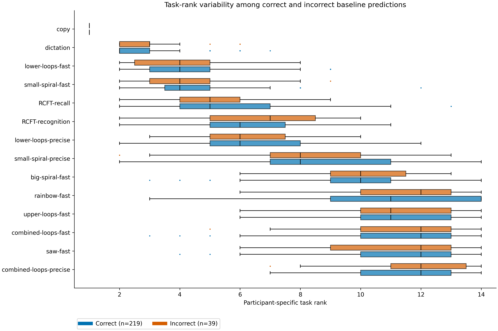

## Quy trình train-only cho nghiên cứu tiếp theo

`diagramo.kinematic_xai.train_only_task_importance` chỉ nhận X/y/ID của **Train
đang xét**, tự cross-fit 3-fold bên trong nó, rồi tính importance từ các hàng
inner held-out. Mỗi participant được giải thích đúng một lần bởi model chưa
thấy người đó. `forbidden_ids` chặn ID ngoài Train. Mỗi outer Train có một bộ
artifact demo riêng tại `train_only/outer_fold_f/`; tổng **18 fit**, tách khỏi
`exploratory/`. Không chọn subset hoặc trọng số task trong nhiệm vụ này.

Khi tích hợp vào inner CV của một mô hình tương lai, phải gọi lại API trên
**inner Train**, với inner Validation và outer Test nằm trong forbidden_ids:

```python
importance, phi, fold_ids = train_only_task_importance(
    X[inner_train], y[inner_train], ids[inner_train], mapping, factory,
    seed=42, forbidden_ids=np.r_[ids[inner_valid], ids[outer_test]])
```

**Không** tải importance đã tính từ toàn outer Train để chọn task/weight cho
inner Validation nằm bên trong chính outer Train đó. Artifact demo outer Train
chỉ phù hợp với quyết định fit trên toàn outer Train tương ứng; cấp inner CV
cần importance được tính lại từ cấp inner Train.

Outer-test XAI hiện tại là phân tích khoa học thăm dò. Nếu chọn task, weight hoặc
kiến trúc theo các bảng này rồi dùng cùng outer Test để tuyên bố một mô hình mới
tốt hơn một cách không thiên lệch thì đã có feedback từ dữ liệu đánh giá. Một
quy trình train-only đúng ở cấp code không xóa được việc nhà nghiên cứu đã xem
kết quả toàn cohort. Cần mô tả tính thăm dò và ưu tiên cohort/hold-out mới để xác
nhận thiết kế tương lai; không coi những fold đã xem là một phép đánh giá mới độc lập.

## Giả thuyết cho Motor-Invariant Task Transformer ở bước sau

- Xét `copy` và `lower-loops-fast` là ứng viên thông tin mạnh, nhưng không gán
trọng số cố định từ outer-test XAI hiện tại.
- Kiểm tra khả năng học đặc trưng motor dùng chung qua source groups, đồng thời
giữ task context: dominance của copy/dictation có thể bao gồm đặc tính riêng tác
vụ; đây là giả thuyết, chưa xác lập representation motor-invariant.
- Những cặp task fast/precise có cùng dạng tên trong schema là ứng viên để kiểm
tra invariance và phụ thuộc tốc độ, với đối chiếu riêng trên Train; không mặc
định chúng đo cùng một cơ chế sinh học.
- Bất đồng SHAP–LOTO cho thấy cần đánh giá task redundancy/interactions và độ ổn
định khi refit, thay vì loại task chỉ theo mass nhỏ. Task subset phải được chọn
trong Train với nested protocol; chưa biết số task tối thiểu.

Nhiệm vụ này không triển khai Transformer, Knowledge Graph hoặc thí nghiệm trên
nhánh embedding. Không có lựa chọn mô hình mới dựa trên các metric ở đây.

## Artifact, chạy lại và validation

```powershell
.venv/Scripts/python.exe -X utf8 -B -u scripts/analyze_kinematic_xai.py
.venv/Scripts/python.exe -X utf8 -B scripts/report_kinematic_xai.py
.venv/Scripts/python.exe -X utf8 -B scripts/plot_kinematic_xai.py
.venv/Scripts/python.exe -X utf8 -B scripts/validate_kinematic_xai.py --numerics-only
.venv/Scripts/python.exe -X utf8 -B scripts/create_kinematic_xai_notebook.py
.venv/Scripts/python.exe -X utf8 -B scripts/execute_notebooks.py --only 05_kinematic_task_xai.ipynb --validation-output results/kinematic_xai/notebook_validation.json
.venv/Scripts/python.exe -X utf8 -B scripts/validate_kinematic_xai.py
```

Checkpoint LOTO và train-only lưu cục bộ ở `checkpoints/` và Git ignore; có thể
tạo lại bằng script với input/code signature đã ghi. Bảng số và thứ tự permutation
được lưu cùng OOF để replay. Thay code phân tích cần output mới, không trộn lượt
chạy khác. Notebook là viewer đọc artifact, bảng số trước hình, không fit model.
Chỉ xem nghiên cứu hoàn tất khi `validation.json` có `complete=true`, mọi fold,
permutation, ablation, train-only provenance, hình, notebook và kiểm thử đã đạt.

## Tài liệu/phần mềm tham khảo

- [SHAP TreeExplainer documentation](https://shap.readthedocs.io/en/latest/generated/shap.TreeExplainer.html).
- Quy trình tái lập: `../../EXPERIMENT_PROTOCOL.md`.
- Kassis, T., Agarwal, V., He, Y., Patel, D., & Brueckner, A. M. (2026).
  *Scientific Agent Skills: A Library of Procedural Knowledge for Research Agents*.
  [doi:10.48550/arXiv.2609.00065](https://doi.org/10.48550/arXiv.2609.00065).
  Tham khảo hướng dẫn SHAP và scientific-visualization; metadata arXiv được
  kiểm tra ngày 2026-11-16, bản hiện hành v2.
