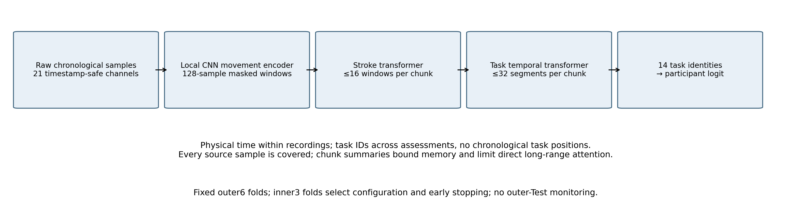
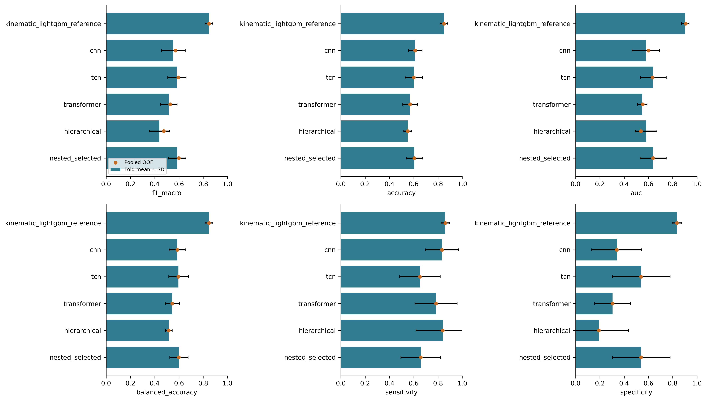
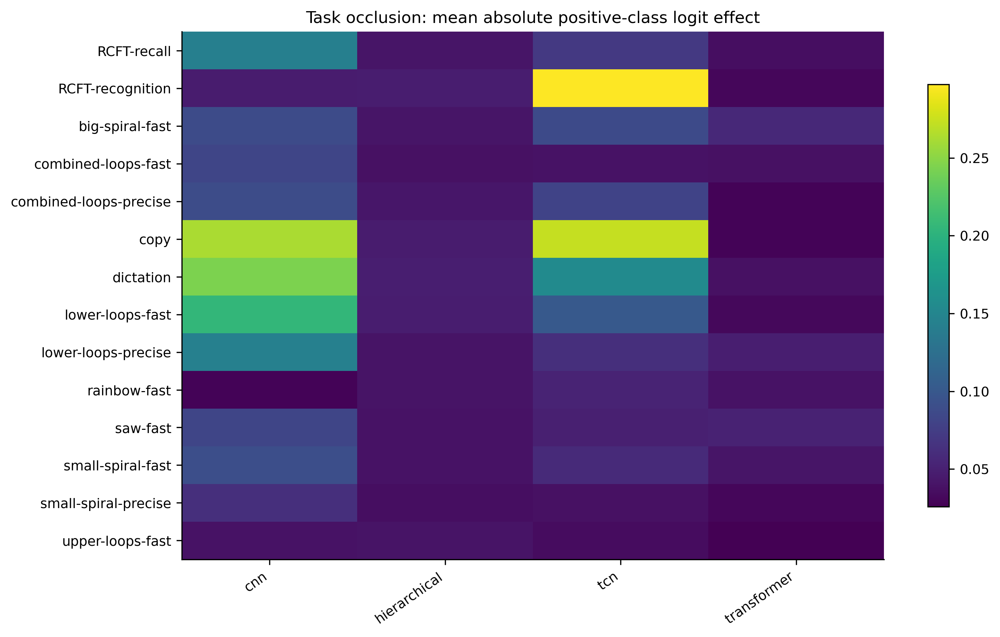
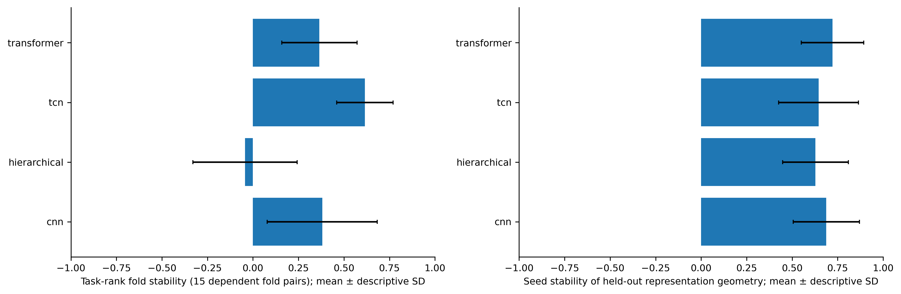
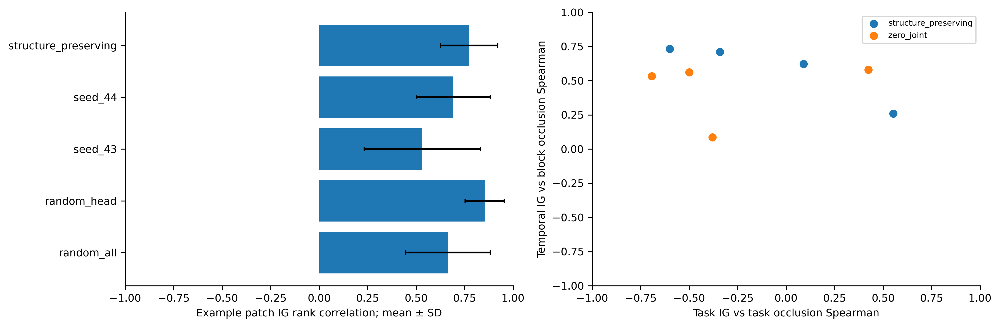
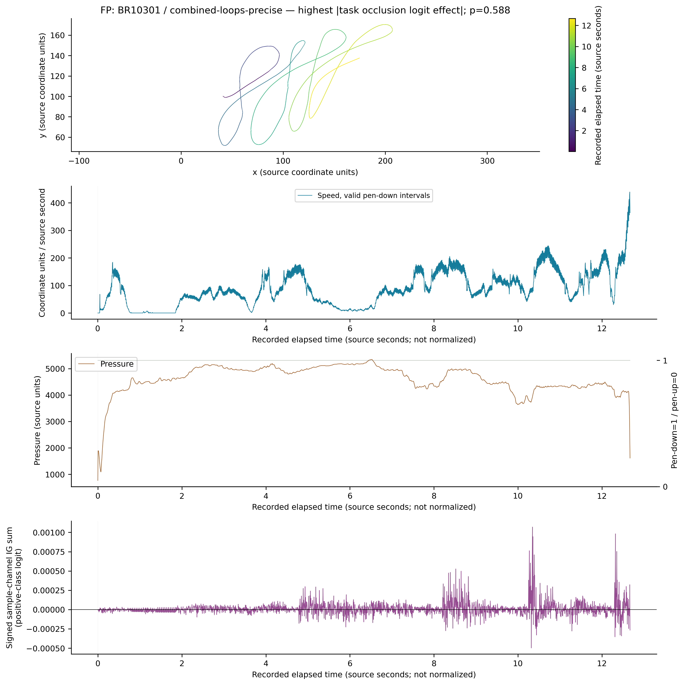
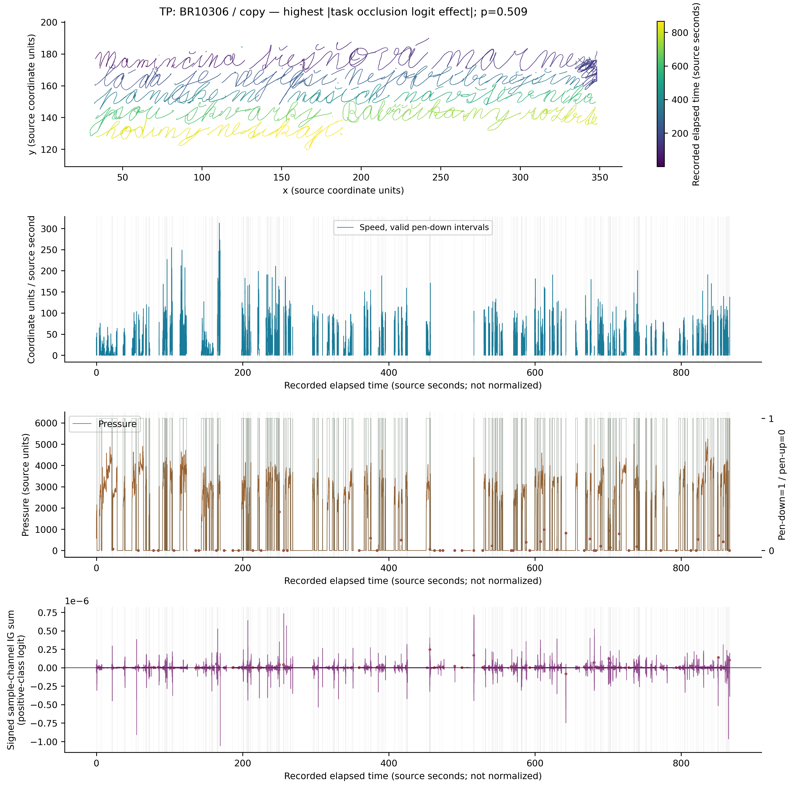
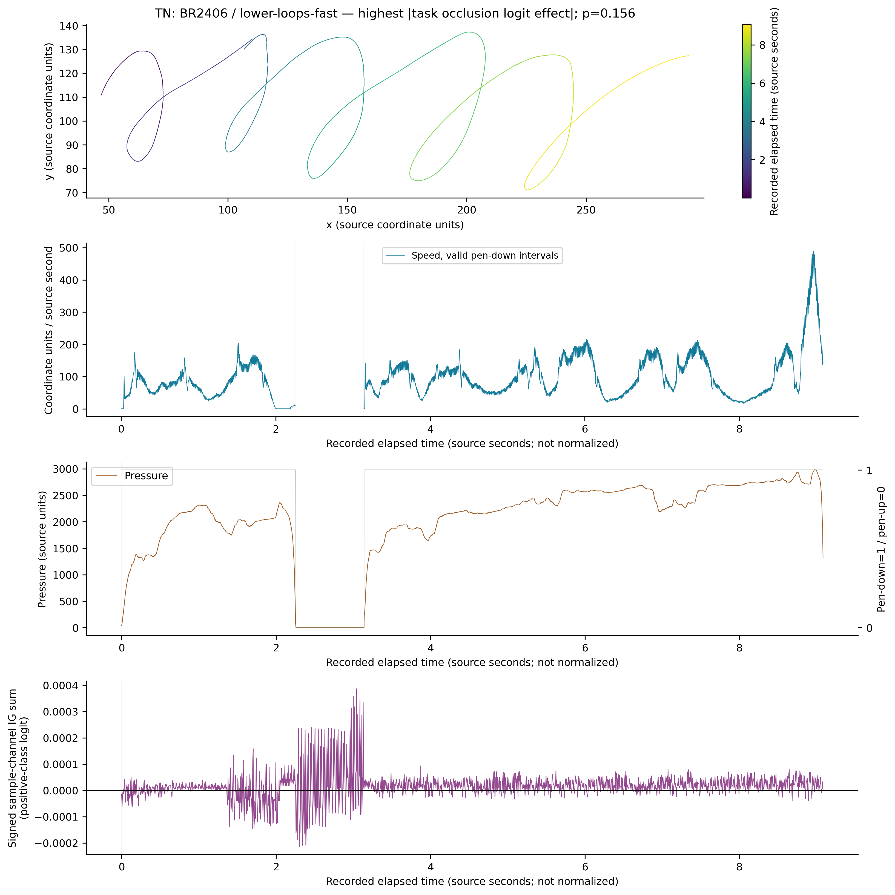
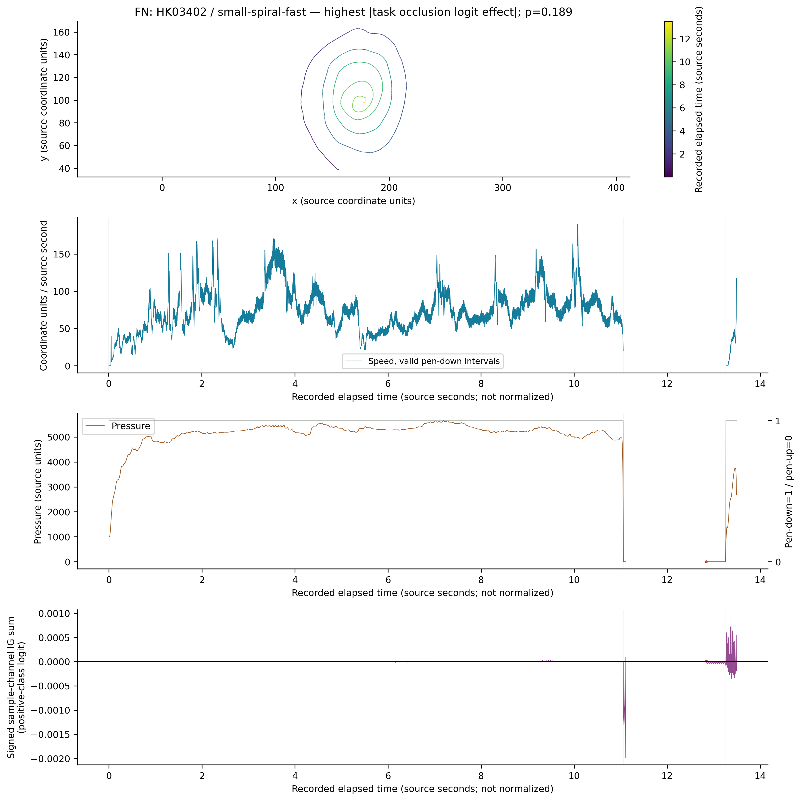

# Raw Temporal Graphomotor Representation Learning — báo cáo Task 2 thay thế

## Kết quả chính và phạm vi kết luận

Đây là nghiên cứu **raw chronological signals**, thay thế hoàn toàn thí nghiệm cũ trên handcrafted task vectors. Code/results cũ đã xóa khỏi active branch bằng normal Git commit; lịch sử public không bị viết lại. Cache/checkpoints cũ được giữ local dưới `data/derived/retired_task2_025b840/`, không tham gia benchmark. Không tái đưa mô hình cũ vào bảng so sánh.

Protected Kinematic + LightGBM đạt Accuracy OOF **84.8837%**, macro-F1 **0.8472**, ROC-AUC **0.9069**. Quy trình chọn raw architecture bằng inner CV (`nested_selected`) đạt Accuracy **60.4651%**, macro-F1 **0.5985**, ROC-AUC **0.6376**; Δmacro-F1 OOF so với reference **-0.2487**.

Chưa có bằng chứng để thay thế baseline Kinematic bằng raw temporal model trên cohort này.

| model | f1_macro | accuracy | auc | balanced_accuracy | sensitivity | specificity |
|---|---|---|---|---|---|---|
| train_majority_reference | 0.35661 | 0.55426 | 0.5 | 0.5 | 1 | 0 |
| kinematic_lightgbm_reference | 0.84716 | 0.84884 | 0.9069 | 0.84746 | 0.86014 | 0.83478 |
| cnn | 0.57117 | 0.6124 | 0.59957 | 0.58565 | 0.83217 | 0.33913 |
| tcn | 0.59493 | 0.60078 | 0.63284 | 0.59474 | 0.65035 | 0.53913 |
| transformer | 0.5277 | 0.56977 | 0.55227 | 0.54378 | 0.78322 | 0.30435 |
| hierarchical | 0.47458 | 0.55039 | 0.53682 | 0.51523 | 0.83916 | 0.1913 |
| nested_selected | 0.59847 | 0.60465 | 0.63758 | 0.59824 | 0.65734 | 0.53913 |

Các bảng metric dùng thang0–1; Accuracy viết bằng phần trăm trong đoạn văn được ghi dấu%. Sensitivity/specificity lần lượt xem group1/group0 là lớp cần phát hiện, không đổi chúng thành nhãn chẩn đoán lâm sàng.

Fold mean±SD (ddof=1), khác pooled OOF:

| model | f1_macro | accuracy | auc | balanced_accuracy | sensitivity | specificity |
|---|---|---|---|---|---|---|
| train_majority_reference | 0.3566 ± 0.0040 | 0.5543 ± 0.0095 | 0.5000 ± 0.0000 | 0.5000 ± 0.0000 | 1.0000 ± 0.0000 | 0.0000 ± 0.0000 |
| kinematic_lightgbm_reference | 0.8470 ± 0.0324 | 0.8488 ± 0.0321 | 0.9040 ± 0.0313 | 0.8473 ± 0.0323 | 0.8599 ± 0.0353 | 0.8346 ± 0.0401 |
| cnn | 0.5534 ± 0.0988 | 0.6124 ± 0.0563 | 0.5774 ± 0.1124 | 0.5855 ± 0.0662 | 0.8324 ± 0.1366 | 0.3386 ± 0.2058 |
| tcn | 0.5830 ± 0.0752 | 0.6008 ± 0.0712 | 0.6394 ± 0.1068 | 0.5963 ± 0.0800 | 0.6519 ± 0.1666 | 0.5408 ± 0.2374 |
| transformer | 0.5161 ± 0.0687 | 0.5698 ± 0.0602 | 0.5503 ± 0.0390 | 0.5444 ± 0.0580 | 0.7844 ± 0.1733 | 0.3044 ± 0.1466 |
| hierarchical | 0.4388 ± 0.0818 | 0.5504 ± 0.0318 | 0.5819 ± 0.0882 | 0.5166 ± 0.0281 | 0.8403 ± 0.2211 | 0.1930 ± 0.2416 |
| nested_selected | 0.5864 ± 0.0712 | 0.6047 ± 0.0658 | 0.6391 ± 0.1074 | 0.5998 ± 0.0754 | 0.6588 ± 0.1640 | 0.5408 ± 0.2374 |

Không chọn mô hình tốt nhất sau khi xem outer Test rồi gọi score của nó là unbiased. `tcn` có macro-F1 OOF mô tả cao nhất trong bốn raw families; đó là **xếp hạng hậu nghiệm**, không thay cho nested selector đã khai báo. Tất cả conclusions vẫn exploratory vì cùng cohort/outer folds đã được nghiên cứu trước đó; cần external validation.

## 1. Động cơ nghiên cứu và mối liên hệ Task 1

Kinematic features đã chứa thông tin temporal như velocity, acceleration, jerk, duration và FFT. Vấn đề là aggregation có thể mất thứ tự sự kiện, động học cục bộ, pauses/resumptions và tương tác giữa strokes; không nói phương pháp trước “không có temporal information”. Giả thuyết là học trực tiếp từ raw progression có thể giữ thêm cấu trúc có ích. Không giả định Transformer tốt hơn CNN/TCN hoặc LightGBM, không giả định language invariance hay biological validity.

Task-1 TreeSHAP cho thấy copy/dictation và các feature groups có vai trò trong mô hình summary; điều đó chỉ gợi ý kiểm tra động học bên trong task. Không dùng SHAP cũ làm neural weights, không Top-K task selection. [Task 1 giữ nguyên](../kinematic_xai/REPORT_VI.md). Các nhánh GAF/CWT/MOMENT, fusion, Knowledge Graph, domain adversarial và cross-language không được triển khai trong nghiên cứu này.

Năm task và năm nhóm đứng đầu trong artifact Task1 đã kiểm chứng:

| task | n_features | share_percent | mean_rank | rank_sd |
|---|---|---|---|---|
| copy | 74 | 35.341 | 1 | 0 |
| dictation | 74 | 11.209 | 2.3333 | 0.5164 |
| lower-loops-fast | 74 | 8.3401 | 3.6667 | 1.0328 |
| small-spiral-fast | 74 | 7.3521 | 4.3333 | 0.8165 |
| RCFT-recall | 74 | 7.1436 | 4.8333 | 1.9408 |

| group | n_features | share_percent | mean_rank | rank_sd |
|---|---|---|---|---|
| fft | 224 | 27.962 | 1.1667 | 0.40825 |
| statistics | 140 | 21.593 | 2.1667 | 0.75277 |
| trajectory | 112 | 20.275 | 2.6667 | 0.5164 |
| orientation | 56 | 8.5462 | 4 | 0 |
| pressure | 112 | 4.8435 | 5.5 | 0.54772 |

`share_percent` là tỷ trọng tổng absolute feature-SHAP mass trong mô hình Kinematic, không phải phần trăm xác suất hoặc grouped Shapley value. Các nhóm có số features khác nhau; các bảng này không xác nhận cơ chế sinh học. FFT và trajectory trong summary đã chứa temporal information; raw temporal kiểm tra thêm cấu trúc tiến triển chưa được giữ bởi aggregation.

## 2. Data audit và timestamp anomalies

Giữ 258 participants, 14 tasks và3.612 recordings với **54,808,751 raw samples**, nhãn `group` (115/143), đúng original fold assignments seed42. Không đổi sang diagnosis flag. Group là grouping trong dataset, không đồng nhất hoàn toàn chẩn đoán dysgraphia. Channels được xác minh theo tên: x,y,time,pen_status,pressure,azimuth,tilt; source schema order cũng được giữ trong audit.

Có 21,283 duplicate intervals, 0 negative intervals, 20,725 gaps>1s, không có nonfinite/missing channel trong cohort. Median samples/recording=2569, maximum=199739. Không mặc định sampling uniform. Effective sampling rate toàn duration và1/median positive Δt được báo cáo riêng.

[Audit tiếng Việt đầy đủ](audit/REPORT_VI.md), `audit/recordings.csv`, `pen_state_runs.csv` và `source_hashes.json` chứa số liệu cho mọi recording. Time dùng source seconds convention như baseline, chưa có calibration certificate; coordinate/pressure giữ đơn vị thiết bị, không tự đổi thành mm hoặc Newton. Không có chuyên gia gán ground-truth tremor/stroke/biomarker.

## Nguồn SVC gốc và xuất dữ liệu merged

Neural input đọc trực tiếp toàn bộ3.612 file `.svc` gốc, có **54,808,751 samples**. Merged JSON chỉ cung cấp mapping task/cohort và metadata `group`. Audit đối chiếu cho thấy3 recordings trong merged ít hơn tổng11 samples và pressure có sai khác export tối đa khoảng5×10⁻⁵ source units ở các recordings aligned; vì vậy không dùng arrays merged làm raw input. Các partial fits trước source revision đều được archive và loại khỏi benchmark. Original SVC, merged JSON, baseline và Task1 không bị sửa.

Khác biệt preprocessing/source precision giữa raw branch và protected Kinematic reference là một giới hạn khi diễn giải so sánh; không gán chênh lệch accuracy riêng cho temporal ordering. Trivial majority reference chỉ chọn lớp phổ biến trong outer Train; score0/1 là hard decision, không phải calibrated probability.

## 3. Preprocessing và alignment

Không sort timestamps, không drop duplicate, không resample cả task sang cùng số điểm. Giữ acquisition order và raw index. Δt≤0, Δt<0,0001 hoặc>1 giây tạo derivative/segment boundary; giữ timestamps và flags. Motion derivatives chỉ tính khi actual Δt hợp lệ và cùng pen-down run; acceleration cần hai velocity intervals liên tiếp hợp lệ. Invalid derivative đặt0 cùng validity mask0, không coi0 là quan sát vận động thật. Không tính derivative xuyên qua pen-up. Không dùng jerk ở phiên bản đầu vì độ nhạy đạo hàm bậc cao.

21 sample channels gồm relative x/y, pressure, orientation values, actual elapsed/Δt, pen state, vx/vy/speed, ax/ay và validity/anomaly/boundary indicators. Signed log1p giảm dynamic range. Per-record origin subtraction loại page offset nhưng giữ kích thước và thời lượng; có thể bỏ thông tin absolute placement hữu ích. Azimuth/tilt giữ số gốc, chưa unwrap/calibrate góc; wrap discontinuities là một hạn chế.

Channel normalization **chỉ fit trên current Train participants**: gộp first/second moments với mỗi participant có trọng số bằng nhau; fixed SD floor0,1, z saturation±10. Có thể làm mất tín hiệu biên độ cực đoan, không gọi mọi extreme là nuisance. Không dùng precomputed74-dimensional Kinematic vectors làm neural input. Cohort IDs/labels chỉ lấy từ validated cache để giữ protocol.

Cache deterministic lưu float32; packed float16 storage chia sẻ qua memory map có maximum input log-channel quantization error0,00390625, được kiểm tra trên toàn dữ liệu. Model/gradient float32, không dùng AMP. Original raw data và inventory timestamps vẫn float64; không thay normalized time axis cho physical duration.

Mapping bắt buộc: participant→task source key→raw index/time/pen-state run→anomaly-split segment→128-sample window. Mapping cho XAI lưu cả original run index (gồm pen-up) và down-stroke index. Không coi every pen-down run là một nét chữ đã được chuyên gia xác nhận.

## 4. Segmentation và full coverage

567,707 non-overlapping windows, tối đa128 samples, không vượt pen-state/anomaly boundary; long strokes chia nhỏ, short windows padding có mask. **54,808,751/54,808,751** samples được phủ đúng một lần. Không truncate hoặc random crop recording. Physical duration của windows khác nhau. So sánh inventory64/128/256 trong audit là trade-off tính toán, không phải predictive window-size tuning.

CNN kernel9 stride8 có right-edge padding bổ sung và output-validity rule dựa trên receptive-field overlap; impulse test kiểm tra mọi vị trí thật, bao gồm phần cuối stride. Một lỗi edge-coverage được phát hiện ở kiểm thử phát triển, đã archive toàn bộ partial inner fits và chạy lại từ đầu; không có outer Test predictions của phiên bản lỗi được dùng. Archive nằm trong ignored `data/derived/raw_temporal_debug_pre_coverage_fix/`. Không phục hồi abandoned handcrafted experiment.

## 5. Bốn raw architectures

| ID | Model | Cấu trúc |
|---|---|---|
| R1 | CNN | Local convolutional movement encoder, bounded patch pooling, task-ID feed-forward aggregation |
| R2 | TCN | Cùng local encoder, ba dilated convolution blocks trên patch tokens trong bounded task chunks |
| R3 | Temporal Transformer | Cùng local encoder, continuous-time encoding, self-attention trên patch tokens trong task chunks |
| R4 | Hierarchical | Local CNN→stroke attention→task temporal attention→task-aware participant attention |

CNN dùng Conv1d21→8, kernel9/stride8, Conv1d8→32 kernel3 và masked pooling. TCN dùng dilation1/2/4, không tuyên bố causal forecasting (padding hai phía, đây là phân loại sau recording). Transformers d32,2heads, một block ở mỗi mức tương ứng, residual/LayerNorm và dropout0,1 hoặc0,25. Continuous-time MLP nhận elapsed source time, window/segment duration, mean physical interval và sample count sau signed-log scaling. Đây là thời gian thực trong recordings;14 task IDs **không có chronological positional encoding**.

R4 attention bounded16 windows/stroke chunk và32 segments/task chunk; mọi chunk được pool, không bỏ cuối chuỗi. R3 và TCN dùng32 patch tokens/chunk. Không có global quadratic attention trên recording200.000 points. Pooling cho phép tóm tắt spans dài nhưng không trực tiếp attention giữa mọi distant sample; receptive field/chunking là giới hạn cần công khai.

Các kiến trúc khác nhau về context và capacity: R1 khoảng4k parameters, R2/R3 khoảng13k, R4 khoảng30k; exact counts trong bảng chi phí. **Chưa capacity-match hoàn toàn**, do đó chênh lệch không thể gán riêng cho attention hoặc hierarchy theo nghĩa nhân quả. Primary inputs/splits/budgets/selection/seeds/threshold được giữ thống nhất.



## 6. Nested participant-independent evaluation

Outer6-fold cố định, mỗi Test43 người, Train215; inner Stratified3-fold seed42. Mọi windows/tasks/strokes của participant nằm cùng partition. Independent sample count là258, không phải567,707 windows. Candidate search chỉ hai mức dropout cho mỗi primary family; không có grid lớn hoặc chọn window size từ Test.

AdamW lr0,001, weight decay0,001, gradient clip1; micro-batch8 participants, effective batch8; maximum20epochs, patience4, minimum6. Chọn inner checkpoint theo validation BCE cải thiện ít nhất1e-4. Chọn candidate theo mean inner macro-F1, tie-break AUC, candidate index; architecture winner cũng chọn chỉ từ inner scores. Final epochs là median best inner epoch và fit toàn outer Train, không monitor Test trong fit. Threshold probability>0,5 cố định.

`minimum_epochs=6` là số epochs tối thiểu trước khi cho phép dừng inner run; best checkpoint có thể nằm ở epoch1–5 và median epoch dùng cho final fit có thể nhỏ hơn6. Các history JSON final chỉ có Train metrics. Dòng console `val0.0` của final fit là giá trị mặc định khi không có validation, không phải loss đo trên outer Test.

216 inner fits và96 final fits đã được thực hiện. Primary4 families lặp seeds42/43/44 với configuration chọn bằng seed42; bốn matched ablations dùng seed42. Seeds không phải independent cohorts; không gộp18 folds như18 quan sát độc lập. Baseline LightGBM dùng original OOF/checkpoints, không retrain hoặc optimize trong nghiên cứu này.



## 7. Temporal-information và multi-scale ablation

OOF của các ablations:

| model | f1_macro | accuracy | auc | balanced_accuracy | sensitivity | specificity |
|---|---|---|---|---|---|---|
| hierarchical | 0.47458 | 0.55039 | 0.53682 | 0.51523 | 0.83916 | 0.1913 |
| no_explicit_time | 0.54933 | 0.55426 | 0.58565 | 0.54938 | 0.59441 | 0.50435 |
| no_position | 0.59177 | 0.6124 | 0.61526 | 0.59501 | 0.75524 | 0.43478 |
| index_time | 0.5168 | 0.53876 | 0.52764 | 0.52177 | 0.67832 | 0.36522 |
| local_stroke | 0.52082 | 0.55814 | 0.5502 | 0.53414 | 0.75524 | 0.31304 |

Paired fold Δ so với full R4:

| model | reference | mean_delta_f1_macro | std_delta_f1_macro | mean_delta_accuracy | std_delta_accuracy | mean_delta_auc | std_delta_auc | mean_delta_balanced_accuracy | std_delta_balanced_accuracy |
|---|---|---|---|---|---|---|---|---|---|
| index_time | hierarchical | -0.0085202 | 0.1768 | -0.011628 | 0.078864 | -0.042089 | 0.051628 | 0.00321 | 0.08866 |
| local_stroke | hierarchical | 0.061715 | 0.10502 | 0.0077519 | 0.096074 | -0.027352 | 0.04123 | 0.018421 | 0.078872 |
| no_explicit_time | hierarchical | 0.10688 | 0.11562 | 0.003876 | 0.071174 | -0.0022375 | 0.042708 | 0.032679 | 0.068456 |
| no_position | hierarchical | 0.14753 | 0.11584 | 0.062016 | 0.037977 | 0.018691 | 0.039164 | 0.077082 | 0.054453 |

`no_explicit_time`: tắt time-embedding và explicit elapsed/Δt/anomaly channels; **vẫn còn velocity/acceleration tính bằng actual Δt và integrity boundaries**, nên không được gọi là hoàn toàn time-free. `no_position`: tắt temporal embedding, nhưng CNN vẫn có local order và sample channels vẫn chứa clocks; không phải phép loại toàn bộ order. `index_time`: dùng sample-order encoding và ordinal motion differences, không dùng physical elapsed/Δt hoặc clock flags, nhưng vẫn giữ boundary inventory để không làm hỏng dữ liệu; còn residual structural timing information.

`local_stroke`: giữ local+stroke modeling, bỏ task temporal và participant attention; đối chiếu với R1 local-only và full R4 cho multi-scale. Hyperparameter/dropout của matched variants lấy từ R4 inner selection, rồi chọn epoch bằng inner validation riêng. Không chọn ablation theo outer Test. Capacity/context và feature representations khác nhau như đã nêu, không diễn giải mọi Δ là tác động đơn độc một yếu tố.

Stroke-order controls đảo/hoán vị **complete pen-state runs**, giữ nội bộ các segments/stroke. Segment slot timing và clock information trong embeddings có thể mâu thuẫn; đó là OOD sensitivity test, không phải trajectory vật lý bình thường. Missing segments dùng boolean masks/key removal, không chèn zero-valued movement vào chuỗi.

| kind | f1_macro_mean | f1_macro_std | accuracy_mean | accuracy_std | auc_mean | auc_std | balanced_accuracy_mean | balanced_accuracy_std | sensitivity_mean | sensitivity_std | specificity_mean | specificity_std | delta_f1_macro_mean | delta_f1_macro_std | delta_accuracy_mean | delta_accuracy_std | delta_auc_mean | delta_auc_std | delta_balanced_accuracy_mean | delta_balanced_accuracy_std | delta_sensitivity_mean | delta_sensitivity_std | delta_specificity_mean | delta_specificity_std | mean_absolute_probability_shift_mean | mean_absolute_probability_shift_std |
|---|---|---|---|---|---|---|---|---|---|---|---|---|---|---|---|---|---|---|---|---|---|---|---|---|---|---|
| missing_segments_0.1 | 0.43964 | 0.082627 | 0.55168 | 0.032305 | 0.58711 | 0.092521 | 0.51809 | 0.028879 | 0.84028 | 0.22597 | 0.19591 | 0.24796 | 0.00083289 | 0.0024998 | 0.001292 | 0.0031647 | 0.0052112 | 0.010131 | 0.001462 | 0.0027835 | 3.1803e-18 | 0.0087841 | 0.002924 | 0.0071623 | 0.0065187 | 0.0061315 |
| missing_segments_0.25 | 0.44296 | 0.090898 | 0.55297 | 0.05496 | 0.56958 | 0.088464 | 0.52047 | 0.043139 | 0.83333 | 0.25504 | 0.2076 | 0.24622 | 0.0041481 | 0.031729 | 0.002584 | 0.02715 | -0.012327 | 0.042992 | 0.0038377 | 0.026084 | -0.0069444 | 0.038036 | 0.01462 | 0.023319 | 0.015169 | 0.013557 |
| reverse_runs | 0.43881 | 0.081786 | 0.55039 | 0.031773 | 0.58154 | 0.085904 | 0.51663 | 0.028122 | 0.84028 | 0.22113 | 0.19298 | 0.24157 | 0 | 0 | 0 | 0 | -0.00035914 | 0.0037691 | 0 | 0 | 0 | 0 | 0 | 0 | 0.0015985 | 0.00159 |
| shuffle_runs | 0.43666 | 0.075984 | 0.55426 | 0.030911 | 0.57875 | 0.089115 | 0.51919 | 0.022501 | 0.85417 | 0.22784 | 0.18421 | 0.24176 | -0.0021468 | 0.012286 | 0.003876 | 0.0094941 | -0.003157 | 0.012233 | 0.0025585 | 0.0092175 | 0.013889 | 0.021517 | -0.0087719 | 0.021487 | 0.0067994 | 0.0077656 |

Reverse repeats giống nhau theo thiết kế, không xem là ba phép thử độc lập. Random orders/masks dùng seeds cố định; repeats được trung bình trong fold trước khi mô tả mean±SD sáu folds.

Trong kết quả này, `no_position` có macro-F1 OOF 0.5918, so với full R4 0.4746 (Δ=+0.1172). Đảo run làm thay đổi xác suất tuyệt đối trung bình 0.001598, với Δmacro-F1 fold trung bình +0.000000. Đây chưa phải bằng chứng cơ chế temporal ordering mang lại lợi ích: mô hình gốc đã dự đoán yếu, có thể ít nhạy với perturbation vì các đường pooling/metadata còn lại. Không suy từ độ bền này thành robustness lâm sàng hoặc bất biến thứ tự nói chung.

## 8. Overfitting, seeds và chi phí

Kiểm tra quyết định ở ngưỡng0,5; một fold dự đoán duy nhất một lớp vẫn có thể có ROC-AUC khác0,5 nếu xác suất còn biến thiên. Đối chứng majority lấy lớp phổ biến chỉ từ outer Train; score0/1 là hard reference, không phải xác suất đã calibration. Không đổi threshold sau khi xem bảng này.

| model | single_class_folds | folds | predicted_positive |
|---|---|---|---|
| cnn | 0 | 6 | 195 |
| hierarchical | 2 | 6 | 213 |
| index_time | 2 | 6 | 170 |
| kinematic_lightgbm_reference | 0 | 6 | 142 |
| local_stroke | 1 | 6 | 187 |
| nested_selected | 0 | 6 | 147 |
| no_explicit_time | 0 | 6 | 142 |
| no_position | 0 | 6 | 173 |
| tcn | 0 | 6 | 146 |
| train_majority_reference | 6 | 6 | 258 |
| transformer | 0 | 6 | 192 |

R4 seed42 có 2/6 folds dự đoán một lớp. Khi hiện tượng này xảy ra, đó là hạn chế của decision rule trong budget này; không đồng nghĩa latent representations hoặc xác suất hoàn toàn hằng. BCE early stopping, class prior và calibration có thể liên quan, nhưng bảng hiện tại không xác định riêng nguyên nhân. Không đổi loss, threshold hay epoch sau khi quan sát outer Test để làm đẹp kết quả.

| model | best_epoch | loss_gap | max_epochs_reached |
|---|---|---|---|
| cnn | 10.694 | 0.00016904 | 0.27778 |
| hierarchical | 9.1389 | -0.0083607 | 0.25 |
| index_time | 8 | -0.013823 | 0.16667 |
| local_stroke | 5.5 | -0.013187 | 0.055556 |
| no_explicit_time | 5.6667 | -0.0093263 | 0 |
| no_position | 6.8889 | -0.0043187 | 0.055556 |
| tcn | 9.8333 | 0.0041217 | 0.22222 |
| transformer | 8.5833 | -0.0095104 | 0.11111 |

Train curves là online loss với dropout và weights đang cập nhật; inner-validation chạy eval. Loss gap là chẩn đoán mô tả, không phải unbiased overfitting estimator. `max_epochs_reached` thể hiện tỷ lệ inner runs chạm budget20; nếu lớn, chưa thể gọi search là hội tụ tối ưu. Early stopping có thể chọn epoch rất sớm trên validation nhỏ; ngân sách cố định hạn chế khả năng kết luận kiến trúc nào tối ưu tuyệt đối.

| model | f1_macro_mean | f1_macro_std | accuracy_mean | accuracy_std | auc_mean | auc_std | balanced_accuracy_mean | balanced_accuracy_std | sensitivity_mean | sensitivity_std | specificity_mean | specificity_std |
|---|---|---|---|---|---|---|---|---|---|---|---|---|
| cnn | 0.54816 | 0.02849 | 0.57235 | 0.040713 | 0.59868 | 0.064948 | 0.55434 | 0.033995 | 0.72028 | 0.10085 | 0.38841 | 0.044623 |
| hierarchical | 0.50114 | 0.024493 | 0.56718 | 0.029091 | 0.55666 | 0.01824 | 0.53521 | 0.022663 | 0.82984 | 0.11218 | 0.24058 | 0.09298 |
| nested_selected | 0.59978 | 0.039756 | 0.61757 | 0.044079 | 0.66038 | 0.065006 | 0.60251 | 0.040335 | 0.74126 | 0.096138 | 0.46377 | 0.067543 |
| tcn | 0.59823 | 0.052137 | 0.62274 | 0.048463 | 0.66093 | 0.065439 | 0.60462 | 0.047374 | 0.77156 | 0.10864 | 0.43768 | 0.10942 |
| transformer | 0.54838 | 0.045112 | 0.59302 | 0.030765 | 0.59801 | 0.049849 | 0.56618 | 0.034944 | 0.81352 | 0.035885 | 0.31884 | 0.083557 |

| model | parameters | parameters_max | train_seconds_mean | inference_seconds_mean | peak_gpu_bytes | peak_tensor_MiB |
|---|---|---|---|---|---|---|
| cnn | 4178 | 4178 | 34.922 | 0.86905 | 1.0549e+09 | 1006 |
| tcn | 13554 | 13554 | 35.576 | 0.44949 | 1.055e+09 | 1006.2 |
| transformer | 12722 | 12722 | 30.858 | 0.48179 | 1.055e+09 | 1006.1 |
| hierarchical | 29810 | 29810 | 58.27 | 0.5542 | 1.0998e+09 | 1048.8 |
| no_explicit_time | 29810 | 29810 | 30.246 | 0.55899 | 1.1138e+09 | 1062.2 |
| no_position | 29810 | 29810 | 36.954 | 0.5557 | 1.1138e+09 | 1062.2 |
| index_time | 29810 | 29810 | 70.898 | 1.8878 | 1.1158e+09 | 1064.2 |
| local_stroke | 12722 | 12722 | 28.856 | 1.1135 | 1.0997e+09 | 1048.8 |

Chi phí của toàn bộ312 lượt fit, tách tìm cấu hình trong inner CV khỏi fit cuối (gồm ba seed cho các mô hình chính):

| model | scope | n_fits | train_seconds_sum | train_seconds_mean | evaluation_seconds_sum | peak_tensor_bytes |
|---|---|---|---|---|---|---|
| cnn | inner_search | 36 | 1438.3 | 39.952 | 29.883 | 1041853440 |
| cnn | outer_train | 18 | 629.79 | 34.988 | 10.302 | 1054910976 |
| hierarchical | inner_search | 36 | 2030.1 | 56.393 | 33.345 | 1180416512 |
| hierarchical | outer_train | 18 | 1047 | 58.166 | 10.075 | 1099786752 |
| index_time | inner_search | 18 | 2176.2 | 120.9 | 50.871 | 1180416512 |
| index_time | outer_train | 6 | 425.39 | 70.898 | 11.327 | 1115844608 |
| local_stroke | inner_search | 18 | 710.43 | 39.468 | 15.683 | 1180195328 |
| local_stroke | outer_train | 6 | 173.13 | 28.856 | 6.6811 | 1099704832 |
| no_explicit_time | inner_search | 18 | 779.86 | 43.326 | 16.963 | 1178261504 |
| no_explicit_time | outer_train | 6 | 181.48 | 30.246 | 3.3539 | 1113806336 |
| no_position | inner_search | 18 | 866.86 | 48.159 | 16.408 | 1178261504 |
| no_position | outer_train | 6 | 221.73 | 36.954 | 3.3342 | 1113806336 |
| tcn | inner_search | 36 | 1482 | 41.168 | 30.609 | 1041971712 |
| tcn | outer_train | 18 | 657.06 | 36.503 | 8.6042 | 1055029248 |
| transformer | inner_search | 36 | 1324.7 | 36.798 | 28.549 | 1041964032 |
| transformer | outer_train | 18 | 543.33 | 30.185 | 8.414 | 1055021568 |

`train_seconds_sum` chỉ cộng thời gian các fit đã hoàn tất và được lưu; không phải wall-clock từ lúc bắt đầu đến lúc kết thúc phiên làm việc. Không cộng thời gian chờ, phần fit bị ngắt, source audit, cache preparation hoặc XAI. `evaluation_seconds_sum` là forward đánh giá sau fit; inner fit đã chứa các lượt validation trong quá trình early stopping.

Inference column là thời gian toàn43 held-out participants trên GPU, gồm cached-input normalization/transfer/forward, không gồm raw extraction. `tables/latency.csv` đo riêng warm CPU forward từng participant từ normalized tensors, với hai CPU threads; hai đại lượng khác thiết bị và scope, không được dùng để suy ra GPU speedup. XAI chạy CPU để không tranh VRAM với training. Train time inner có validation overhead; final fit không có validation. Peak là allocated tensor memory của process, không gồm toàn driver/context/reserved memory. Benchmark cuối cùng chạy tuần tự một GPU worker trên Quadro T1000 4GB; không trộn các partial fits trước khi khóa implementation/runtime.

XAI CPU có thể chạy song song với worker GPU và cùng dùng tài nguyên host; vì vậy thời gian Train/inference/latency là chi phí quan sát trong workflow này, không phải dedicated hardware benchmark. Không diễn giải chênh lệch nhỏ thành lợi thế tốc độ chắc chắn của kiến trúc.

Mỗi participant được forward một lần không tính giờ để warmup đúng ragged shape, sau đó đo một forward CPU. Độ phân tán latency vì vậy chứa khác biệt độ dài recording và host contention, không phải sai số của nhiều lần đo cùng một input. Hai fold XAI trước khi sửa warmup được archive; bảng equivalence kiểm tra rằng mọi output giải thích/embedding được giữ nguyên, chỉ số đo thời gian thay đổi.

Host CPU: Intel(R) Core(TM) i7-10850H CPU @ 2.70GHz (6 cores/12 logical processors). Training dùng bốn CPU threads, XAI/CPU latency dùng hai threads. GPU Quadro T1000 có4.096MiB VRAM, driver 610.60; package versions lưu trong `provenance.json`.

Pilot trên tám participants có số samples lớn nhất trong outer Train0 đạt peak tensor 1247.3MiB; không dùng Test cho resource/model tuning. Các thử nghiệm concurrency ban đầu được ghi trong provenance; benchmark cuối dùng một worker với micro-batch8. TCN dùng unfold+GEMM tương đương dilated convolution và có test output/input-gradient/weight-gradient. Deterministic preprocessing SVC mất 153.5s, audit mất 144.8s; packing/statistics là chi phí một lần, không cộng vào forward latency. Baseline training cost để N/A vì không retrain baseline.

## 9. Paired failure analysis

| model | corrected | harmed | mean_delta_f1_macro | std_delta_f1_macro | mean_delta_accuracy | std_delta_accuracy | mean_delta_auc | std_delta_auc | mean_delta_balanced_accuracy | std_delta_balanced_accuracy | mean_delta_sensitivity | std_delta_sensitivity | mean_delta_specificity | std_delta_specificity |
|---|---|---|---|---|---|---|---|---|---|---|---|---|---|---|
| cnn | 17 | 78 | -0.2936 | 0.081401 | -0.23643 | 0.045135 | -0.32665 | 0.087487 | -0.26176 | 0.053243 | -0.027476 | 0.13627 | -0.49605 | 0.1825 |
| hierarchical | 20 | 97 | -0.40823 | 0.076163 | -0.29845 | 0.030911 | -0.32212 | 0.086327 | -0.33065 | 0.034596 | -0.019626 | 0.21976 | -0.64167 | 0.25351 |
| kinematic_lightgbm_reference | 0 | 0 | 0 | 0 | 0 | 0 | 0 | 0 | 0 | 0 | 0 | 0 | 0 | 0 |
| nested_selected | 15 | 78 | -0.26066 | 0.076101 | -0.24419 | 0.073173 | -0.26496 | 0.091427 | -0.24747 | 0.082689 | -0.20109 | 0.18195 | -0.29386 | 0.25482 |
| tcn | 15 | 79 | -0.26404 | 0.079306 | -0.24806 | 0.077364 | -0.26459 | 0.090764 | -0.25095 | 0.086429 | -0.20803 | 0.18307 | -0.29386 | 0.25482 |
| train_majority_reference | 20 | 96 | -0.49046 | 0.032016 | -0.29457 | 0.031773 | -0.40403 | 0.031284 | -0.34728 | 0.032343 | 0.1401 | 0.035308 | -0.83465 | 0.040097 |
| transformer | 17 | 89 | -0.33091 | 0.085706 | -0.27907 | 0.081892 | -0.35373 | 0.038149 | -0.30287 | 0.078059 | -0.075483 | 0.1973 | -0.53026 | 0.15285 |

Corrected/harmed dùng cùng participants so với protected baseline; không chọn threshold lại. `participant_changes.csv` giữ probabilities/outcomes cho mọi người, không chỉ ca thuận lợi. Different error cases gợi ý giả thuyết bổ sung, **chưa chứng minh conditional complementary information** hay fusion gain; fusion chưa được chạy.

## 10. Hierarchical XAI và temporal alignment

Task importance: missing-task occlusion cho toàn258 người, bốn raw models và ba seeds. Importance là absolute change của positive-class logit hoặc probability, không phải grouped Shapley value và không phải clinical relevance. Tính thêm fold macro-F1 drop khi thiếu task để kiểm chứng ranking theo criterion khác.

Task occlusion đồng thời loại nội dung, task identity và cấu trúc hiện diện của tác vụ. Hiệu ứng vì vậy có thể phản ánh prior của mô hình về tác vụ, không chỉ chuyển động. Integrated Gradients giữ task IDs, segmentation và masks cố định; attribution là lời giải thích có điều kiện trên cấu trúc đó. Không suy ra số tác vụ tối thiểu hoặc ý nghĩa chẩn đoán từ hai phép phân tích này.

| model | seed | task | mean_absolute_logit_delta | mean_signed_logit_delta | mean_absolute_probability_delta | rank |
|---|---|---|---|---|---|---|
| hierarchical | 42 | dictation | 0.048581 | 0.0036505 | 0.010845 | 1 |
| hierarchical | 42 | lower-loops-fast | 0.048113 | 0.0038428 | 0.010651 | 2 |
| hierarchical | 42 | RCFT-recognition | 0.047584 | 0.0064177 | 0.010705 | 3 |
| hierarchical | 42 | copy | 0.046894 | 0.021694 | 0.010421 | 4 |
| hierarchical | 42 | combined-loops-precise | 0.041933 | -0.010817 | 0.0094623 | 5 |
| hierarchical | 42 | big-spiral-fast | 0.041571 | 0.021208 | 0.0090969 | 6 |
| hierarchical | 42 | RCFT-recall | 0.041209 | 0.014711 | 0.0092027 | 7 |
| hierarchical | 42 | rainbow-fast | 0.040002 | -0.013263 | 0.0089289 | 8 |
| hierarchical | 42 | lower-loops-precise | 0.039911 | -0.0057355 | 0.0089854 | 9 |
| hierarchical | 42 | upper-loops-fast | 0.039869 | -0.017709 | 0.008927 | 10 |
| hierarchical | 42 | small-spiral-fast | 0.039426 | 0.004092 | 0.0085576 | 11 |
| hierarchical | 42 | saw-fast | 0.039082 | -0.019028 | 0.0086852 | 12 |
| hierarchical | 42 | combined-loops-fast | 0.038522 | -0.0022057 | 0.008589 | 13 |
| hierarchical | 42 | small-spiral-precise | 0.03545 | 0.0028168 | 0.0078396 | 14 |



Stroke/segment importance: R4 seed42 có joint occlusion cho mọi original pen-state run và từng safe segment của tất cả held-out participants. Giữ original run/down-stroke indices, raw start/end, physical timestamps, pen state và dấu logit effect. Temporal occlusion chia mỗi task thành tối đa8 contiguous patch blocks, che bằng masks, giữ mapping cho mọi interval. Task occlusion không phải tổng các stroke effects vì mô hình nonlinear.

Integrated Gradients cho bộ ca minh họa cố định giải thích **positive-class logit**, không phải probability. Tích phân đồng thời sample channels, patch-time metadata và segment-time metadata; segmentation inventory/masks giữ cố định. Hai references: `zero_joint` và `structure_preserving` (giữ pen/validity/boundary flags và count metadata). Đây là mathematical references, không phải recording khỏe mạnh có thật. Tổng IG được kiểm tra bằng logit(x)−logit(reference), tolerance0,003+0,003×|delta|; tăng Gauss–Legendre steps16→256 để hội tụ, không nới tolerance theo Test.

| participant_id | category | seed | baseline | kind | steps | residual |
|---|---|---|---|---|---|---|
| BR10301 | FP | 42 | zero_joint | trained | 16 | 0.0050751 |
| BR10301 | FP | 42 | structure_preserving | trained | 64 | -9.797e-05 |
| BR10301 | FP | 9042 | zero_joint | random_head | 32 | 0.00061986 |
| BR10301 | FP | 9042 | zero_joint | random_all | 16 | 2.9635e-08 |
| BR10301 | FP | 43 | zero_joint | trained | 32 | -6.8804e-05 |
| BR10301 | FP | 43 | structure_preserving | trained | 128 | -0.00026272 |
| BR10301 | FP | 44 | zero_joint | trained | 16 | -2.2634e-05 |
| BR10301 | FP | 44 | structure_preserving | trained | 32 | -0.00027486 |
| BR10306 | TP | 42 | zero_joint | trained | 16 | 2.6222e-08 |
| BR10306 | TP | 42 | structure_preserving | trained | 16 | 5.4041e-08 |
| BR10306 | TP | 9042 | zero_joint | random_head | 16 | 5.6716e-08 |
| BR10306 | TP | 9042 | zero_joint | random_all | 16 | 4.6083e-08 |
| BR10306 | TP | 43 | zero_joint | trained | 16 | 7.7803e-08 |
| BR10306 | TP | 43 | structure_preserving | trained | 16 | 1.2161e-07 |
| BR10306 | TP | 44 | zero_joint | trained | 16 | -9.0443e-09 |
| BR10306 | TP | 44 | structure_preserving | trained | 16 | -9.4286e-08 |
| BR2406 | TN | 42 | zero_joint | trained | 16 | 0.011555 |
| BR2406 | TN | 42 | structure_preserving | trained | 16 | -0.00050278 |
| BR2406 | TN | 9042 | zero_joint | random_head | 16 | -0.0030156 |
| BR2406 | TN | 9042 | zero_joint | random_all | 16 | 7.9016e-08 |
| BR2406 | TN | 43 | zero_joint | trained | 32 | -7.7951e-06 |
| BR2406 | TN | 43 | structure_preserving | trained | 64 | 0.00014396 |
| BR2406 | TN | 44 | zero_joint | trained | 16 | -0.00091743 |
| BR2406 | TN | 44 | structure_preserving | trained | 16 | 0.00021439 |
| HK03402 | FN | 42 | zero_joint | trained | 32 | -0.001592 |
| HK03402 | FN | 42 | structure_preserving | trained | 32 | -0.00020218 |
| HK03402 | FN | 9042 | zero_joint | random_head | 32 | 0.00033305 |
| HK03402 | FN | 9042 | zero_joint | random_all | 16 | 3.7764e-08 |
| HK03402 | FN | 43 | zero_joint | trained | 32 | -0.0011934 |
| HK03402 | FN | 43 | structure_preserving | trained | 256 | 1.9881e-05 |
| HK03402 | FN | 44 | zero_joint | trained | 16 | 2.9461e-05 |
| HK03402 | FN | 44 | structure_preserving | trained | 64 | 0.00013198 |

Dense IG lưu local trong `xai/examples/*.npz`. Sample-channel IG ánh xạ về đúng raw samples; metadata attributions lưu riêng theo window/segment. Không tự rải metadata attribution lên raw points rồi gọi đó là pointwise ground truth. Temporal overlays chỉ hiển thị signed sample-channel contributions và ghi rõ phần đó.

Reference được định nghĩa trong không gian input **đã normalization/log-transform**: continuous channels bằng0 thường tương ứng tâm Train của log-channel, không phải mọi đại lượng vật lý bằng0. Sample-channel IG cũng bao gồm elapsed/Δt và flags, không chỉ x/y hoặc các đạo hàm vận động. Inventory và độ dài thật vẫn giữ cố định; do đó đường tích phân không nhất thiết là chuỗi chuyển động vật lý hợp lệ.

IG xem21 input channels như các tọa độ của representation đã chuẩn bị, dù velocity/acceleration phụ thuộc x/y/time trong dữ liệu thật. Chưa áp dụng chain rule xuyên qua toàn bộ preprocessing và việc tạo masks để đưa attribution về bảy raw signals độc lập. Overlay theo raw index/time vì vậy giải thích reliance trên representation tại các thời điểm đó, không phải hiệu ứng vật lý hay nhân quả của từng sensor channel.

`tables/ig_components.csv` và hình `case_*_ig_components` tách reference logit, tổng signed sample-channel IG và hai tổng time-metadata IG. Phân rã này cho thấy overlay tín hiệu chỉ là một phần của output; reference vẫn giữ topology/task identity theo định nghĩa phép giải thích. Không chuyển các tổng logit này thành phần trăm xác suất.

## 11. Stability, faithfulness và sanity checks

Task rank stability qua folds:

| model | spearman_mean | spearman_std | top3_jaccard_mean | top3_jaccard_std |
|---|---|---|---|---|
| cnn | 0.38051 | 0.30175 | 0.30667 | 0.34942 |
| hierarchical | -0.04381 | 0.28663 | 0.16667 | 0.1291 |
| tcn | 0.61436 | 0.15506 | 0.52 | 0.28082 |
| transformer | 0.36498 | 0.20667 | 0.28 | 0.20071 |

Với R4, Spearman trung bình giữa các cặp fold là -0.0438 và top-3 Jaccard là 0.1667. Thứ hạng task hiện không ổn định qua folds; danh sách task đứng đầu khi gộp OOF chỉ nên dùng mô tả mô hình này, chưa đủ để đề xuất rút gọn bộ đánh giá. Các cặp fold phụ thuộc nhau, không phải các lần xác nhận độc lập.

Task rank stability qua seeds (trung bình participants trong fold rồi mô tả sáu folds):

| model | mean | std |
|---|---|---|
| cnn | 0.087239 | 0.049855 |
| hierarchical | 0.1828 | 0.11616 |
| tcn | 0.24683 | 0.11489 |
| transformer | 0.09839 | 0.069475 |

Representation geometry qua seeds, dùng Spearman của pairwise Euclidean distances trên cùng43 Test participants, bất biến rotation/translation/global scale:

| model | mean | std |
|---|---|---|
| cnn | 0.68759 | 0.14114 |
| hierarchical | 0.6281 | 0.14231 |
| tcn | 0.64511 | 0.11906 |
| transformer | 0.72185 | 0.17049 |



903 distances/fold không phải903 participants độc lập. Không đối chiếu trực tiếp từng latent coordinate giữa hai seeds hoặc hai folds vì không gian có thể quay/dịch. Cross-fold task ranks dùng held-out subjects khác nhau; không giải thích chênh lệch hoàn toàn là instability của một người.

IG so với independent temporal/task occlusion trên ca minh họa:

Task IG mass gồm absolute attribution của cả sample channels, patch metadata và segment metadata. Temporal-block correlation và IG-top/bottom window deletion chỉ dùng sample-channel + patch-metadata mass; không phân bổ segment-metadata IG tùy ý xuống các windows. Vì vậy đây là kiểm chứng một phần representation, không phải so sánh toàn bộ joint IG với một ground-truth temporal explanation.

| participant_id | baseline | temporal_spearman | task_spearman |
|---|---|---|---|
| BR10301 | zero_joint | 0.58017 | 0.42418 |
| BR10301 | structure_preserving | 0.71029 | -0.34066 |
| BR10306 | zero_joint | 0.086853 | -0.38022 |
| BR10306 | structure_preserving | 0.25861 | 0.55165 |
| BR2406 | zero_joint | 0.56161 | -0.4989 |
| BR2406 | structure_preserving | 0.62333 | 0.09011 |
| HK03402 | zero_joint | 0.53373 | -0.69231 |
| HK03402 | structure_preserving | 0.73292 | -0.6 |

Trên toàn cohort, tương quan giữa task importance theo mean absolute logit change và task-level macro-F1 drop của R4 là 0.0505. Độ lớn thay đổi output vì vậy không tự là thước đo thứ hạng giá trị dự đoán của task; tương tác giữa tasks và ngưỡng quyết định có thể làm hai đại lượng khác nhau. Không dùng bảng importance để kết luận số tác vụ tối thiểu.

Sensitivity với baseline, seeds và model randomization:

| participant_id | comparison | task_spearman | patch_spearman |
|---|---|---|---|
| BR10301 | seed_43 | 0.81099 | 0.46253 |
| BR10301 | seed_44 | 0.93407 | 0.60145 |
| BR10301 | structure_preserving | 0.34945 | 0.66423 |
| BR10301 | random_head | 0.81978 | 0.79498 |
| BR10301 | random_all | 0.081319 | 0.61323 |
| BR10306 | seed_43 | 0.4989 | 0.97481 |
| BR10306 | seed_44 | 0.48132 | 0.97616 |
| BR10306 | structure_preserving | 0.046154 | 0.98777 |
| BR10306 | random_head | 0.42418 | 0.98655 |
| BR10306 | random_all | 0.0065934 | 0.97521 |
| BR2406 | seed_43 | -0.21758 | 0.37958 |
| BR2406 | seed_44 | 0.44176 | 0.58454 |
| BR2406 | structure_preserving | 0.054945 | 0.75512 |
| BR2406 | random_head | 0.86813 | 0.87402 |
| BR2406 | random_all | 0.076923 | 0.46656 |
| HK03402 | seed_43 | -0.34505 | 0.31344 |
| HK03402 | seed_44 | 0.068132 | 0.60457 |
| HK03402 | structure_preserving | 0.72308 | 0.68725 |
| HK03402 | random_head | 0.96484 | 0.75766 |
| HK03402 | random_all | 0.16923 | 0.60104 |

Trong bốn ca đã chọn, patch-level rank correlation trung bình sau randomization toàn mô hình là 0.6640; sau randomization head là 0.8533. Attribution vẫn giữ tương quan đáng kể với mô hình gốc ở mức patch, nên sanity check không hỗ trợ diễn giải các vị trí nổi bật như bằng chứng riêng của trọng số đã học. Cấu trúc đầu vào, độ dài và masks có thể góp phần nhưng chưa được tách bằng thí nghiệm riêng. Đây là giới hạn thực tế của explanations hiện tại, không được che bằng việc IG đạt completeness.



Random head/full-model reinitialization chỉ phục vụ sanity checks, không là kiến trúc mới hoặc candidate để tối ưu accuracy. Correlation còn cao sau randomization nếu có là giới hạn đáng báo cáo, không ép về0. Completeness chứng minh phép tích phân khớp output, **không chứng minh explanation faithful theo nghĩa nhân quả hay sinh học**. Occlusion có thể OOD hoặc tương tác feature redundancy. IG-top/bottom deletion curves lưu riêng, chỉ trên documented examples, không suy thành test lâm sàng.

Các bảng segment/run dùng sigmoid trên scalar float32 từ encoder, còn temporal-block output được chuyển sang float64 trước sigmoid. Validator tái tạo đúng phép tính từng bảng với sai số đối chiếu1e-12, đồng thời kiểm tra chênh lệch với phép tính sigmoid float64 không quá một epsilon float32; giá trị lớn nhất lưu trong `xai_validation.json`. Đây là roundoff của xác suất, không phải khác biệt checkpoint hay thay đổi attribution.

Task ranking so với existing Kinematic TreeSHAP được giữ trong `kinematic_xai_rank_comparison.csv`, chỉ descriptive vì phương pháp/reference khác nhau; không dùng làm training weights hoặc ép nhất quán.

## 12. Ca TP/TN/FP/FN và hình thực

| participant_id | label | fold | model | seed | probability | prediction | category | selection |
|---|---|---|---|---|---|---|---|---|
| BR10301 | 0 | 4 | hierarchical | 42 | 0.58769 | 1 | FP | lexicographically first ID per seed42 hierarchical OOF category |
| BR10306 | 1 | 5 | hierarchical | 42 | 0.50902 | 1 | TP | lexicographically first ID per seed42 hierarchical OOF category |
| BR2406 | 0 | 4 | hierarchical | 42 | 0.15629 | 0 | TN | lexicographically first ID per seed42 hierarchical OOF category |
| HK03402 | 1 | 4 | hierarchical | 42 | 0.1888 | 0 | FN | lexicographically first ID per seed42 hierarchical OOF category |

Các khoảng phóng to được mô tả bằng số liệu trực tiếp từ SVC gốc:

| participant_id | category | task | raw_start | raw_end_exclusive | samples | duration | pen_state |
|---|---|---|---|---|---|---|---|
| BR10301 | FP | combined-loops-precise | 1536 | 1664 | 128 | 0.678 | 1 |
| BR10306 | TP | copy | 15627 | 15687 | 60 | 0.313 | 1 |
| BR2406 | TN | lower-loops-fast | 423 | 551 | 128 | 0.678 | 0 |
| HK03402 | FN | small-spiral-fast | 2161 | 2205 | 44 | 0.229 | 1 |

| participant_id | valid_speed_samples | speed_median | speed_max | pressure_median | acceleration_median | invalid_time_samples |
|---|---|---|---|---|---|---|
| BR10301 | 128 | 164.18 | 205.23 | 4951.4 | 4460.7 | 0 |
| BR10306 | 59 | 50 | 227.07 | 3296.9 | 2096.8 | 0 |
| BR2406 | 0 | nan | nan | 0 | nan | 0 |
| HK03402 | 43 | 30.185 | 117.2 | 2585.1 | 788.89 | 0 |

Speed/acceleration dùng coordinate units/source second và coordinate units/source second²; pressure giữ source units. NaN nghĩa là đoạn không có đủ intervals hợp lệ để tính đạo hàm, không thay bằng0 hoặc kết luận người viết đứng yên. Pen-up không tự đồng nghĩa một pause có ý nghĩa bệnh lý. Đây là mô tả các đoạn theo rule đã định, không phải đặc trưng được chọn lại để huấn luyện.

Chọn participant ID nhỏ nhất theo từ điển trong mỗi outcome của R4 seed42 OOF. Nếu một outcome không xuất hiện, không tạo ca giả hoặc đổi threshold để có đủ. Cùng bộ ca giữ cố định cho mọi seed/reference/randomization. Task hiển thị là task có |task-occlusion logit effect| lớn nhất ở participant đó, rule được công khai.

Hình dùng trajectory thật tô màu theo source elapsed time, speed/acceleration chỉ ở valid intervals, pressure, pen state, boundaries, temporal IG và run-level effects. Dense traces được rasterize khi nhúng trong SVG để giảm kích thước, không resample dữ liệu phân tích. Attribution spike không chứng minh tremor, motor impairment hoặc dysgraphia. Attention chỉ là supplementary, không dùng thay độc lập IG/occlusion.

### Ca FP: BR10301



[Trajectory và tín hiệu SVG](figures/case_FP_raw_signals.svg) · [Stroke effects](figures/case_FP_stroke_effects.svg) · [Khoảng thời gian phóng to](figures/case_FP_temporal_zoom.svg) · [Phân rã IG](figures/case_FP_ig_components.svg)

### Ca TP: BR10306



[Trajectory và tín hiệu SVG](figures/case_TP_raw_signals.svg) · [Stroke effects](figures/case_TP_stroke_effects.svg) · [Khoảng thời gian phóng to](figures/case_TP_temporal_zoom.svg) · [Phân rã IG](figures/case_TP_ig_components.svg)

### Ca TN: BR2406



[Trajectory và tín hiệu SVG](figures/case_TN_raw_signals.svg) · [Stroke effects](figures/case_TN_stroke_effects.svg) · [Khoảng thời gian phóng to](figures/case_TN_temporal_zoom.svg) · [Phân rã IG](figures/case_TN_ig_components.svg)

### Ca FN: HK03402



[Trajectory và tín hiệu SVG](figures/case_FN_raw_signals.svg) · [Stroke effects](figures/case_FN_stroke_effects.svg) · [Khoảng thời gian phóng to](figures/case_FN_temporal_zoom.svg) · [Phân rã IG](figures/case_FN_ig_components.svg)

## 13. Trả lời câu hỏi nghiên cứu

**RQ1:** Raw nested selection đạt F1=0.5985 so với Kinematic 0.8472. Chưa vượt reference. Kể cả có corrected cases, chưa chứng minh thông tin bổ sung có điều kiện ngoài summaries; việc đó cần nghiên cứu độc lập/fusion trong tương lai, chưa thực hiện ở đây.

**RQ2:** Flat Temporal Transformer trừ raw CNN/TCN tốt hơn theo OOF: ΔF1=-0.0672. Không thấy lợi ích dự đoán từ flat self-attention so với baseline convolution tốt hơn trong protocol này. Không chọn outer winner rồi gọi là xác nhận độc lập.

**RQ3:** R4 trừ R3 ΔF1=-0.0531; multi-scale controls và parameter counts được báo cáo song song. Chưa có bằng chứng hierarchy giúp hơn flat temporal attention trên OOF này.

**RQ4:** Bảng trained time ablations và held-out run ordering/missing-segment controls định lượng reliance. Không gộp `no_position`, `no_explicit_time` và `index_time` thành cùng một khái niệm; chúng giữ/loại thông tin khác nhau. Performance thay đổi dưới OOD perturbation chưa là proof về clinically meaningful temporal learning.

**RQ5:** Có explanations thật ở task/run/segment/raw-sample levels, completeness, alignment, occlusion, two references và randomization. Mức agreement/sanity trong các bảng thể hiện giới hạn; không coi attention hoặc IG completeness tự đủ để bảo đảm faithful clinical interpretation. IG ví dụ không đại diện toàn bộ cohort, còn coarse occlusion được chạy trên mọi held-out participant.

**RQ6:** Seed predictive metrics, task importance và representation-distance stability đã đo riêng. Không gian latent không cần giữ cùng tọa độ; uncertainty giữa folds/subjects và repeated seeds không độc lập. Stability cao nếu có không bù được accuracy thấp, và chưa có external/cross-language validation.

## 14. Hạn chế và bước nghiên cứu tiếp theo

258 independent subjects vẫn nhỏ so với54,8 triệu correlated samples. Có adaptive research bias do từng xem các outer folds; có sensor/time anomalies và thiếu calibration/clinical annotation. Bounded context, log scaling/saturation/half storage, unequal model capacity và fixed20-epoch budget có thể hạn chế kết quả. Orientation chưa được unwrap/calibrate. Missing masks và order perturbations không luôn là biến đổi label-preserving hoặc recording thực tế.

Không tối ưu lại baseline, không đưa handcrafted features vào neural input, không fusion, không Top-K XAI, không cross-language. Hướng tiếp theo sau review có thể kiểm chứng calibration/segmentation và external cohort; nếu nghiên cứu complementarity/fusion cần protocol riêng, không suy từ overlap errors hiện tại. Không tự triển khai các bước đó.

## 15. Deliverables và tái lập

Code ở `src/diagramo/temporal/`, scripts tên `*_raw_temporal*.py`, config `configs/raw_temporal.json`; outputs duy nhất của nghiên cứu mới ở `results/raw_temporal/`. [Notebook bảng số](../../notebooks/06_raw_temporal_graphomotor.ipynb) đọc artifacts, không train khi mở. Figures PNG300dpi/SVG có source/output hashes và captions; paper drafts chưa xác minh quy định journal cụ thể.

```powershell
.venv/Scripts/python.exe -X utf8 -B scripts/audit_raw_temporal_sources.py
.venv/Scripts/python.exe -X utf8 -B scripts/audit_raw_temporal.py
.venv/Scripts/python.exe -X utf8 -B scripts/prepare_raw_temporal.py
.venv/Scripts/python.exe -X utf8 -B scripts/prepare_raw_temporal_statistics.py
.venv/Scripts/python.exe -X utf8 -B scripts/pack_raw_temporal.py
.venv/Scripts/python.exe -X utf8 -B scripts/train_raw_temporal.py
.venv/Scripts/python.exe -X utf8 -B scripts/evaluate_raw_temporal.py
.venv/Scripts/python.exe -X utf8 -B scripts/analyze_raw_temporal_xai.py --device cpu
.venv/Scripts/python.exe -X utf8 -B scripts/analyze_raw_temporal_xai.py --examples-only --device cpu
.venv/Scripts/python.exe -X utf8 -B scripts/summarize_raw_temporal_xai.py
.venv/Scripts/python.exe -X utf8 -B scripts/validate_raw_temporal.py --phase data
.venv/Scripts/python.exe -X utf8 -B scripts/validate_raw_temporal.py --phase fits
.venv/Scripts/python.exe -X utf8 -B scripts/validate_raw_temporal.py --phase xai
.venv/Scripts/python.exe -X utf8 -B scripts/report_raw_temporal.py
.venv/Scripts/python.exe -X utf8 -B scripts/plot_raw_temporal.py
.venv/Scripts/python.exe -X utf8 -B scripts/create_raw_temporal_notebook.py
.venv/Scripts/python.exe -X utf8 -B scripts/execute_notebooks.py --only 06_raw_temporal_graphomotor.ipynb --validation-output results/raw_temporal/notebook_validation.json
.venv/Scripts/python.exe -X utf8 -B scripts/validate_raw_temporal.py --phase final
```

Checkpoint/deterministic caches/dense IG giữ local, không thay thế raw recordings. Training signature ngăn resume với code/config khác. Data validation đối chiếu mọi cached point với raw preprocessing; fit validation kiểm tra IDs/normalizers/inner choices/epochs và replay mọi inner/outer prediction; XAI validation kiểm tra toàn bộ mapping/arithmetic và replay task occlusion cùng first/last segments mỗi task, không giả vờ đã replay mọi dense occlusion. Reproducibility manifest giữ code/artifact hashes.

Chỉ coi nghiên cứu hoàn tất khi `validation.json` có **complete=true** sau các kiểm tra, notebook execution và16 raw-temporal +8 Task1 +6 baseline regression tests. Không push/merge hay viết lại remote history trong nhiệm vụ này.
