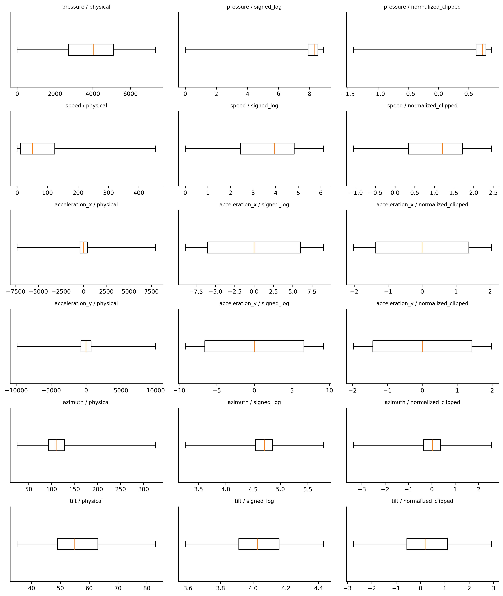
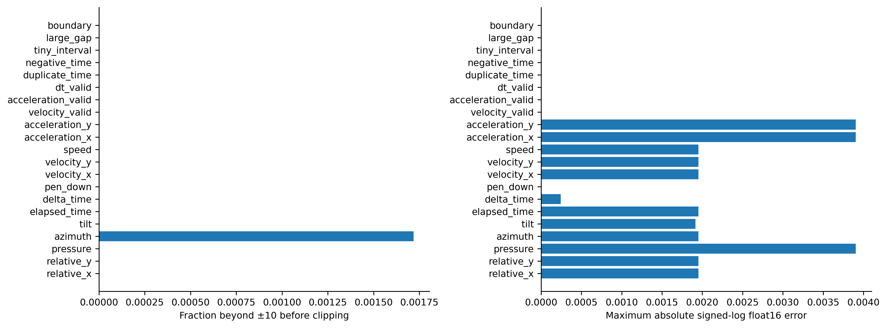
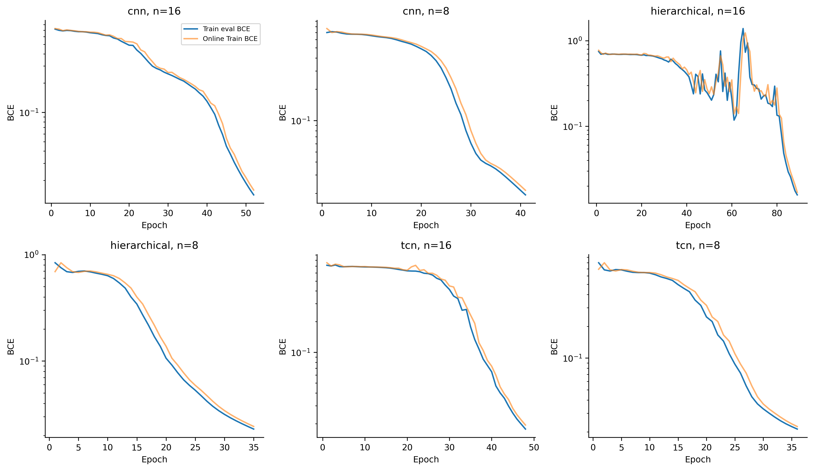
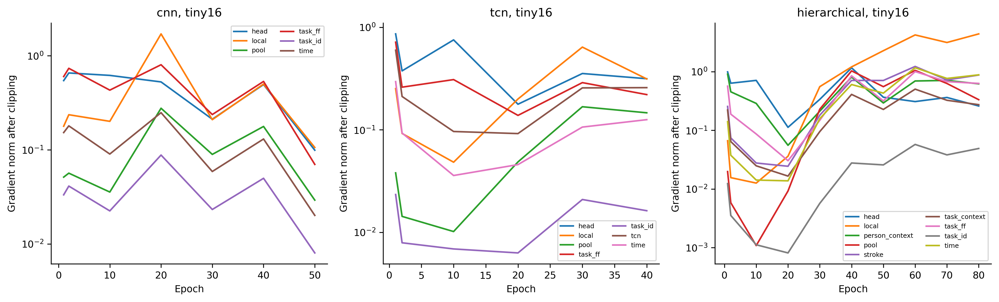
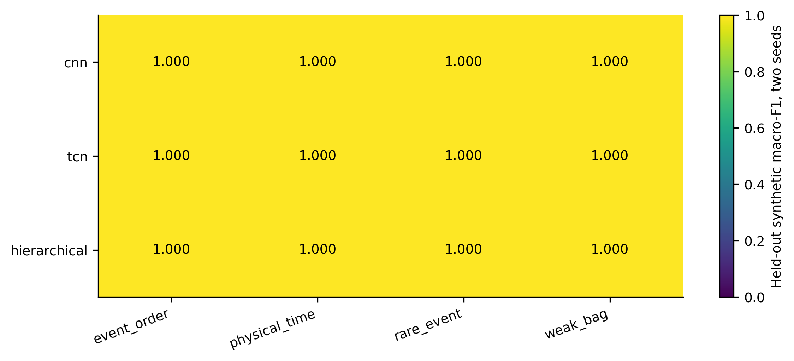

# Phase 0 — Chẩn đoán tính hợp lệ kỹ thuật

## Phạm vi và kết luận hiện tại

Sáu kiểm tra memorization đều đạt: CNN, TCN và Hierarchical nhớ được cả tập cân bằng8 và16 người chỉ lấy từ development Train. Điều này xác nhận khả năng tối ưu trong điều kiện chẩn đoán, **không chứng minh generalization**, không loại trừ underlearning trong budget cũ và chưa xác định bottleneck ở layer nào.

Không thay đổi preprocessing, model, checkpoint, baseline Kinematic hoặc báo cáo Raw Temporal cũ. Nhánh nghiên cứu mới là `study/raw-temporal-research-v2`. Outer fold0 được dùng làm ranh giới phát triển:143 fit,72 validation và43 outer Test bị loại khỏi quyết định phát triển. Các kết quả trên cohort này vẫn mang tính thăm dò vì đã nhiều lần nghiên cứu cùng258 người.

## 1. Nguồn dữ liệu, preprocessing và sensor fidelity

Đã kiểm tra lại hash của 3870 nguồn SVC/metadata, 706 artifacts baseline/Task1 và 1215 source/artifacts v1. Audit channel dùng toàn bộ 45,496,694 samples của215 outer Train participants,3010 recordings;43 outer Test không tham gia bảng phân phối dùng định hướng thiết kế. Normalizer chỉ fit143 development Train, không fit72 validation.

SVC có thứ tự cột x,y,time,pen_status,azimuth,tilt,pressure. Mapping được truy cập bằng tên, không suy từ thứ tự kênh của extractor khác. Timestamp giữ nguyên acquisition order; duplicate/tiny/negative/gap>1s tạo ranh giới, derivative chỉ hợp lệ trong các khoảng pen-down liên tiếp. Đã tính lại velocity/acceleration bằng công thức độc lập và đối chiếu cache float32 cùng raw-index/time inventory. Không áp dụng đổi mm, lực hoặc đơn vị góc khi thiếu calibration.

| channel | physical_mean | physical_std | physical_minimum | physical_maximum | clipping_fraction | invalid_derivative_fraction | quantization_absolute_max |
|---|---|---|---|---|---|---|---|
| relative_x | 102.31 | 90.65 | -326.99 | 321.15 | 0 | 0 | 0.0019531 |
| relative_y | -20.925 | 36.236 | -185.06 | 190.97 | 0 | 0 | 0.0019531 |
| pressure | 2625.8 | 2203 | 0 | 8192 | 0 | 0 | 0.0039062 |
| azimuth | 120.61 | 58.049 | 0 | 360 | 0.0017194 | 0 | 0.0019526 |
| tilt | 53.647 | 8.1988 | 19 | 90 | 0 | 0 | 0.001914 |
| elapsed_time | 218.38 | 209.25 | 0 | 2510.7 | 0 | 0 | 0.0019531 |
| delta_time | 0.0055576 | 0.010678 | 0 | 1 | 0 | 0 | 0.00024354 |
| pen_down | 0.65859 | 0.47418 | 0 | 1 | 0 | 0 | 0 |
| velocity_x | 4.0839 | 28.189 | -1846 | 1594 | 0 | 0.34355 | 0.0019526 |
| velocity_y | 0.12265 | 35.962 | -1852 | 1760 | 0 | 0.34355 | 0.0019526 |
| speed | 21.248 | 40.658 | 0 | 2052.2 | 0 | 0.34355 | 0.0019531 |
| acceleration_x | 9.4793 | 1087.9 | -2.42e+05 | 3.7e+05 | 0 | 0.34567 | 0.0039053 |
| acceleration_y | 3.4344 | 1375.3 | -6.6e+05 | 6.6e+05 | 0 | 0.34567 | 0.0039053 |
| velocity_valid | 0.65645 | 0.47489 | 0 | 1 | 0 | 0 | 0 |
| acceleration_valid | 0.65433 | 0.47559 | 0 | 1 | 0 | 0 | 0 |
| dt_valid | 0.99916 | 0.028936 | 0 | 1 | 0 | 0 | 0 |
| duplicate_time | 0.00039438 | 0.019855 | 0 | 1 | 0 | 0 | 0 |
| negative_time | 0 | 0 | 0 | 0 | 0 | 0 | 0 |
| tiny_interval | 0 | 0 | 0 | 0 | 0 | 0 | 0 |
| large_gap | 0.00037748 | 0.019425 | 0 | 1 | 0 | 0 | 0 |
| boundary | 0.0045687 | 0.067438 | 0 | 1 | 0 | 0 | 0 |

Các bảng `raw_sensor_by_recording.csv` và `channel_by_recording.csv` giữ phạm vi theo task/participant, zero/nonfinite counts, effective ranges, các biến đổi signed-log và normalized/clipped. Quantiles và hình boxplot lấy tối đa128 vị trí phân tầng đều trên mỗi recording; số lượng, sums, extrema, tỷ lệ clipping và quantization error được tính trên **mọi sample**, không lấy quantile mẫu làm min/max thật.

Azimuth quan sát có 11492 bước nhảy lớn hơn180 source units, trong đó 11465 giữ cùng pen state. Chu kỳ360 ở đây chỉ là chẩn đoán ứng viên wraparound dựa trên miền giá trị quan sát, chưa là chứng nhận đơn vị. Signed-log không tự làm hai đầu miền góc gần nhau. Chưa tự sửa góc hoặc kết luận wraparound là nguyên nhân giảm accuracy; cần control biểu diễn riêng ở Phase1/2.

## 2. Source consistency với Kinematic được bảo vệ

Các descriptor Kinematic được tính lại từ SVC trên nhóm Train đã chọn trước; so với cache cũ theo đúng task/feature mapping, không ghi đè cache. Duration, width, height, path length, pressure mean/std còn có phép tính độc lập để đối chiếu extractor. Bảng74 descriptor giữ riêng sai khác tuyệt đối/tương đối; tuyệt đối không dùng handcrafted vectors làm neural input.

| feature | n | maximum_absolute_difference | mean_absolute_difference | maximum_relative_difference |
|---|---|---|---|---|
| curvature_std | 210 | 12985 | 61.833 | 0.0014635 |
| jerk_rms | 210 | 3859.5 | 18.859 | 0.0014632 |
| jerk_std | 210 | 3798.8 | 18.4 | 0.0014503 |
| pressure_min | 210 | 2996.3 | 22.869 | 1 |
| jerk_mean | 210 | 740.56 | 4.3919 | 0.0023784 |
| curvature_mean | 210 | 483.3 | 2.3014 | 0.0029257 |
| pressure_std | 210 | 19.223 | 0.16889 | 0.034656 |
| pressure_p75 | 210 | 16.25 | 0.078596 | 0.0034956 |
| acceleration_p95 | 210 | 16.19 | 0.13825 | 0.0065018 |
| pressure_mean | 210 | 8.2778 | 0.073003 | 0.0029258 |
| acceleration_rms | 210 | 7.2148 | 0.045593 | 0.0020822 |
| acceleration_std | 210 | 6.7842 | 0.036775 | 0.0014164 |
| statistics_pressure_kurtosis | 210 | 6.1694 | 0.042002 | 0.77838 |
| energy_pressure_rms | 210 | 5.2087 | 0.041692 | 0.001464 |
| pressure_rms | 210 | 5.2087 | 0.041692 | 0.001464 |

Kinematic cũ giữ các điểm timestamp tăng và dùng gradient đi qua pen lifts; Raw Temporal chỉ dùng motion derivative pen-down có validity mask, đồng thời giữ cả các điểm timestamp lỗi và toàn bộ coverage. Vì vậy khác biệt representation không chỉ là neural architecture. Export merged trước đây còn làm tròn pressure và thiếu11 samples trong3 recordings; lịch sử đó đã được audit và giữ nguyên.

Phát hiện metadata cũ không nhất quán: `results/raw_temporal/audit/raw_svc_comparison.json` còn mô tả `primary_input` là merged JSON, trong khi `scripts/raw_temporal_common.py:recording_map` mặc định đọc SVC và cache/source checks xác nhận SVC. Đây là lỗi mô tả provenance lịch sử, chưa là bằng chứng input training sai; không sửa file được bảo vệ.

## 3. Tiny-set memorization và gradients

| model | participants | epochs | eval_train_bce | macro_f1 | embedding_variance | mean_pair_distance | train_seconds | gpu_peak_mib |
|---|---|---|---|---|---|---|---|---|
| cnn | 16 | 52 | 0.014184 | 1 | 0.034523 | 1.3809 | 15.37 | 911.36 |
| cnn | 8 | 41 | 0.019326 | 1 | 0.006713 | 0.615 | 6.8905 | 664.87 |
| hierarchical | 16 | 89 | 0.015744 | 1 | 1.2082 | 7.7974 | 62.986 | 911.4 |
| hierarchical | 8 | 35 | 0.022947 | 1 | 0.71977 | 5.9447 | 12.117 | 665.3 |
| tcn | 16 | 48 | 0.017718 | 1 | 0.032691 | 1.3051 | 19.465 | 911.13 |
| tcn | 8 | 36 | 0.021274 | 1 | 0.035476 | 1.3685 | 7.6549 | 665.09 |

AdamW lr0,003, dropout0, weight decay0, effective batch8, micro-batch2; tối đa1000epochs, dừng khi macro-F1≥0,999 và eval Train BCE≤0,03 trong5epochs liên tiếp. Các thay đổi này chỉ dành cho chẩn đoán, không được tự coi là production protocol tối ưu. So sánh với v1 còn khác learning rate, regularization và training duration, nên không quy toàn bộ khoảng cách cho early stopping.

Gradient đến LocalMovement và các module downstream có finite updates. Bảng `gradient_updates.csv` lưu gradient norm sau global clip5, zero fraction, nonfinite counts, unused parameters và parameter update norm. Activation mean/variance, participant embedding variance, pairwise distances và logit spread được đo riêng; không suy representation hữu ích ngoài Train chỉ từ variance khác0. Dự đoán batch1/2/8 và train/eval khi dropout0 khớp trong tolerance1e-4 logit.

## 4. Synthetic temporal competence

| test | model | seed | f1_macro | accuracy | auc | stats_accuracy | epochs | best_epoch | parameters | train_seconds |
|---|---|---|---|---|---|---|---|---|---|---|
| event_order | cnn | 42 | 1 | 1 | 1 | 0.5 | 40 | 40 | 2610 | 4.8985 |
| event_order | cnn | 43 | 1 | 1 | 1 | 0.5 | 30 | 30 | 2610 | 3.8141 |
| event_order | hierarchical | 42 | 1 | 1 | 1 | 0.5 | 30 | 30 | 11154 | 5.5459 |
| event_order | hierarchical | 43 | 1 | 1 | 1 | 0.5 | 30 | 30 | 11154 | 5.6999 |
| event_order | tcn | 42 | 1 | 1 | 1 | 0.5 | 47 | 47 | 11986 | 9.643 |
| event_order | tcn | 43 | 1 | 1 | 1 | 0.5 | 30 | 30 | 11986 | 6.0866 |
| physical_time | cnn | 42 | 1 | 1 | 1 | 1 | 30 | 30 | 2610 | 3.2686 |
| physical_time | cnn | 43 | 1 | 1 | 1 | 1 | 30 | 30 | 2610 | 3.2693 |
| physical_time | hierarchical | 42 | 1 | 1 | 1 | 1 | 30 | 30 | 11154 | 4.3858 |
| physical_time | hierarchical | 43 | 1 | 1 | 1 | 1 | 30 | 30 | 11154 | 4.267 |
| physical_time | tcn | 42 | 1 | 1 | 1 | 1 | 30 | 30 | 11986 | 5.4243 |
| physical_time | tcn | 43 | 1 | 1 | 1 | 1 | 30 | 30 | 11986 | 5.0635 |
| rare_event | cnn | 42 | 1 | 1 | 1 | 1 | 30 | 30 | 2610 | 4.1304 |
| rare_event | cnn | 43 | 1 | 1 | 1 | 1 | 30 | 30 | 2610 | 3.7296 |
| rare_event | hierarchical | 42 | 1 | 1 | 1 | 1 | 30 | 30 | 11154 | 5.0126 |
| rare_event | hierarchical | 43 | 1 | 1 | 1 | 1 | 30 | 30 | 11154 | 5.2433 |
| rare_event | tcn | 42 | 1 | 1 | 1 | 1 | 30 | 30 | 11986 | 5.6853 |
| rare_event | tcn | 43 | 1 | 1 | 1 | 1 | 30 | 30 | 11986 | 5.6416 |
| weak_bag | cnn | 42 | 1 | 1 | 1 | 1 | 30 | 30 | 2610 | 3.6838 |
| weak_bag | cnn | 43 | 1 | 1 | 1 | 1 | 30 | 30 | 2610 | 3.6887 |
| weak_bag | hierarchical | 42 | 1 | 1 | 1 | 1 | 30 | 30 | 11154 | 4.9223 |
| weak_bag | hierarchical | 43 | 1 | 1 | 1 | 1 | 30 | 30 | 11154 | 4.9362 |
| weak_bag | tcn | 42 | 1 | 1 | 1 | 1 | 30 | 30 | 11986 | 5.731 |
| weak_bag | tcn | 43 | 1 | 1 | 1 | 1 | 30 | 30 | 11986 | 5.4005 |

Synthetic Train/validation/Test dùng các generator độc lập128/64/64 bags. Hai seeds42/43; best checkpoint chọn bằng validation BCE, không Test. Rare-event thay đổi độ dài128/256/512 và vị trí event; event-order hoán đổi hai complete patches có A/B events trong cùng multiset. Mean/std baseline được kiểm tra có accuracy0,5 cho bài thứ tự. Physical-time giữ sample patterns nhưng thay elapsed-time/dt; weak-bag có nhiều segments và event thưa, không tạo giả nhãn từng window bằng cách sao chép nhãn người.

Các model ở đây ghép các component LocalMovement, TCN/TemporalBlock và Pool hiện có để kiểm tra competence; không phải toàn bộ hierarchy14 tasks. Tensors là fixture ở mức biểu diễn21 kênh, chưa mô phỏng SVC có calibration. Không gộp synthetic n với258 người thật, không dùng synthetic accuracy làm bằng chứng clinical temporal learning. Các test yếu/âm vẫn giữ trong bảng, không mặc định Self-Attention tốt hơn.

## 5. Gate và bước tiếp theo

`phase0_validation.json` kiểm tra source/normalization isolation, sáu memorization fits,24 synthetic fits, checkpoint replay và unit tests. Gate kỹ thuật đạt khi không còn lỗi implementation nền tảng chưa giải quyết; **toàn nghiên cứu Phase0–4 chưa hoàn tất**.

Phase1 phải kiểm tra local feature maps, pooled windows, strokes/tasks/person bằng frozen probes trên người held-out trong miền phát triển, rồi so sánh pooling và aggregation dưới budget được ghi trước. Khả năng memorize chỉ loại trừ một dạng hỏng tối ưu hiển nhiên; chưa bác bỏ H0/H1 hoặc xác nhận underlearning/SSL/temporal relational modeling. Chưa chạy fusion ở Phase0.
