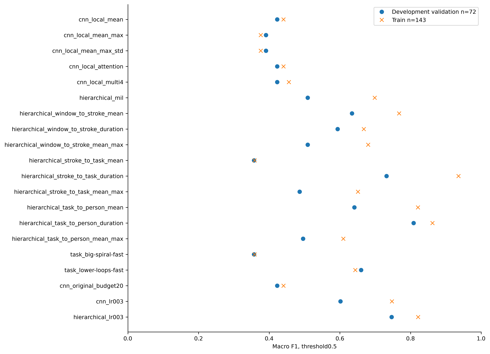
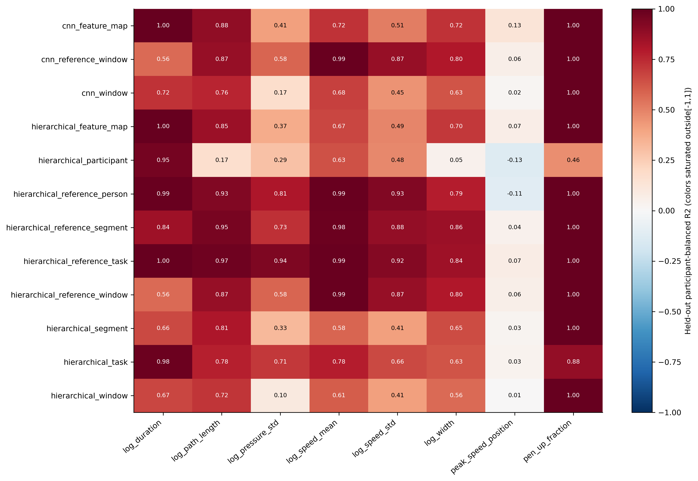
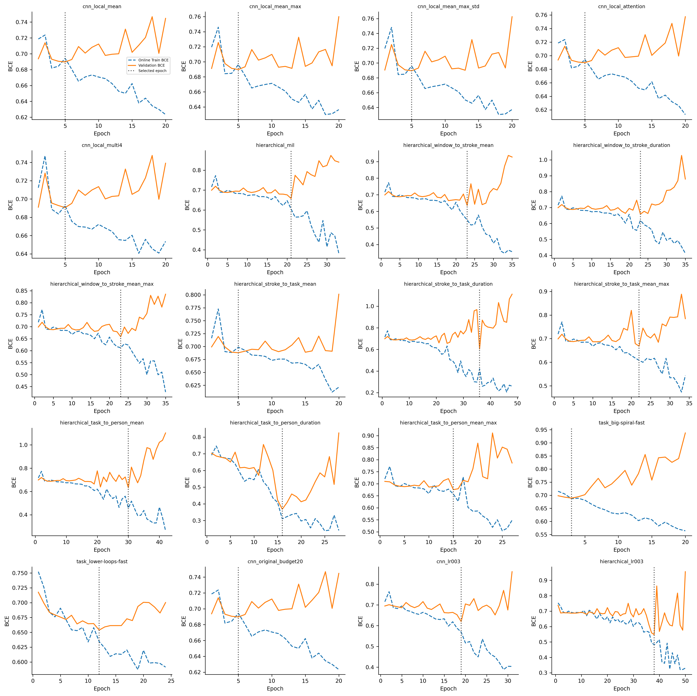
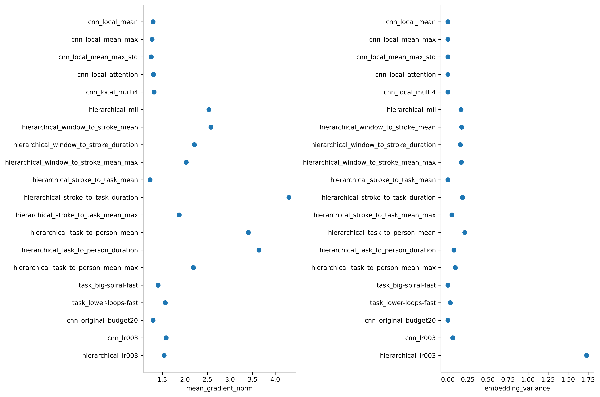

# Phase 1 — Kiểm tra bottleneck của biểu diễn

Đã chạy và replay 20 cấu hình trên143 Train/72 validation, cùng20 kiểm tra synthetic. Không dùng43 outer Test để chọn thiết kế. Đây là kết quả phát triển thăm dò, **không phải Nested CV hay xác nhận độc lập**.

## So sánh dự đoán và chi phí

| configuration | accuracy | f1_macro | auc | train_f1_macro | parameters | best_epoch | seconds | peak_gpu_mib |
|---|---|---|---|---|---|---|---|---|
| cnn_local_mean | 0.58333 | 0.42246 | 0.44453 | 0.4405 | 4178 | 5 | 77.874 | 311.4 |
| cnn_local_mean_max | 0.56944 | 0.39066 | 0.44141 | 0.37599 | 6258 | 5 | 78.484 | 312.9 |
| cnn_local_mean_max_std | 0.56944 | 0.39066 | 0.44219 | 0.37599 | 7282 | 5 | 96.141 | 354.95 |
| cnn_local_attention | 0.58333 | 0.42246 | 0.44531 | 0.4405 | 4211 | 5 | 94.317 | 321.71 |
| cnn_local_multi4 | 0.58333 | 0.42246 | 0.43359 | 0.45562 | 4178 | 5 | 111.3 | 311.63 |
| hierarchical_mil | 0.58333 | 0.50909 | 0.61719 | 0.69875 | 29810 | 21 | 231.31 | 377.39 |
| hierarchical_window_to_stroke_mean | 0.63889 | 0.63438 | 0.71406 | 0.76759 | 29810 | 23 | 227.91 | 392.74 |
| hierarchical_window_to_stroke_duration | 0.63889 | 0.59375 | 0.66875 | 0.66786 | 29810 | 23 | 225.19 | 393.24 |
| hierarchical_window_to_stroke_mean_max | 0.58333 | 0.50909 | 0.68594 | 0.67999 | 31890 | 23 | 232.59 | 393.3 |
| hierarchical_stroke_to_task_mean | 0.55556 | 0.35714 | 0.44766 | 0.35874 | 29810 | 5 | 139.42 | 377.36 |
| hierarchical_stroke_to_task_duration | 0.73611 | 0.73192 | 0.80547 | 0.93581 | 29810 | 36 | 311.04 | 392.99 |
| hierarchical_stroke_to_task_mean_max | 0.56944 | 0.48607 | 0.58359 | 0.65137 | 31890 | 22 | 222.34 | 393.54 |
| hierarchical_task_to_person_mean | 0.65278 | 0.64108 | 0.70859 | 0.82094 | 29810 | 30 | 264.84 | 394.29 |
| hierarchical_task_to_person_duration | 0.81944 | 0.80878 | 0.92109 | 0.86184 | 29810 | 16 | 177.84 | 379.66 |
| hierarchical_task_to_person_mean_max | 0.58333 | 0.4958 | 0.58594 | 0.60962 | 31890 | 15 | 181.02 | 379.7 |
| task_big-spiral-fast | 0.55556 | 0.35714 | 0.40859 | 0.35874 | 4178 | 3 | 75.68 | 314.77 |
| task_lower-loops-fast | 0.66667 | 0.66011 | 0.66328 | 0.64368 | 4178 | 12 | 89.85 | 314.88 |
| cnn_original_budget20 | 0.58333 | 0.42246 | 0.44453 | 0.4405 | 4178 | 5 | 72.51 | 314.1 |
| cnn_lr003 | 0.63889 | 0.6017 | 0.75859 | 0.74744 | 4178 | 19 | 107.03 | 314.21 |
| hierarchical_lr003 | 0.76389 | 0.74622 | 0.84687 | 0.82147 | 29810 | 38 | 328.26 | 394.62 |

Cấu hình đứng đầu development theo quy tắc đã định trước: `hierarchical_task_to_person_duration`, F1 macro=0.808784, AUC=0.921094. Chênh lệch trong một split không chứng minh ưu thế tổng quát. Các cấu hình chọn checkpoint bằng validation BCE, ngưỡng xác suất0.5; không chọn epoch bằng outer Test.

## Probe vật lý theo tầng

Encoder v1 đóng băng được fit trên đúng143 Train; checkpoint CNN/hierarchical đã replay với dự đoán validation cũ. Ridge và RBF-Ridge chọn alpha bằng3fold participant bên trong143 Train; scaler đầu vào và target chỉ fit Train. Mỗi participant có tổng trọng số bằng nhau dù số window khác nhau. Reference là42 moment mean/std của21 input channels, chỉ dùng probe, không đưa vào classifier participant.

Các target log1p mô tả speed, pressure variability, duration, path length, width **trong chính observation đó**, cộng pen-up fraction và vị trí peak speed. Target participant là trung bình14 target task, không ghép các task thành một chuỗi thời gian giả. Những observation không có chuyển động pen-down hợp lệ không có target speed: loại complete-case, báo cáo coverage; vì vậy kết quả window/segment áp dụng cho tập con có chuyển động xác định.

| level | rows | defined_rows | excluded_undefined_motion_rows | participants |
|---|---|---|---|---|
| cnn_feature_map | 13760 | 8654 | 5106 | 215 |
| cnn_window | 13760 | 8654 | 5106 | 215 |
| cnn_reference_window | 13760 | 8654 | 5106 | 215 |
| hierarchical_feature_map | 13760 | 8654 | 5106 | 215 |
| hierarchical_window | 13760 | 8654 | 5106 | 215 |
| hierarchical_segment | 13760 | 6621 | 7139 | 215 |
| hierarchical_task | 3010 | 3010 | 0 | 215 |
| hierarchical_participant | 215 | 215 | 0 | 215 |
| hierarchical_reference_person | 215 | 215 | 0 | 215 |
| hierarchical_reference_segment | 13760 | 6621 | 7139 | 215 |
| hierarchical_reference_task | 3010 | 3010 | 0 | 215 |
| hierarchical_reference_window | 13760 | 8654 | 5106 | 215 |

Probe các readout mới sau cùng protocol supervised, Ridge trên cùng scope window:

| pool | log_duration | log_path_length | log_pressure_std | log_speed_mean | log_speed_std | log_width | peak_speed_position | pen_up_fraction |
|---|---|---|---|---|---|---|---|---|
| attention | 0.69344 | 0.75791 | 0.15993 | 0.6727 | 0.43609 | 0.61728 | 0.016596 | 1 |
| mean | 0.69649 | 0.75803 | 0.1596 | 0.67528 | 0.43924 | 0.62002 | 0.01639 | 1 |
| mean_max | 0.68693 | 0.79571 | 0.15096 | 0.62838 | 0.45816 | 0.60695 | 0.0075157 | 1 |
| mean_max_std | 0.67675 | 0.78727 | 0.15584 | 0.6229 | 0.46299 | 0.60065 | 0.0068718 | 1 |
| multi4 | 0.98476 | 0.83069 | 0.32241 | 0.64335 | 0.44437 | 0.64958 | 0.12806 | 1 |

Multi4 được nối4 token để probe128 chiều, các readout khác32 chiều. Khác biệt khả năng tuyến tính của probe chưa tách khỏi số chiều. Bảng RBF-Ridge đối chứng ở `tables/phase1_pooling_physical_probes.csv`.

Đối chứng feature-map→PCA32 có scaler/PCA fit riêng trong Train của mỗi inner split, so với pooled-window32 chiều; không PCA toàn cohort:

| level | log_duration | log_path_length | log_pressure_std | log_speed_mean | log_speed_std | log_width | peak_speed_position | pen_up_fraction |
|---|---|---|---|---|---|---|---|---|
| cnn_feature_map_pca32 | 0.98669 | 0.66878 | 0.34914 | 0.40027 | 0.27349 | 0.48688 | 0.079494 | 1 |
| hierarchical_feature_map_pca32 | 0.96466 | 0.7311 | 0.28368 | 0.47947 | 0.30325 | 0.51394 | 0.050794 | 1 |

Bảng đầy đủ R², MAE, correlation ở `tables/phase1_layer_probes.csv`. Không so trực tiếp R² window với task rồi suy ra lượng thông tin mất: observation và target thay đổi theo tầng. So sánh feature-map với pooled-window của cùng encoder/cùng observation phù hợp hơn, nhưng feature map544 chiều và pooled-window32 chiều nên chưa tách ảnh hưởng dung lượng probe. Padding/mask để lại dấu vết chiều dài: R² duration gần1 ở feature map không chứng minh hiểu thời gian vật lý. Pen-up fraction là thống kê trực tiếp của input flag nên R² cao cũng là kiểm tra truy xuất đơn giản. Probe cao không phải quan hệ nhân quả hay ý nghĩa lâm sàng. Validation từng được dùng early stopping encoder v1 nên vẫn là phân tích development.

## Capacity matching và kiểm tra bổ sung

Mean+max và mean+max+std được project về32 chiều, khởi tạo bằng mean; attention local khởi tạo uniform. Multi4 giữ4 nhóm vị trí convolution, dùng timestamp gốc ở tâm receptive field, context nhóm lớn gấp4 để giữ cùng số window gốc. Multi4 đồng thời thay độ hạt thời gian và context token; không quy toàn bộ thay đổi cho pooling. Số tham số, epochs và peak memory thực tế nằm trong bảng.

Mỗi aggregation ablation chỉ đổi một tầng window→stroke, stroke→task hoặc task→person; các tầng còn lại giữ MIL. Duration pooling dùng duration nguồn, không suy từ sample count. Task-specific dùng hai task xác định trước bằng tên schema, không chọn theo nhãn. CNN budget20 và learning-rate controls không phải thay đổi kiến trúc.

Task-specific ở đây mask13 task khác trong mô hình, loader vẫn xử lý bag14 task. Thời gian chạy không đại diện cho hệ thu thập chỉ một task; hai kiểm tra này không xác định số task tối thiểu cho screening.

| test | pool | accuracy | f1_macro | auc |
|---|---|---|---|---|
| event_order | attention | 1 | 1 | 1 |
| event_order | mean | 1 | 1 | 1 |
| event_order | mean_max | 1 | 1 | 1 |
| event_order | mean_max_std | 1 | 1 | 1 |
| event_order | multi4 | 1 | 1 | 1 |
| rare_event | attention | 1 | 1 | 1 |
| rare_event | mean | 1 | 1 | 1 |
| rare_event | mean_max | 1 | 1 | 1 |
| rare_event | mean_max_std | 1 | 1 | 1 |
| rare_event | multi4 | 1 | 1 | 1 |

Synthetic rare-event/order là kiểm tra năng lực trên fixture dễ, có metadata thời gian. Nếu nhiều cấu hình cùng đạt trần thì không phân biệt được phương pháp và không chứng minh cơ chế trên dữ liệu thật.

## Kết luận có giới hạn và chuyển Phase 2

Tiny memorization Phase0 loại trừ lỗi không thể tối ưu hoàn toàn trong điều kiện chẩn đoán, nhưng không loại trừ thiếu giám sát hoặc overfit. Kết quả probe, khoảng cách Train/validation và ablation phải được đọc cùng nhau: không tự kết luận local pooling là nguyên nhân duy nhất. Khác biệt giữa các target và số chiều probe cũng là yếu tố gây nhiễu. Phase2 sẽ kiểm tra ba họ CNN đa tỉ lệ statistical/MIL/stroke Transformer dưới cùng protocol; chỉ giữ Self-Attention nếu đối chứng có bằng chứng hữu ích.

Validation: `phase1_validation.json`; ledger và checkpoint hash có trong từng thư mục. Baseline và checkpoint cũ giữ nguyên. Kết luận cuối cùng H0–H4 chờ Phase2–4.
