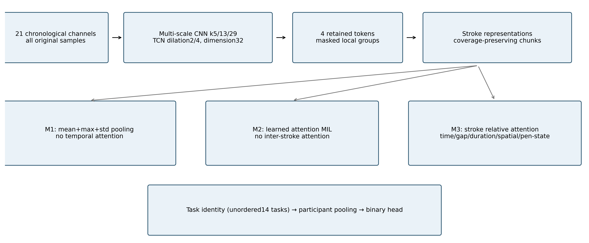
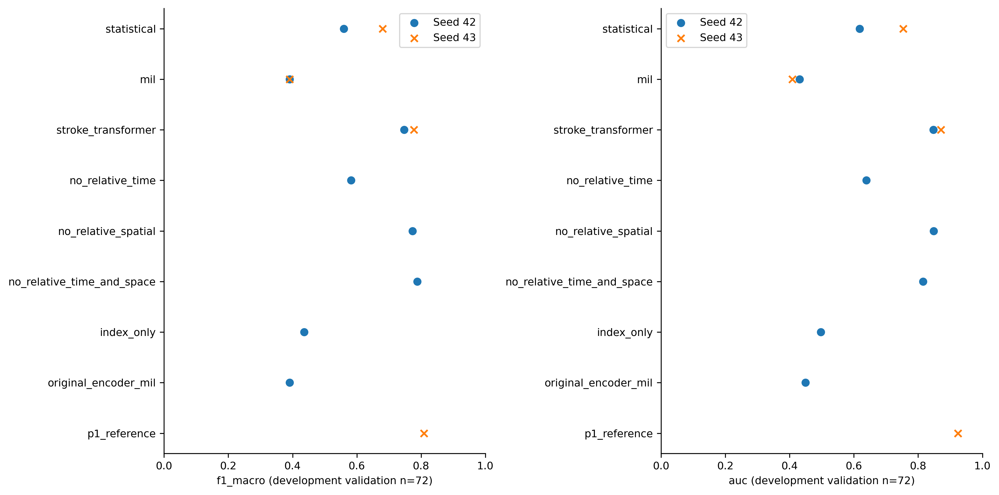
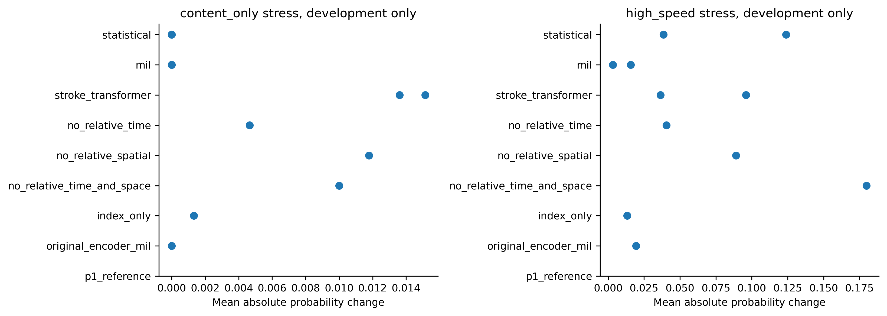

# Phase 2 — Temporal modeling dưới đối chứng

Đã chạy và replay 12 fits.143 Train/72 validation,43 outer Test không tham gia. Thiết kế được khóa sau Phase1, hash dependency nằm trong config. Đây là nghiên cứu nội bộ thăm dò, không phải Nested CV.

## Ba họ mô hình và đối chứng

Local encoder dùng kernel5/13/29, stride4, hai residual dilated convolution2/4, giữ4 token32 chiều mỗi window. M1 dùng mean/max/std, M2 dùng MIL, M3 thêm duy nhất stroke-relative attention hai heads với sequence tối đa32 stroke. Cùng backbone và cùng protocol cho phép so M2/M3; số tham số vẫn khác và được báo cáo. Đối chứng original-local MIL thay riêng backbone bằng convolution gốc, cùng4 token/aggregation. Không thêm Task Transformer vì chưa có bằng chứng biện minh.

Tất cả window được giữ. Stroke quá dài được chia nhóm bounded, các chunk gom bằng trọng số số token hợp lệ; đây không tương đương attention trên một sequence vô hạn. Task identity được dùng để phân biệt14 tác vụ, không giả làm thứ tự thời gian giữa task.

| configuration | seed | accuracy | f1_macro | auc | pr_auc | balanced_accuracy | sensitivity | specificity | brier | train_f1_macro | parameters | best_epoch | epochs | seconds | peak_gpu_mib |
|---|---|---|---|---|---|---|---|---|---|---|---|---|---|---|---|
| statistical | 42 | 0.56944 | 0.55915 | 0.61797 | 0.62014 | 0.55937 | 0.65 | 0.46875 | 0.23693 | 0.77693 | 19730 | 12 | 24 | 919.1 | 294.12 |
| statistical | 43 | 0.68056 | 0.68049 | 0.75313 | 0.79834 | 0.6875 | 0.625 | 0.75 | 0.20918 | 0.83903 | 19730 | 22 | 34 | 1356.4 | 312.3 |
| mil | 42 | 0.56944 | 0.39066 | 0.43125 | 0.4977 | 0.51562 | 1 | 0.03125 | 0.24724 | 0.39276 | 16626 | 5 | 20 | 1034.4 | 279.51 |
| mil | 43 | 0.56944 | 0.39066 | 0.40859 | 0.47852 | 0.51562 | 1 | 0.03125 | 0.24901 | 0.35874 | 16626 | 1 | 20 | 1187.2 | 279.51 |
| stroke_transformer | 42 | 0.75 | 0.74687 | 0.84766 | 0.87282 | 0.74687 | 0.775 | 0.71875 | 0.18422 | 0.94343 | 25252 | 33 | 45 | 3182.7 | 280.33 |
| stroke_transformer | 43 | 0.77778 | 0.77761 | 0.87109 | 0.89323 | 0.78438 | 0.725 | 0.84375 | 0.15072 | 0.79716 | 25252 | 23 | 35 | 1989.8 | 280.33 |
| no_relative_time | 42 | 0.625 | 0.58238 | 0.63906 | 0.71676 | 0.59688 | 0.85 | 0.34375 | 0.22874 | 0.72965 | 25252 | 17 | 29 | 1031.8 | 280.33 |
| no_relative_spatial | 42 | 0.77778 | 0.77341 | 0.84844 | 0.8419 | 0.77187 | 0.825 | 0.71875 | 0.16942 | 0.92907 | 25252 | 33 | 45 | 1692.7 | 280.33 |
| no_relative_time_and_space | 42 | 0.79167 | 0.78836 | 0.81484 | 0.83851 | 0.7875 | 0.825 | 0.75 | 0.17539 | 0.95729 | 25252 | 31 | 43 | 1657.2 | 280.33 |
| index_only | 42 | 0.56944 | 0.43622 | 0.49687 | 0.55255 | 0.52187 | 0.95 | 0.09375 | 0.24368 | 0.51128 | 25252 | 5 | 20 | 783.63 | 280.33 |
| original_encoder_mil | 42 | 0.56944 | 0.39066 | 0.44922 | 0.50805 | 0.51562 | 1 | 0.03125 | 0.25125 | 0.35874 | 4018 | 1 | 20 | 432.45 | 279.31 |
| p1_reference | 43 | 0.81944 | 0.80878 | 0.92422 | 0.93975 | 0.80312 | 0.95 | 0.65625 | 0.13801 | 0.86792 | 29810 | 27 | 39 | 274.26 | 407.5 |

Trung bình hai seed của ba thiết kế chính, không phải trung bình6fold:

| configuration | accuracy | f1_macro | auc | parameters | seconds | peak_gpu_mib |
|---|---|---|---|---|---|---|
| mil | 0.56944 | 0.39066 | 0.41992 | 16626 | 1110.8 | 279.51 |
| statistical | 0.625 | 0.61982 | 0.68555 | 19730 | 1137.7 | 303.21 |
| stroke_transformer | 0.76389 | 0.76224 | 0.85938 | 25252 | 2586.3 | 280.33 |

## Relative-time và spatial ablation

Time features gồm signed-log time difference, positive gap và duration ratio. Spatial là displacement giữa centroid stroke **xấp xỉ**, khôi phục từ signed-log float16 cache gốc, theo device units; không gán đơn vị mm/đặc tính sinh học. Pen-state difference và self-identity vẫn được giữ khi tắt time/spatial. Các ablation tắt riêng quan hệ, không loại các kênh input vật lý khỏi encoder; index-only dùng index cache/normalizer riêng và stroke ordinal thay thời gian vật lý.

## Perturbation và rare-event stress

| configuration | seed | stress | mean_abs_probability_change | accuracy | f1_macro | auc | pr_auc | balanced_accuracy | sensitivity | specificity | brier |
|---|---|---|---|---|---|---|---|---|---|---|---|
| statistical | 42 | transport | 1.626e-08 | 0.56944 | 0.55915 | 0.61797 | 0.62014 | 0.55937 | 0.65 | 0.46875 | 0.23693 |
| statistical | 42 | content_only | 1.626e-08 | 0.56944 | 0.55915 | 0.61797 | 0.62014 | 0.55937 | 0.65 | 0.46875 | 0.23693 |
| statistical | 42 | high_speed | 0.038565 | 0.625 | 0.61236 | 0.65625 | 0.6573 | 0.6125 | 0.725 | 0.5 | 0.23055 |
| statistical | 42 | random_windows | 0.0038163 | 0.56944 | 0.55915 | 0.61719 | 0.62134 | 0.55937 | 0.65 | 0.46875 | 0.238 |
| statistical | 43 | transport | 4.0499e-08 | 0.68056 | 0.68049 | 0.75313 | 0.79834 | 0.6875 | 0.625 | 0.75 | 0.20918 |
| statistical | 43 | content_only | 4.0499e-08 | 0.68056 | 0.68049 | 0.75313 | 0.79834 | 0.6875 | 0.625 | 0.75 | 0.20918 |
| statistical | 43 | high_speed | 0.12389 | 0.59722 | 0.59083 | 0.725 | 0.73851 | 0.61875 | 0.425 | 0.8125 | 0.24256 |
| statistical | 43 | random_windows | 0.0072585 | 0.68056 | 0.68049 | 0.75234 | 0.79875 | 0.6875 | 0.625 | 0.75 | 0.20947 |
| mil | 42 | transport | 7.43e-09 | 0.56944 | 0.39066 | 0.43125 | 0.4977 | 0.51562 | 1 | 0.03125 | 0.24724 |
| mil | 42 | content_only | 7.43e-09 | 0.56944 | 0.39066 | 0.43125 | 0.4977 | 0.51562 | 1 | 0.03125 | 0.24724 |
| mil | 42 | high_speed | 0.0032606 | 0.59722 | 0.45269 | 0.40391 | 0.4782 | 0.54688 | 1 | 0.09375 | 0.24808 |
| mil | 42 | random_windows | 0.00021416 | 0.56944 | 0.39066 | 0.4375 | 0.5011 | 0.51562 | 1 | 0.03125 | 0.24718 |
| mil | 43 | transport | 1.3356e-08 | 0.56944 | 0.39066 | 0.40859 | 0.47852 | 0.51562 | 1 | 0.03125 | 0.24901 |
| mil | 43 | content_only | 1.3356e-08 | 0.56944 | 0.39066 | 0.40859 | 0.47852 | 0.51562 | 1 | 0.03125 | 0.24901 |
| mil | 43 | high_speed | 0.015782 | 0.58333 | 0.44444 | 0.56953 | 0.61017 | 0.53438 | 0.975 | 0.09375 | 0.24201 |
| mil | 43 | random_windows | 0.00028019 | 0.56944 | 0.39066 | 0.41172 | 0.4798 | 0.51562 | 1 | 0.03125 | 0.24891 |
| stroke_transformer | 42 | transport | 2.1998e-08 | 0.75 | 0.74687 | 0.84766 | 0.87282 | 0.74687 | 0.775 | 0.71875 | 0.18422 |
| stroke_transformer | 42 | content_only | 0.013602 | 0.75 | 0.74687 | 0.84766 | 0.87581 | 0.74687 | 0.775 | 0.71875 | 0.18468 |
| stroke_transformer | 42 | high_speed | 0.095957 | 0.73611 | 0.72722 | 0.8125 | 0.82559 | 0.725 | 0.825 | 0.625 | 0.20402 |
| stroke_transformer | 42 | random_windows | 0.0080063 | 0.75 | 0.74687 | 0.85391 | 0.87749 | 0.74687 | 0.775 | 0.71875 | 0.18087 |
| stroke_transformer | 43 | transport | 2.1367e-08 | 0.77778 | 0.77761 | 0.87109 | 0.89323 | 0.78438 | 0.725 | 0.84375 | 0.15072 |
| stroke_transformer | 43 | content_only | 0.015137 | 0.79167 | 0.7913 | 0.87109 | 0.89492 | 0.79688 | 0.75 | 0.84375 | 0.14715 |
| stroke_transformer | 43 | high_speed | 0.03651 | 0.80556 | 0.80541 | 0.87344 | 0.88171 | 0.8125 | 0.75 | 0.875 | 0.14354 |
| stroke_transformer | 43 | random_windows | 0.012018 | 0.79167 | 0.7913 | 0.87734 | 0.9004 | 0.79688 | 0.75 | 0.84375 | 0.14342 |
| no_relative_time | 42 | transport | 1.7585e-08 | 0.625 | 0.58238 | 0.63906 | 0.71676 | 0.59688 | 0.85 | 0.34375 | 0.22874 |
| no_relative_time | 42 | content_only | 0.0046492 | 0.625 | 0.58238 | 0.63828 | 0.7146 | 0.59688 | 0.85 | 0.34375 | 0.22916 |
| no_relative_time | 42 | high_speed | 0.040572 | 0.65278 | 0.62679 | 0.63125 | 0.69475 | 0.63125 | 0.825 | 0.4375 | 0.23407 |
| no_relative_time | 42 | random_windows | 0.0023065 | 0.625 | 0.58238 | 0.64141 | 0.71814 | 0.59688 | 0.85 | 0.34375 | 0.22865 |
| no_relative_spatial | 42 | transport | 2.2485e-08 | 0.77778 | 0.77341 | 0.84844 | 0.8419 | 0.77187 | 0.825 | 0.71875 | 0.16942 |
| no_relative_spatial | 42 | content_only | 0.011772 | 0.77778 | 0.77341 | 0.84922 | 0.85082 | 0.77187 | 0.825 | 0.71875 | 0.16861 |
| no_relative_spatial | 42 | high_speed | 0.088951 | 0.72222 | 0.70779 | 0.82188 | 0.83213 | 0.70625 | 0.85 | 0.5625 | 0.19447 |
| no_relative_spatial | 42 | random_windows | 0.0048503 | 0.77778 | 0.77341 | 0.85391 | 0.84609 | 0.77187 | 0.825 | 0.71875 | 0.16758 |
| no_relative_time_and_space | 42 | transport | 2.3479e-08 | 0.79167 | 0.78836 | 0.81484 | 0.83851 | 0.7875 | 0.825 | 0.75 | 0.17539 |
| no_relative_time_and_space | 42 | content_only | 0.009998 | 0.79167 | 0.78836 | 0.81562 | 0.83548 | 0.7875 | 0.825 | 0.75 | 0.17435 |
| no_relative_time_and_space | 42 | high_speed | 0.17974 | 0.68056 | 0.65085 | 0.74063 | 0.78349 | 0.65625 | 0.875 | 0.4375 | 0.24862 |
| no_relative_time_and_space | 42 | random_windows | 0.011644 | 0.77778 | 0.77341 | 0.81797 | 0.83574 | 0.77187 | 0.825 | 0.71875 | 0.17401 |
| index_only | 42 | transport | 1.4196e-08 | 0.56944 | 0.43622 | 0.49687 | 0.55255 | 0.52187 | 0.95 | 0.09375 | 0.24368 |
| index_only | 42 | content_only | 0.0013166 | 0.56944 | 0.43622 | 0.49687 | 0.55167 | 0.52187 | 0.95 | 0.09375 | 0.24355 |
| index_only | 42 | high_speed | 0.013304 | 0.55556 | 0.428 | 0.48359 | 0.5357 | 0.50938 | 0.925 | 0.09375 | 0.24532 |
| index_only | 42 | random_windows | 0.0005245 | 0.56944 | 0.43622 | 0.50391 | 0.55738 | 0.52187 | 0.95 | 0.09375 | 0.24361 |
| original_encoder_mil | 42 | transport | 1.0669e-08 | 0.56944 | 0.39066 | 0.44922 | 0.50805 | 0.51562 | 1 | 0.03125 | 0.25125 |
| original_encoder_mil | 42 | content_only | 1.0669e-08 | 0.56944 | 0.39066 | 0.44922 | 0.50805 | 0.51562 | 1 | 0.03125 | 0.25125 |
| original_encoder_mil | 42 | high_speed | 0.019455 | 0.58333 | 0.42246 | 0.45078 | 0.55971 | 0.53125 | 1 | 0.0625 | 0.25046 |
| original_encoder_mil | 42 | random_windows | 0.00028091 | 0.56944 | 0.39066 | 0.44766 | 0.5078 | 0.51562 | 1 | 0.03125 | 0.25131 |

Transport đảo token và metadata cùng nhau trong bounded group: kiểm tra equivariance phải không đổi dự đoán. Content-only đảo nội dung stroke nhưng giữ các slot quan hệ cũ: **metadata-inconsistent OOD stress**, không phải handwriting tự nhiên hay bằng chứng nhân quả. High-speed stress che toàn bộ window thuộc top5% speed trung bình trong các interval hợp lệ của từng participant; so với che ngẫu nhiên cùng số window. Đây là heuristic stress, không phải annotation event bệnh lý; không chọn ngưỡng từ nhãn.

## Self-Attention có cung cấp thông tin hữu ích thêm không?

Có tín hiệu development thuận lợi cho attention, nhưng hai seed/một split chưa xác nhận generalization. Chênh lệch trung bình Transformer−MIL: F1 macro=+0.371577, AUC=+0.439453. Không suy ra kết luận nhân quả hoặc lợi ích sàng lọc chỉ từ development. Quy tắc chọn family chỉ dùng F1/AUC hai seed của ba thiết kế chính, đã ghi trước khi chấm perturbation; các đối chứng một seed không được chọn opportunistically.

Family được chọn cho Phase3: `stroke_transformer`; local encoder `multiscale` theo đối chứng paired MIL seed42: chỉ chọn original khi cả F1 và AUC đều hơn multiscale. Đây là lựa chọn development một seed cho backbone, chưa chứng minh ưu thế. Phase3 phải có scratch controls khớp local encoder/family và hai seed; không foundation model, không pretrain held-out participant.

Để không bỏ một aggregation tốt chỉ vì đang thử kiến trúc mới, winner Phase1 được chạy thêm seed43 theo cùng protocol (seed42 dùng artifact đã có). Trung bình hai seed của reference Phase1: F1=0.808784, AUC=0.922656. So sánh reference này với best primary family bằng quy tắc F1/AUC/parameter đã khóa. Chọn reference Phase1 cho SSL: `True`. Local encoder thực sự dùng cho SSL: `original`; kiến trúc downstream đầy đủ nằm trong `development_decision.json`. Nếu không khớp một scratch configuration đã chạy thì Phase3 phải bổ sung scratch controls trước khi so fine-tuning. Reference không tham gia bảng stress M1/M2/M3; không suy rằng Transformer mới nhất là mô hình mạnh nhất.

Checkpoint replay, unit tests và transport invariance: `phase2_validation.json`. Paired predictions, learning curves và chi phí trong từng thư mục/tables. Hình là bản tổng quát cho review, chưa tuyên bố tuân thủ yêu cầu của journal cụ thể. Công cụ quy trình được ghi nhận ở `SOFTWARE_REFERENCES.md`.
