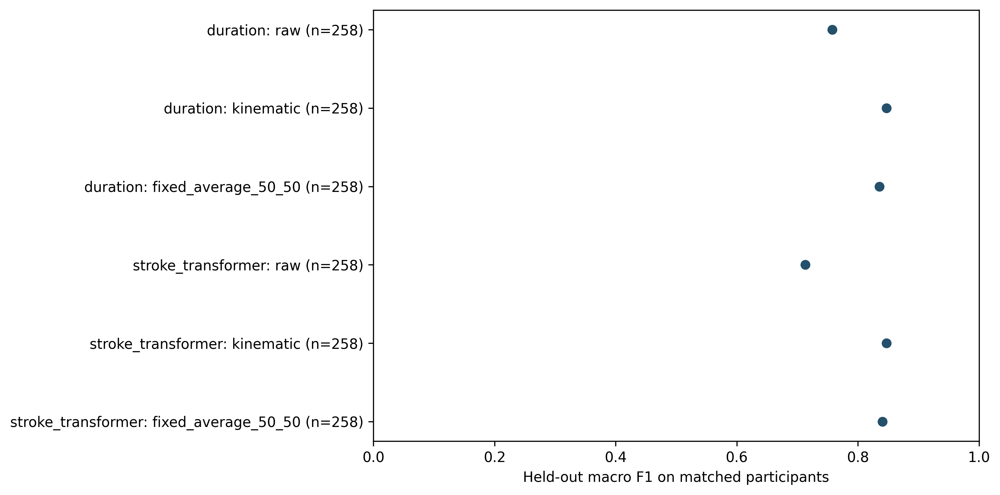

# Phase 4 lite — đánh giá cấu hình cố định trong ngân sách

**Trạng thái:** `lite_complete`. Primary duration-aware: **6/6 folds**; Stroke Transformer: **6/6 folds**. Phase 3 full SSL và nghiên cứu đầy đủ **chưa hoàn tất**. Protocol Phase 4 đầy đủ được giữ nguyên và không khởi chạy.

## Protocol khóa trước outer evaluation

258 participants, nhãn `group`, original participant-independent Stratified 6-Fold seed42. Một initialization seed42, không inner architecture search. Primary là duration-aware, chọn bằng kết quả development Phase1/2 đã có; secondary là Stroke Transformer. Mỗi mô hình fit mới trên outer Train215, normalizer chỉ fit Train. Primary **22 epochs**, secondary **28 epochs**, lấy rounded median BCE-best development epochs ở hai seed. AdamW LR0.001, weight decay0.001, dropout0.1, clip1, effective batch8/micro2. Không dùng outer Test để early-stop, chọn mô hình, epoch, threshold hoặc fusion weight. Không kéo dài fit dựa vào outer score.

Cả hai mô hình khởi tạo ngẫu nhiên với seed42 và học supervised từ đầu; không dùng checkpoint SSL pilot trong OOF.

Đây là **exploratory internal CV**: cùng cohort đã được xem trong lịch sử và development toàn cục ảnh hưởng cấu hình; không mô tả đây là Nested CV hoặc xác nhận độc lập.

## So sánh OOF trên đúng cùng participants

| candidate | method | participants | completed_folds | all_six_folds_complete | accuracy | f1_macro | auc | balanced_accuracy | specificity |
| --- | --- | --- | --- | --- | --- | --- | --- | --- | --- |
| duration | raw | 258 | 6 | True | 0.759690 | 0.757930 | 0.822986 | 0.759380 | 0.756522 |
| duration | kinematic | 258 | 6 | True | 0.848837 | 0.847163 | 0.906902 | 0.847461 | 0.834783 |
| duration | fixed_average_50_50 | 258 | 6 | True | 0.837209 | 0.835539 | 0.899240 | 0.836120 | 0.826087 |
| stroke_transformer | raw | 258 | 6 | True | 0.713178 | 0.713178 | 0.807540 | 0.721678 | 0.800000 |
| stroke_transformer | kinematic | 258 | 6 | True | 0.848837 | 0.847163 | 0.906902 | 0.847461 | 0.834783 |
| stroke_transformer | fixed_average_50_50 | 258 | 6 | True | 0.841085 | 0.840681 | 0.906111 | 0.845576 | 0.886957 |

Mỗi dòng Kinematic được giới hạn đúng IDs/folds có Raw hoàn tất của candidate đó. Chỉ khi 6/6 folds và258 IDs mới gọi là full-cohort OOF. Fold còn thiếu không được điền0 hoặc suy diễn. Mean/sampleSD theo folds ở `paired_comparison.csv`; với một fold, SD chưa xác định. Threshold cố định probability>0.5.

OOF AUC tính trên pooled probabilities; có thể khác mean fold AUC khi thứ hạng/calibration thay đổi giữa các mô hình fold.

## Error overlap và probability average

| candidate | participants | both_correct | kin_only | raw_only | both_wrong | probability_correlation |
| --- | --- | --- | --- | --- | --- | --- |
| duration | 258 | 179 | 40 | 17 | 22 | 0.627886 |
| stroke_transformer | 258 | 159 | 60 | 25 | 14 | 0.503027 |

`raw_only` là trường hợp Raw đúng/Kinematic sai; `kin_only` là Raw sai/Kinematic đúng. Không coi corrected cases riêng lẻ là bằng chứng complementary value. Fusion duy nhất là xác suất **0.5 Kinematic +0.5 Raw**, đã định trước; không fit weights, gate hoặc stacking trên outer predictions. Tất cả probability mức participant ở `phase4_lite/oof_predictions.csv`.

| candidate | method | reference | metric | participants | delta | lower95 | upper95 | bootstrap_replicates |
| --- | --- | --- | --- | --- | --- | --- | --- | --- |
| duration | raw | kinematic_same_participants | f1_macro | 258 | -0.089234 | -0.145229 | -0.035529 | 500 |
| duration | raw | kinematic_same_participants | auc | 258 | -0.083916 | -0.128884 | -0.037583 | 500 |
| duration | fixed_average_50_50 | kinematic_same_participants | f1_macro | 258 | -0.011624 | -0.048900 | 0.027162 | 500 |
| duration | fixed_average_50_50 | kinematic_same_participants | auc | 258 | -0.007662 | -0.028089 | 0.013741 | 500 |
| stroke_transformer | raw | kinematic_same_participants | f1_macro | 258 | -0.133985 | -0.207409 | -0.070175 | 500 |
| stroke_transformer | raw | kinematic_same_participants | auc | 258 | -0.099362 | -0.158781 | -0.051440 | 500 |
| stroke_transformer | fixed_average_50_50 | kinematic_same_participants | f1_macro | 258 | -0.006483 | -0.056853 | 0.042707 | 500 |
| stroke_transformer | fixed_average_50_50 | kinematic_same_participants | auc | 258 | -0.000791 | -0.030449 | 0.024152 | 500 |

Paired bootstrap500 lần dùng chung participant resamples; trained models cố định, không tính uncertainty do refit/adaptive development. CI trên partial coverage chỉ áp dụng nhóm held-out đã hoàn tất. Không dùng kết quả này để chọn lại training recipe.

## Thời gian, bộ nhớ và resume

| candidate | training_seconds | estimated_outer_train_epoch_seconds | estimated_fold_seconds_with_safety | estimated_six_folds_seconds_with_safety |
| --- | --- | --- | --- | --- |
| duration | 1.119184 | 28.544093 | 942.859735 | 5657.158411 |
| stroke_transformer | 1.493829 | 38.099179 | 1603.459196 | 9620.755174 |

| model | fold | training_seconds | evaluation_and_replay_seconds | peak_gpu_allocated_mib | peak_gpu_reserved_mib | parameters | epochs |
| --- | --- | --- | --- | --- | --- | --- | --- |
| duration | 0 | 184.316094 | 4.894728 | 390.499023 | 1308.000000 | 29810 | 22 |
| duration | 1 | 184.132416 | 1.274411 | 349.825684 | 1132.000000 | 29810 | 22 |
| duration | 2 | 179.703258 | 1.297646 | 385.078613 | 1436.000000 | 29810 | 22 |
| duration | 3 | 185.382258 | 1.227516 | 383.032227 | 1068.000000 | 29810 | 22 |
| duration | 4 | 191.243454 | 2.733921 | 407.213379 | 1134.000000 | 29810 | 22 |
| duration | 5 | 204.497132 | 1.188406 | 409.871582 | 1302.000000 | 29810 | 22 |
| stroke_transformer | 0 | 1427.920948 | 6.298296 | 289.238770 | 930.000000 | 25252 | 28 |
| stroke_transformer | 1 | 1477.045752 | 5.906758 | 273.410645 | 842.000000 | 25252 | 28 |
| stroke_transformer | 2 | 1597.643441 | 8.956535 | 289.270996 | 844.000000 | 25252 | 28 |
| stroke_transformer | 3 | 1290.792007 | 5.535770 | 273.380371 | 894.000000 | 25252 | 28 |
| stroke_transformer | 4 | 1280.657082 | 5.780104 | 284.862305 | 768.000000 | 25252 | 28 |
| stroke_transformer | 5 | 1311.716994 | 5.526936 | 287.819824 | 940.000000 | 25252 | 28 |

Chi phí các fit chưa có OOF được ghi riêng, không bỏ khỏi accounting và không điền metrics giả:

Không có hàng dữ liệu trong bảng này.

Ước lượng cập nhật từ các fold thực sự đã hoàn tất (không dùng outer scores để đổi recipe):

| candidate | measured_completed_folds | actual_completed_training_and_replay_seconds | mean_actual_fold_seconds | estimated_remaining_full_folds_seconds | note |
| --- | --- | --- | --- | --- | --- |
| duration | 6 | 1141.891240 | 190.315207 | 0.000000 | Runtime extrapolation only, does not change architecture/epochs; unfinished-fold work not subtracted |
| stroke_transformer | 6 | 8423.780622 | 1403.963437 | 0.000000 | Runtime extrapolation only, does not change architecture/epochs; unfinished-fold work not subtracted |

Benchmark dùng tám development-Train people, đầy đủ recordings; dự báo theo window count, scaling tới215 Train, safety factor1.5. Chi phí lịch sử Phase2 giữ riêng, không nhầm với thời gian đo mới. `training_seconds` gồm lưu resume checkpoint mỗi optimizer update; `evaluation_and_replay_seconds` gồm outer inference và replay checkpoint. Tensor allocated/reserved peak khác với tổng process memory trong nvidia-smi. Pilot benchmarks không phải outer fits.

Dự báo nhỏ có thể lệch vì warm-up, cache và kích thước các bag; thời gian actual của fold và session là số dùng cho accounting. Bảng forecast không phải thời gian đã tiêu tốn.

Mỗi phiên tối đa120 phút; mặc định110, có reserve cho ghi file/report. Checkpoint gồm weights, optimizer, CPU/CUDA/Python/NumPy RNG, permutation và cursor. Ngắt ở ranh giới optimizer update, tiếp tục đúng phần còn lại. Mọi epoch giữ toàn bộ cached samples, không silently truncate. Các phiên trong `phase4_lite/sessions/`; các fold dở trong `fits/*/status.json`.

| session | status | maximum_seconds | elapsed_seconds | reporting_seconds |
| --- | --- | --- | --- | --- |
| 20261118_160018_4d0d94 | failed | 4500.000000 | 831.027483 |  |
| 20261118_161641_70c92b | paused_session_budget | 3516.521572 | 3431.606928 | 38.901688 |
| 20261120_234713_391df8 | fits_finished | 6600.000000 | 5425.633453 | 65.835589 |

Log lỗi I/O của lần chạy đầu được giữ trong `session_current.stderr.log` và `io_failure_recovery.json`. Checkpoint trước lỗi được resume với cùng training signature; retry chỉ thay thao tác ghi file. Thời hạn kết thúc ban đầu giữ nguyên. Cumulative fit timers lấy từ checkpoint; tổng thời gian session cũng bao gồm công việc dở trước lỗi và startup. Hai loại thời gian không được cộng lặp.

Tiếp tục trong phiên khác: `.venv/Scripts/python.exe scripts/session_raw_temporal_v2_lite.py --minutes 110`. Wrapper bổ sung retry cho atomic checkpoint replace khi Windows tạm khóa file; code toán học và training signature được giữ nguyên. Không tự tạo phiên thứ hai sau khi chạm budget. Nếu có phục hồi do lỗi I/O, thời hạn kết thúc ban đầu vẫn được giữ bằng `--deadline-unix`.

## Khuyến nghị nghiên cứu

Duration-aware trên 258 người hiện có ΔF1 Raw−Kinematic=-0.089234, average−Kinematic=-0.011624. Average chưa có CI F1 hoàn toàn dương so với Kinematic. Chưa có bằng chứng đủ mạnh để ưu tiên full nested fusion/SSL; giữ baseline và hoàn tất đối chứng cố định còn thiếu trước. Stroke Transformer average trên 258 người hiện có ΔF1=-0.006483, CI95% [-0.056853,+0.042707].

Ưu tiên hoàn tất các folds của protocol lite đã khóa trước khi chi thêm cho nested search hoặc kiến trúc mới. Nếu Raw hoặc fixed-average không chứng minh lợi ích trên tập OOF đã hoàn tất, chưa có cơ sở chi ngân sách cho full nested fusion. Chỉ cân nhắc nested CV sau một tín hiệu ổn định cần kiểm chứng bằng Train-only selection và một ngân sách mới. SSL recovery mới là pilot; chưa có downstream comparison để khuyến nghị full SSL. Không mở thêm architecture grid từ kết quả outer folds hiện tại.

Bảo toàn artifacts cũ: đã kiểm tra 2516 paths và 1921 protected references bằng SHA. Baseline Kinematic OOF được dùng nguyên trạng. Báo cáo/code/results mới nằm riêng; không push hoặc merge tự động.
